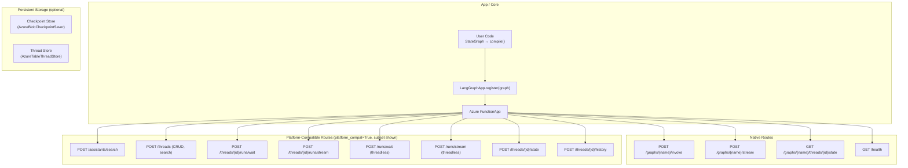

# DESIGN.md

## Design Principles

1. **Thin Adapter, Not a Framework** — We wrap LangGraph, not replace it. All graph logic stays in LangGraph.
2. **Zero Boilerplate** — `register()` + `function_app` is the entire API surface.
3. **LangGraph Conventions First** — Input/output contracts follow LangGraph's patterns (messages, config, stream_mode).
4. **Azure Functions Native** — Use the v2 programming model directly, no intermediate web framework.
5. **Checkpointer Agnostic** — Users bring their own checkpointer; we pass config through.

## Stability policy

This project follows a **rolling 0.x** development model: core adapter APIs aim
for backward compatibility across minor releases while newer surfaces may still
evolve. The canonical **per-surface stability table** (Stable / Beta /
Experimental) lives near the top of [`README.md`](README.md) and is the single
source of truth; the `Development Status :: 3 - Alpha` classifier reflects the
youngest surfaces, not the stable core.

## Architecture

### Core adapter and deployment extensions

The core path is `LangGraphApp` → `register()` → `function_app`, with a
LangGraph checkpointer attached at compile time when graph state is needed.
`ThreadLock` is the writer-exclusion protocol; the default `InProcessThreadLock`
is **single-process only**, including when one Azure instance has multiple
workers. Checkpoint backends and thread locking remain **Beta** under the
README stability policy, not Stable merely because the core uses them.

Distributed topology is a separate decision: the shipped Blob lease lock is a
low-cost option, not a mandatory backend. Platform `ThreadStore` CAS maintains
thread metadata/run ownership and is not acquired by native or trigger runs.
Mixed surfaces must share the distributed lock configuration and graph/thread
keys. Durable is an opt-in execution/polling lifecycle; Service Bus sessions
are sender-configured ordering within one queue/subscription. Neither is a
universal single-writer workaround. The
[production guide](docs/production-guide.md#distributed-deployment) owns wiring,
guards, lease lifetime, cancellation and recovery guidance.



## Key Decisions

### 1. Compiled graphs as intended input
Registration enforces only the `InvocableGraph` protocol (requiring `invoke()`), so any object satisfying the protocol works. In practice, users call `.compile()` before registering because compiled graphs carry configured checkpointers and validated graph structure. The library does not import or check for `CompiledStateGraph` directly.

### 2. SSE streaming as buffered response
This adapter buffers all stream events and returns them as a single SSE-formatted response. This is **the adapter's current implementation choice** given its classic `HttpRequest`/`HttpResponse` model — not an Azure Functions platform limitation. This is functional but not truly streaming.

Future versions may adopt the app-wide FastAPI/ASGI streaming model (`azurefunctions-extensions-http-fastapi`, runtime 4.34.1+) to enable true streaming; because that mode cannot be mixed with the classic-model routes this package uses today, it is a dedicated architecture spike rather than a drop-in.

**⚠️ User expectation**: The SSE endpoints use "stream" in their path names and return `text/event-stream` content type, but responses are **buffered end-to-end**. Users should expect complete SSE-formatted responses delivered at once, not incremental token-by-token delivery. True incremental streaming exists on Azure Functions Python v2 but requires the app-wide FastAPI/streaming model, which is incompatible with the current classic-model surface — so it is tracked as a separate architecture spike, not a platform blocker.

### 3. Thread ID in request body config (native routes)
For native routes (`/graphs/{name}/invoke`, etc.), `thread_id` is passed in `config.configurable.thread_id`, not as a URL path parameter. This keeps the native API surface minimal and compatible with LangGraph's client patterns. Platform-compatible routes use path parameters (`/threads/{thread_id}/...`) to match the LangGraph Platform REST API.

### 4. No mandatory Durable Functions dependency
The default adapter remains HTTP-first with no Durable dependency. The shipped
experimental `async_runs="durable"` opt-in adds long-running execution and
polling via the `durable` extra, not global thread serialization. Graphs execute
inside activities, never orchestrators; checkpoints and writer exclusion remain
separate responsibilities.

### 5. Per-graph auth override (v0.2)
Each graph registration can override the app-level `auth_level`. This enables mixed-auth deployments where public-facing graphs use `ANONYMOUS` while admin graphs require `FUNCTION` keys. The override is stored per-registration and applied at route creation time.

### 6. State endpoint via StatefulGraph protocol (v0.2)
Graphs that implement `get_state(config)` (i.e., graphs compiled with a checkpointer) expose a `GET /graphs/{name}/threads/{thread_id}/state` endpoint. This uses a new `StatefulGraph` protocol added to `protocols.py`, keeping the protocol-based design consistent.

### 7. Azure Blob Storage checkpointer (v0.4)

**Context**: LangGraph's built-in `MemorySaver` loses state on process restart. Azure Functions are stateless — each invocation may run on a different instance. Users need durable checkpoint persistence.

**Decision**: Implement `AzureBlobCheckpointSaver` as an optional extra (`azure-functions-langgraph[azure-blob]`). Each checkpoint is stored as a hierarchy of blobs: `{thread_id}/{checkpoint_ns}/{checkpoint_id}/checkpoint.bin`, with separate blobs for channel values and pending writes. A `latest.json` hint blob accelerates lookups.

**Consequences**: Checkpoint data survives restarts and scales across instances. Blob Storage provides high throughput and automatic geo-replication. The `azure-storage-blob` dependency is optional — import fails with a helpful message if not installed.

**Non-goals**: Concurrent-writer conflict resolution (single-writer assumed).
Sync I/O and optional native async Blob I/O are supported.

**⚠️ Concurrency constraint**: The checkpointer assumes a single writer per
thread. The write order (durable dirty hint → values → metadata → checkpoint
commit marker → clean hint) supports crash recovery under that assumption, not concurrent-write conflict
resolution. Use a distributed `ThreadLock` for shared writers, or an explicitly
single-writer topology. Platform Table CAS covers Platform operations only;
queueing alone does not serialize a thread. See the
[deployment decision table](docs/production-guide.md#distributed-deployment).

Only version-1 clean hints are trusted for direct latest reads. Dirty, legacy,
missing, malformed or dangling hints trigger an authoritative marker scan.
Readers never clear dirty intent: a paused writer could still commit after the
scan. The next successful writer reconciles and publishes a clean monotonic
pointer. Failed dirty-intent persistence prevents checkpoint uploads; marker
failure leaves the prior committed checkpoint visible. Orphan collection skips
untrusted publication, including its per-orphan recheck. This adds one dirty
upload per write and scans during recovery, not on every healthy read (pending
write listing remains necessary). Legacy writers must be drained before rollout;
mixed old/new writers do not provide this recovery guarantee. Arbitrary external
rollback of a valid clean pointer is not detectable by the bounded fast path.

### 8. Azure Table Storage thread store (v0.4)

**Context**: `InMemoryThreadStore` loses thread metadata on restart. Thread lifecycle (create, search, count, delete) needs to persist across Azure Functions instances.

**Decision**: Implement `AzureTableThreadStore` as an optional extra (`azure-functions-langgraph[azure-table]`). Single-partition design (`PartitionKey="thread"`) with client-side filtering for metadata subset matching and status filters.

**Consequences**: Thread records persist across restarts. Table Storage is low-cost and low-latency for key-value lookups. Client-side filtering works well for <100K threads; at scale, the single partition may become a bottleneck.

**Non-goals**: Server-side metadata querying (Azure Table OData filters don't support nested JSON), multi-partition sharding.

**Scale envelope**: The single-partition design works well for up to ~100K threads. At that scale:
- Azure Table Storage throughput limit of ~2,000 entities/sec per partition applies.
- Client-side metadata filtering for `search()` and `count()` becomes progressively expensive as all entities must be scanned.
- Consider migrating to a multi-partition design, Azure Cosmos DB, or a dedicated database when approaching these limits.

#### Benchmark findings: search and count at scale (#767)

> **Provenance: every number below comes from a counting in-memory fake or from the Azurite emulator. None is an Azure Storage measurement, none includes real network latency, throttling or transaction billing, and none establishes a supported thread count.** Real-Azure measurement is still outstanding.

Reproduce with `tools/benchmark_table_store.py` (see its docstring): `hatch run table:python tools/benchmark_table_store.py --sizes 1000,10000,100000` (fake), `... --azurite --azurite-port 10112 --sizes 1000,10000` against an Azurite table service you start yourself (the script only creates and deletes its own `bench<N>` tables) and `... --prototype-check`. Synthetic threads: about 80% `idle`, 10% `busy`, 7% `interrupted`, 3% `error`; metadata `tenant` (50 values, about 2% selectivity), `kind`, `user`. "Requests" are modeled as one per started page of 1,000 entities, the Table query page limit. Medians of 3 runs, one machine; compare ratios, not absolute values.

Fake client (entities read, modeled requests, peak Python memory, median latency, which here is client-side CPU only):

| Threads | `search(limit=10)` unfiltered | `search(status="idle", limit=10, offset=0.6N)` | `search(metadata={"tenant": "t7"}, limit=10)` | `count(status="busy")` | `count(metadata={"tenant": "t7"})` |
|---:|---|---|---|---|---|
| 1,000 | 1,000 / 1 / 1.6 MiB / 8 ms | 814 / 1 / 1.3 MiB / 6 ms | 1,000 / 1 / 1.6 MiB / 7 ms | 85 / 1 / 0.1 MiB / 1 ms | 1,000 / 1 / 1.6 MiB / 7 ms |
| 10,000 | 10,000 / 10 / 16 MiB / 88 ms | 8,016 / 9 / 13 MiB / 76 ms | 10,000 / 10 / 16 MiB / 92 ms | 967 / 1 / 1.5 MiB / 10 ms | 10,000 / 10 / 16 MiB / 92 ms |
| 100,000 | 100,000 / 100 / 161 MiB / 1,233 ms | 80,067 / 81 / 129 MiB / 947 ms | 100,000 / 100 / 158 MiB / 1,150 ms | 10,113 / 11 / 16 MiB / 128 ms | 100,000 / 100 / 158 MiB / 1,187 ms |

Azurite on loopback through the real SDK (same columns; latency includes SDK deserialization and emulator time): at 1,000 threads an unfiltered `search(limit=10)` took about 72 ms and a tenant-filtered `count()` about 63 ms; at 10,000 threads they took about 724 ms and 715 ms (peak 29 MiB). `count(status="busy")` read only the 967 matching rows (about 62 ms), because the status filter is applied server-side.

Findings (all emulator/fake-derived):

- Cost scales linearly with the partition (or status) size, not with `limit` or `offset`. A `limit=10` search and a high-offset search read the same number of entities as an unbounded scan of the same filter; scan amplification (entities read per entity returned) was 100 at 1,000 threads, 1,000 at 10,000 and 10,000 at 100,000 for `limit=10`.
- Only the `status` filter reduces entities read, and only in proportion to the status's share of threads. Metadata filters never reduce reads (the metadata is a JSON string property).
- Process memory peak is about 1.6 KiB per scanned thread in the fake because the whole result list is materialized before sorting; about 3 KiB per thread at 10,000 threads under Azurite with the real SDK.

Thresholds used for guidance (emulator-derived, to be re-derived on real Azure): treat more than 1 modeled page (1,000 entities) read per request as scan amplification worth reviewing, and an interactive endpoint whose emulator latency exceeds about 500 ms (reached at about 10,000 threads under Azurite for unfiltered or metadata-filtered search and count) as unacceptable until measured on real Azure. A 100,000-thread single partition read about 100,000 entities (100 modeled pages) and about 1 s of client CPU in the fake for one search, so the `~100K` envelope above should not be read as an interactive-search guarantee. Target workload for the current design: low thread counts (thousands), searches that carry a selective `status`, and `get`/`create`/`update` by `thread_id` (point operations are unaffected).

Operational guidance: keep `limit`/`offset` pagination cheap by narrowing with `status` where possible; avoid unfiltered high-frequency `count()` on large tables; measure on your own storage account before relying on search latency at more than a few thousand threads. Transaction cost is deliberately not estimated: Microsoft's [Table Storage pricing page](https://azure.microsoft.com/en-us/pricing/details/storage/tables/) states that any operation against the storage, including reads, counts as a transaction and bills per 10,000 transactions, but the page content fetched for this work did not render price values, so no dollar figure is given here.

Bounded alternatives evaluated (no production change, public `ThreadStore` semantics unchanged):

| Option | Effect | Cost / risk |
|---|---|---|
| Server-side `status` filter | Already used; reduces reads to the status share | None |
| Promote selected metadata keys to Table properties and filter server-side | Would cut reads for those keys | Schema/write-path change, migration of existing rows, only for pre-declared keys; changes what is queryable |
| Time-ordered index partition per status (`RowKey` = inverted `created_at` + thread id) | Newest-first search without metadata filter can stop after `offset + limit` rows | Second write per create/status change without cross-partition atomicity (needs batch transactions within one partition only, so index and thread rows cannot share a transaction); migration; does not help `count()` or metadata filters |
| Per-status counters | `count(status=...)` without scan | Contention on counter rows; drift on partial failures |
| Multi-partition sharding | Spreads per-partition throughput | Every search must fan out; does not reduce scan work |

The index-partition option was prototyped only inside the benchmark (`--prototype-check`, not production code): on 5,000 synthetic threads including `created_at` ties, 24 combinations of status, `limit` (including 0), `offset` (including beyond the end) returned thread ids identical in order to `search()`, and `count()` equalled the index cardinality. This verifies ordering, tie-break (`RowKey` ascending on equal `created_at`), limit and count semantics for the prototype only; it does not measure write amplification or failure-recovery behavior. No implementation follow-up is split: the measured impact on real Azure is unknown, and the prototype's consistency cost needs a maintainer decision first.

### 9. Threadless runs (v0.4)

**Context**: The LangGraph SDK supports `runs.wait(None, ...)` and `runs.stream(None, ...)` for fire-and-forget executions that don't need a persistent thread.

**Decision**: Add `POST /runs/wait` and `POST /runs/stream` endpoints. These clone the registered graph with `checkpointer=None`, producing a stateless execution. Client-supplied `thread_id` in config is rejected with 422 to prevent semantic confusion.

**Consequences**: SDK clients can run graphs without pre-creating threads. No checkpoint is saved, so the execution is truly ephemeral. The thread store is not modified by threadless runs.

**Non-goals**: Persisting threadless run results, associating threadless runs with thread records.

### 10. Protocol-based capability detection (v0.4)

**Context**: v0.4 adds `update_state()` and `get_state_history()` endpoints, but not all graphs support these operations.

**Decision**: Add `UpdatableStateGraph` and `StateHistoryGraph` protocols to `protocols.py`, each with `@runtime_checkable`. Route handlers use `isinstance()` checks to return 409 when a graph doesn't support the operation.

**Consequences**: Graceful degradation — graphs without these capabilities still work for all other endpoints. New protocols follow the same pattern as existing `StatefulGraph` and `StreamableGraph`.

### 11. Ecosystem responsibility boundaries

**Context**: The Azure Functions Python DX Toolkit has grown to multiple packages with overlapping capabilities.

**Decision**: Establish clear responsibility boundaries:
- `azure-functions-langgraph` owns LangGraph runtime exposure (graph deployment, invoke, stream, threads, runs, state)
- `azure-functions-validation-python` owns request/response validation and serialization
- `azure-functions-openapi-python` owns API documentation (OpenAPI spec generation, Swagger UI)

**Consequences**: OpenAPI support is delegated to the dedicated `azure-functions-openapi-python` package. A bridge module (`azure_functions_langgraph.openapi`) allows users to register LangGraph endpoints with the external openapi package.

**Non-goals**: Absorbing validation or documentation concerns into this package.

### 13. Auth level default

**Context**: Oracle design review flagged that `LangGraphApp` defaulting to `ANONYMOUS` creates a security risk - users copy example code into Azure without changing auth settings. The official Azure Functions Python `FunctionApp` class defaults to `FUNCTION`.

**Decision**: `LangGraphApp` defaults to `AuthLevel.FUNCTION`. Passing `auth_level=ANONYMOUS` is an explicit opt-in that emits an unconditional `UserWarning`, so an accidental anonymous surface is loud in test/CI output. All examples set `auth_level` explicitly.

**Consequences**: Deployed endpoints require a function key out of the box, matching the official Azure Functions `FunctionApp` default and closing the copy-paste-into-Azure security gap. The health surfaces are gated separately (`GET /api/health` liveness is `ANONYMOUS` by default and exposes only `{"status": "ok"}`; `GET /api/health/details` inherits `auth_level`, so the graph inventory is protected by default).

**Decision history**: The original v0.5 plan was to keep `ANONYMOUS` as the default through v0.5.x-v0.6.x for backward compatibility and only switch to `FUNCTION` in v1.0. That plan was superseded: `FUNCTION` became the default in **v0.7.3** (#243), ahead of v1.0, because the security risk of an anonymous default outweighed the backward-compatibility concern.

**Non-goals**: Environment-dependent defaults (surprising behavior), `DeprecationWarning` emission (ignored by default, creates noise without protection).

### 14. Retain bounded Blob lease renewal (0.13 evaluation, #697)

**Decision:** Keep `AzureBlobLeaseThreadLock`, its default 60-second finite lease
with `auto_renew=True`, and the existing `ThreadLock.acquire` / owner-token
`release` protocol unchanged. Retain the renewal daemon and bounded worker pool;
do not replace them with a fixed lease or an infinite default in 0.13.

**Evidence:** Evaluated against `ef72421` (2026-10-25), including the fixes for
#384 (retry transient renewal failures and retain lost local ownership), #387
(isolate slow renewals with bounded concurrency), and #642 (release acquisitions
that cross terminal close). Controlled two-instance tests in
`tests/test_blob_lease_evaluation.py` advance service time through 180 seconds:
healthy renewal excludes a contender; expiration without renewal, or after
renewal failure, admits a second owner while the first graph can still write.
An acquisition wait timeout is not an execution deadline, and cancelling a
running synchronous worker cannot stop it. Failed close recovers through finite
expiry but leaves an infinite lease requiring operator intervention.

**Alternatives evaluated:**

| Alternative | Benefit | Safety / operational cost | Outcome |
| --- | --- | --- | --- |
| Retain / streamline bounded renewal | No extra service; supports work longer than 60 seconds; finite crash recovery | Best effort under network loss; worker threads cannot be forcibly stopped; no checkpoint write fence | Retain existing implementation, no speculative concurrency rewrite |
| Fixed finite lease for explicitly bounded work | Removes renewal bookkeeping | Must enforce a deadline including graph, tools, checkpoint I/O and cleanup, cancel and join all work before expiry, and atomically reject stale writes at storage; not provided by the current protocol/checkpointer | Existing explicit opt-out only, not a safe automatic migration |
| Non-expiring lease (`-1`) | Removes renewal and natural-expiry overlap | A crash strands ownership; break/release must follow verified worker quiescence or write fencing; operational recovery is mandatory | Existing opt-in only, not the default |

Azure permits finite leases of 15–60 seconds or an infinite lease. Its lease
protects the **marker blob**, not the separate checkpoint blobs. The opaque
release token protects owner bookkeeping, not checkpoint writes. Neither
renewal, opt-out, nor infinite leases automatically fence in-flight writes;
manual breaks and premature `close()` can also admit a new owner. Checking a
lease before writing is not an atomic write fence. An HTTP response timeout
(including the Functions 230-second limit) does not terminate graph execution.

**Consequences / migration:** No runtime, dependency, protocol, default or version
change; no migration is required. This evaluation adds tests and operating
guidance, not a stronger mutual-exclusion guarantee. Removing automatic renewal
would require evidence of enforced cancellation **and** storage-side fencing
before changing the default, plus explicit migration/release documentation.
Do not present the retained lock as partition-proof or as real-Azure
certification. Worker count is bounded, but hung SDK calls can exhaust that
pool; queued submissions are not an admission-bounded queue. The tick wait
timeout does not cancel network I/O. Keep SDK timeouts/retries bounded and
drain graph work before closing the lock.

See the [production lease lifecycle and recovery guidance](docs/production-guide.md#blob-lease-safety-and-recovery)
and the authoritative [Azure lease semantics](https://learn.microsoft.com/en-us/rest/api/storageservices/lease-blob)
and [Functions HTTP limits](https://learn.microsoft.com/en-us/azure/azure-functions/functions-bindings-http-webhook-trigger#limits).

### 15. Checkpoint fencing proposal (#765)

**Status: proposal only. Not implemented; maintainer decision pending.** No `src/` runtime behavior, `ThreadLock` protocol, lock or saver changes accompany this section. The recorded maintainer decision for #765 is "design proposal only". The section fixes the mechanism and its invariants; the full acceptance list for an implementation is in #790.

**Problem.** `AzureBlobLeaseThreadLock` gives mutual exclusion for *acquiring* a per-thread marker lease. `AzureBlobCheckpointSaver.put()` never consults it: every blob it writes (`latest.json` dirty marker, channel values, metadata, `checkpoint.bin`, `latest.json` publish) is an unconditional `upload_blob(overwrite=True)`. A writer that lost its lease while its graph was still running can therefore still commit. Fake-based characterization already pinned this (`tests/test_lease_loss_characterization.py`); real-Azure evidence below confirms it against the actual Blob service.

**Real-Azure evidence (2026-11-05, `koreacentral`, temporary Standard_LRS StorageV2 account, `azure-storage-blob` 12.31.1, `azure-core` 1.41.0, Python 3.11.15, client on a developer machine, three identical runs).** A throwaway probe (not committed) did, per run: owner A acquires `AzureBlobLeaseThreadLock(lease_duration=15, auto_renew=False)` for a thread and writes `cp-001` through the real saver; owner B (separate lock instance, same lock container) is refused while A's lease is live; lease loss is induced **by letting A's 15 s lease expire without renewal** (B polls `acquire()`), then B acquires and writes `cp-002` (parent `cp-001`); stale A then writes `cp-002a` (parent `cp-001`).

| Observation (identical in all 3 runs) | Result |
| --- | --- |
| B acquires while A's lease is live | refused (lease held) |
| Time until B acquired | 15.3 s, 15.3 s, 15.4 s |
| Stale A `lease.renew()` | rejected, HTTP 409 `LeaseIdMismatchWithLeaseOperation` (about 7 ms) |
| Stale A `upload_blob` to the *marker blob* with its old lease id | rejected, HTTP 412 `LeaseIdMismatchWithBlobOperation` (about 8 ms) |
| Stale A `AzureBlobCheckpointSaver.put()` of `cp-002a` | **accepted** (62 to 67 ms for the whole multi-blob `put`); no lease or ETag condition rejected anything |
| Blobs present afterwards | `cp-001`, `cp-002`, `cp-002a` (a fork under one parent) |
| Final `latest.json` | `{"version":1,"dirty":false,"checkpoint_id":"cp-002a"}`; `get_tuple()` returns the stale writer's state (`latest` is `max(id)`, not "last committed by the current owner") |

Conclusions: (1) the Blob service enforces lease ownership on the leased marker blob and rejects the stale owner there (lock-level mutual exclusion works as documented); (2) nothing at checkpoint level is conditional, so a stale writer's commit is accepted and, because a later-generated id sorts higher, becomes the visible head. This is evidence of one controlled interleaving per run, not a measured production incidence rate.

**Minimal design: attempt-isolated payloads plus a lease-conditional manifest commit.** A Blob lease only conditions writes to the *leased blob itself*, and the saver spreads one checkpoint over several blobs, so correctness needs three things: payloads a stale writer cannot overwrite, one atomic commit point, and readers that trust only the commit point.

1. **Capability, not a protocol change.** The lock optionally exposes `FencingThreadLock.fence(graph_name, thread_id, token) -> CheckpointFence | None`, a handle bound to the held lease id and a fresh `attempt_id`. `ThreadLock.acquire`/`release` and the opaque token are unchanged; locks without the capability (in-process, third-party) return no fence and behave as today. Every boundary that acquires the lock and then runs the graph or mutates thread state hands the fence to the saver through a private `__`-prefixed configurable key (to be verified against the pinned `langgraph` so it is not persisted in checkpoint metadata): the native invoke and stream handlers (`_handlers.py`), Platform runs and thread-state updates (`platform/_runs.py`, `platform/_threads.py`), true streaming (`streaming.py`), the Durable activity (`durable/_activity.py`) and the Service Bus trigger when it uses the lock, through one shared helper placed next to each `acquire`/`release` pair so that no path can forget it. A boundary that bypasses the lock (Service Bus `session_exclusive`) gets no fence and no protection.
2. **Attempt-isolated, immutable payloads.** With a fence, every blob a `put()` or `put_writes()` produces (channel values, metadata, `checkpoint.bin`, write blobs) goes under the thread's own prefix `threads/{thread}/attempts/{attempt_id}/...` and is written once, never overwritten. A stale writer therefore cannot touch a committed checkpoint's payloads even when it reuses the same checkpoint id (the same-id characterization case): it only creates unreferenced objects under its own attempt prefix. **Inherited channel values:** a `put()` uploads only the channels in `new_versions`, but a checkpoint's `channel_versions` also names unchanged channels whose payloads were written by earlier attempts, and the reader loads all of them. Loading only from the committing attempt's prefix would lose those channels, so each manifest entry records an immutable reference per channel version (`channel -> version -> attempt-prefixed path`); an inherited channel points at the earlier attempt's write-once blob, which therefore must stay reachable for as long as any committed entry references it. Reclamation reachability is computed over every reference in the manifest, not only over `attempt` ids. The alternative is to materialize a complete snapshot of all channels in every commit: no cross-attempt references, but each commit writes every channel again (write size and cost scale with state size instead of the delta), which is why references are proposed. **Legacy inheritance:** a legacy checkpoint's channel values live at the existing unprefixed `values/` paths, which the legacy saver writes with `overwrite=True` and which the existing retention and orphan cleanup may delete, so a fenced entry must never reference them. The first fenced `put()` after a legacy checkpoint in a namespace therefore copies every inherited channel value it needs from the legacy path into its own attempt prefix before publication (one read and one write per such channel, once per thread and namespace; later commits inherit through fenced references), and its entry references the copies. Legacy checkpoints themselves stay readable through the fallback of item 5.
3. **One commit point: a per-thread manifest on the leased blob.** The manifest is the content of the per-thread marker blob that `AzureBlobLeaseThreadLock` already creates (empty today, created once with `overwrite=False`, so existing code never clobbers it; empty content means "no manifest yet") and leases, so one lease id conditions both ownership and the commit. Readers need no lease (Get Blob on a leased blob is allowed), but they do need the lock container's client in the saver's configuration, a new coupling between saver and lock configuration (see open questions). It is namespace-indexed: `{"v":1,"retired":["<attempt_id>/<op_id>"],"namespaces":{"<checkpoint_ns>":{"head":"<id>","floor":"<id>","committed":{"<id>":{"attempt":"<attempt_id>","ops":["<op_id>"],"channels":{"<channel>":{"<version>":"<attempt-prefixed path>"}},"writes":{"<task_id>/<write_index>":"<attempt-prefixed path>"}}}}}}`. A commit is `upload_blob(manifest', lease=<lease id>, if_match=<etag read under the lease>)`. The lease id makes the service reject a stale or expired owner atomically (412 `LeaseIdMismatchWithBlobOperation`, or `LeaseNotPresentWithBlobOperation` after expiry); the ETag guards the read-modify-write inside one owner. A pre-write ownership check is not a substitute (a lease can expire between the check and the write). Because the lock is per `(graph_name, thread_id)` while the saver keeps heads per `(thread_id, checkpoint_ns)`, one manifest with a per-namespace section means a valid commit in one namespace cannot replace another namespace's head, and only one lease is needed. The cost is that the manifest grows with committed ids (see open questions).
4. **Pending writes go through the same commit and keep the saver's slot semantics.** Today a pending write is identified by `(task_id, write_index)` within a checkpoint: for a nonnegative index the first write wins (an existing blob is skipped), for the negative indexes of `WRITES_IDX_MAP` (`__error__`, `__scheduled__`, `__interrupt__`, `__resume__`) a later write replaces the earlier one, and repeated calls with the same writes leave one logical copy (`test_put_writes_dedup`). The manifest keeps exactly that: an entry's `writes` is a map keyed by `<task_id>/<write_index>` whose values are immutable attempt-prefixed blobs (the channel and task path stay in the blob's metadata, as today). `put_writes()`/`aput_writes()` read the entry under the lease, skip every nonnegative slot that is already present (in the manifest, or at a legacy path for a legacy checkpoint id) without uploading anything, write immutable blobs under the attempt prefix for the remaining slots, and publish them with the same conditional manifest commit: new slots are added and a negative slot is repointed to the new blob (the superseded blob stays immutable and becomes unreferenced garbage for the collector). A batch with nothing new publishes nothing; otherwise its `op_id` is appended to the entry's `ops` (item 6). For a checkpoint id that exists only at legacy paths (the owner resumed from a legacy checkpoint) the manifest gets a `legacy: true` stub entry that holds only the fenced slots, and reads merge the legacy write blobs with the stub's slots by the same key and rules (a nonnegative slot present in both keeps the legacy blob, which was written first; a negative slot present in both takes the stub's, which is later). A stale writer's pending writes are never referenced, so they cannot change what `get_tuple()` returns for the current owner's checkpoint.
5. **Readers trust the manifest, not blob existence.** With a manifest present, `get_tuple()` without an id returns the namespace head (a namespace without a head, such as an empty or stub-only manifest, resolves id-less reads through the legacy lookup); an explicit-id read and `list()`/history are served from `committed` and load payloads from the paths the entry references (its own attempt prefix and the inherited channel references of item 2); blobs not referenced by the manifest are invisible even if they exist. A payload that is missing for a reference the reader has just read is normally a concurrent change (retention removed the entry, item 7, or a negative pending-write slot was replaced and its old blob reclaimed, items 4 and 6): the reader re-reads the manifest and re-resolves from the fresh references, at most three times; a vanished entry means absent, a repointed reference is followed, and a payload that is still missing while the fresh manifest is unchanged (same ETag) is an inconsistency that raises a typed error instead of returning partial state. **Legacy checkpoints** (written before fencing, at the existing unprefixed paths) count as committed: ids not present in the manifest fall back to the existing unprefixed blob lookup, and listing merges manifest entries with unprefixed legacy blobs. `latest.json` remains a compatibility hint, written best-effort after a successful commit.
6. **Reconciliation before any deletion, per publication.** The `attempt_id` identifies one owner session, which can span many saver operations, so it cannot prove that a particular publication succeeded (A may commit `cp-001`, lose its lease, and get a 412 for a later checkpoint; finding A's attempt in the manifest must not turn that failure into success). Every `put()` and every `put_writes()` batch therefore gets its own durable `op_id`, generated once per publication and reused only for retries of that same publication; the entry's `ops` list records every committed publication (the checkpoint's `put()` and each `put_writes()` batch that changed anything). On a timeout or a 412 the writer re-reads the manifest and looks for that exact `op_id` in the entry's `ops`: present means the commit succeeded (response lost) and nothing is deleted, even if B has since resumed from that checkpoint; absent means that publication is uncommitted. Deletion is only for reclamation, never a reaction to a 412 by a stale writer.
   **Reclamation is two-phase and safe against ownership loss.** A fresh manifest read, a safety age or holding the thread lease while deleting is not enough: the lease conditions writes to the marker blob only, not deletes of separate payload blobs, so a collector that pauses past its lease expiry could resume after another owner has published and delete that owner's payloads on the strength of a stale snapshot. The collector therefore never deletes from a snapshot; it first makes the decision durable in the manifest. (1) The collector acquires the thread lease (a thread whose lease is held by an owner is skipped), reads the manifest `M` (ETag `E`), lists the thread's `attempts/` prefix and selects the op prefixes that nothing in `M` references (no committed entry, channel reference or write reference); the safety age only avoids retiring in-flight uploads needlessly and is not a correctness mechanism. (2) It commits `M'` = `M` plus a `retired` list of those prefixes with `lease=<collector lease id>` and `if_match=E`; if the lease was lost or the manifest changed, the commit fails (412) and nothing is deleted. (3) Only after that commit succeeds does it release the lease (the thread is unavailable to new owners only for the read, list and commit steps) and delete exactly the retired prefixes (a fixed set, never re-enumerated), possibly late and even after another owner has taken the lease: no later commit can reference them, because a later owner writes only under fresh `attempt_id`/`op_id` prefixes (names are never reused, and a publisher that finds its `op_id` in `retired` re-uploads under a fresh one) and a publisher with a pre-retirement view fails its `if_match`. Another owner's payloads are not in the retired set, so a stale collector cannot touch them. (4) A later pass drops a `retired` entry only after its prefix lists empty, and a publisher that finds its `op_id` absent from a fresh manifest re-uploads its payloads (`overwrite=False`; a 409 means an intact write-once copy already exists) before committing again, so a payload deleted in the meantime is never referenced.
7. **Retention and deletion go through the same commit.** `delete_old_checkpoints`, `delete_checkpoints_before`, `collect_orphaned_values` and `delete_thread` mutate or delete what the manifest references, so on a thread that has a manifest they act on the manifest first. The caller holds the thread lease (it passes the held token or acquires the lease as a collector does) and removes the affected entries from `committed` (all of them for `delete_thread`) in one lease- and ETag-conditional commit, which makes every payload that nothing else references unreferenced; only then are those payloads deleted, as a retired set by the item 6 protocol, and reachability still counts inherited channel references, so a retained checkpoint keeps the blobs written by attempts of deleted ones. The same commit advances a monotonic per-namespace `floor` id (retention already defines "older" as `id < X`; `delete_thread` sets the floor past the newest id), and the legacy fallback of item 5, `list()` and id-less reads serve only ids at or above the floor, so removing an entry can never re-expose a legacy blob with the same id or restore an older head. Legacy-layout blobs below the floor are then deleted as today, and that cleanup can be retried after a crash. Without the lease these calls refuse rather than delete from a stale view, and an entry is always removed (and the floor advanced) before its payloads are deleted.

Alternative commit primitive for locks without leases: a monotonically increasing **epoch** stored by the lock on acquire and checked with `If-Match` on the manifest ETag. It is lock-agnostic but adds two requests per acquire and still needs items 2 to 6.

**Cost and latency (estimates, not measured for the proposal).** Per `put()`: one manifest read (cacheable by ETag within an owner) and one conditional manifest write, plus the unchanged payload writes; per `put_writes()` batch one extra manifest write. That is about one to two extra small blob requests per checkpoint and per pending-write batch. From the probe client a lease-conditional rejection took about 7 to 8 ms and a whole unfenced `put()` of a tiny checkpoint 62 to 67 ms, so the extra cost should be in the order of 10 to 30 ms per commit from a similar distance. The manifest is a hot per-thread blob (single-writer by construction), and its size grows linearly with committed checkpoints and with the per-channel references unless compacted. The snapshot alternative for inherited channels trades manifest size for write amplification (every channel rewritten per commit). The first fenced commit after a legacy checkpoint also copies the inherited channel values once (one read and one write per channel, per thread and namespace), and each reclamation pass adds one conditional manifest write plus the deletes.

**Rollout and mixed-version fleets.** Fencing is opt-in per saver/lock pair and protects only fenced writers. An old-version instance writes unprefixed legacy blobs and no manifest entry, so once readers rely on the manifest its commits are classed as legacy (visible only via the fallback) and are neither fenced nor ordered against fenced commits: enable fenced mode only after every instance runs a fencing-capable version: (a) ship reader support with fencing disabled, (b) enable when the fleet is homogeneous, (c) treat manifest-aware readers as a one-way door. **Rollback:** fenced payloads live under `attempts/` and are referenced only by the manifest; a pre-fencing reader loads only unprefixed paths and `latest.json` is merely a pointer, so after rolling back to a pre-fencing release fenced checkpoints would disappear from reads (older state or an empty thread). Rollback is therefore supported only to manifest-aware releases, and a manifest-aware saver must not fork a fenced thread when fencing is switched off: once a namespace has a manifest, every commit to it, with or without a fence, goes through the manifest (a legacy-layout checkpoint written beside a manifest would be invisible to id-less reads, which return the manifest head, so a resumed thread would silently go back to the older state). Switching fencing off therefore only stops creating manifests for threads that have none: commits to an existing manifest continue as before, through the manifest and with the held lease id whenever the lock hands one over, which is always the case under `AzureBlobLeaseThreadLock` (its marker blob is the manifest, and the Blob service rejects a write without the lease id to a blob that is currently leased with 412 `LeaseIdMissing`, so an ETag-only write would leave the rolled-back deployment unable to save checkpoints). The fence handoff from the lock to the saver therefore stays on when fencing is switched off; only manifest creation is gated. A commit is ETag-conditional only when no lease is held on the manifest (a lock without leases). Previously fenced threads keep advancing and resuming correctly. Leaving the manifest layout takes a quiesced migration (copy the manifest-referenced committed checkpoints to the legacy layout, then clear the manifest), which is not automatic and is required before going back to a pre-fencing release. Existing threads bootstrap an empty manifest on the first fenced commit; everything already at legacy paths stays committed by the fallback rule.

**Failure modes.** Lost commit response (item 6); crash between payload writes and commit (unreferenced attempt prefix, reclaimed later); `lost` local bookkeeping with a still-valid service lease (commit still succeeds, as today); manual `break_lease` (next commit fails instead of silently succeeding, desired); concurrent manifest writes within one owner (ETag mismatch, retry after re-read); a collector that pauses past its lease expiry while another owner publishes (it deletes only the durably retired set, item 6); a first fenced commit after a legacy checkpoint (inherited legacy values are copied, item 2); a fenced thread written after fencing is switched off (commits keep going through the manifest with the held lease id, rollout); a saver without a held lease id (a bypassed lock such as Service Bus `session_exclusive`) writing a manifest that another surface currently leases (412 `LeaseIdMissing`, surfaced as an ownership error and never retried without the lease: fail closed); repeated `put_writes()` calls for one task (slot semantics, item 4); retention or `delete_thread` running against a fenced thread (entries removed and the floor advanced first, item 7; a crash before physical cleanup leaves only blobs the floor hides); a reader racing a pending-write replacement or retention (bounded re-read, item 5); a later publication failing after an earlier one succeeded in the same attempt (per-publication `op_id`); a reader older than the manifest (rollback section); manifest growth; throttling of a hot manifest.

**Test plan.** Unit with the existing fakes: fence plumbing, typed `StaleCheckpointWriterError` mapping, manifest merge per namespace, legacy-fallback reads, reconciliation decision table. Integration (opt-in, real Azure; Azurite only after verification): (i) the probe's three-owner interleaving, asserting the stale `put()` raises and `get_tuple()` returns B's checkpoint; (ii) the same-checkpoint-id case: stale A re-puts B's id, B's payloads are unchanged; (iii) stale `put_writes()` for B's current checkpoint leaves B's pending writes unchanged; (iv) stale writer uploads and crashes: explicit-id read and `list()` do not expose it; (v) two namespaces: a commit in one does not move the other's head; (vi) A's commit succeeds but its response is lost (fault-injected), B resumes, A retries: nothing is deleted and A's checkpoint remains committed; (vii) cross-acquisition round trip retaining an unchanged channel: A commits channels `x` and `y`, B (new owner) commits changing only `y`, and B's checkpoint reads back both, with `x` loaded from A's immutable attempt blob; (viii) a collector racing a valid owner: the owner pauses after uploading past the safety age, the collector cannot acquire the lease and deletes nothing, and after release it retires and deletes only unreferenced prefixes; (ix) multi-operation attempt: A commits `cp-001`, loses its lease, then its `put()` of `cp-002` and a `put_writes()` batch each get a 412 and reconcile to failure by `op_id`, not to success because A's attempt appears in the manifest; (x) the supported rollback target: with fencing switched off and the same `AzureBlobLeaseThreadLock` still configured, a manifest-aware saver keeps reading and writing a previously fenced thread through the manifest, supplying the held lease id (an ETag-only write to the leased marker is rejected with 412 `LeaseIdMissing`, asserted), so a `put()` after the switch is followed by an id-less `get_tuple()` that returns the new checkpoint (not the earlier manifest head); the same holds with a lock that offers no lease (ETag-only commits), and a thread that never had a manifest still gets none; (xi) legacy-to-fenced delta round trip: a legacy checkpoint with channels `x` and `y`, then a fenced `put()` that changes only `y` reads back both, `x` from its copy under the attempt prefix, and deleting the legacy `x` blob afterwards (existing retention) does not affect the fenced checkpoint; a fenced `put_writes()` for a legacy checkpoint id merges with its legacy write blobs; (xii) a collector that pauses past its lease expiry: it commits its retirement set, pauses until its lease expires, another owner acquires, publishes new payloads and commits, then the collector resumes and deletes: the new owner's checkpoint and payloads are intact and only the retired set is gone; a collector that loses the lease before its retirement commit deletes nothing; (xiii) pending-write slot semantics: repeated `put_writes()` for the same task and slots leave one logical copy (a nonnegative slot keeps its first write, a later `__error__` replaces an earlier one), for fenced entries and for legacy-stub merges (a legacy nonnegative slot keeps the legacy blob), with every physical blob written once and never overwritten, and a batch with nothing new performs no manifest write; (xiv) retention on a fenced thread: `delete_old_checkpoints(keep_last=n)` removes the old entries in one lease-conditional commit before any payload is deleted, keeps every payload a retained checkpoint references (including inherited channel blobs written by deleted checkpoints' attempts), and a caller without the lease deletes nothing; `delete_thread` clears the manifest and leaves no readable checkpoint; a crash between the retention commit and the physical cleanup of legacy blobs never exposes a deleted legacy checkpoint or an older head to `list()`, explicit-id reads or id-less reads, and a retried cleanup finishes the deletion; (xv) every lock-owning boundary hands over the fence: a checkpointed invoke through the native handler and a Durable activity each save and read back a checkpoint on a thread whose manifest is leased by the Blob lock, with no `LeaseIdMissing`; (xvi) a reader paused after reading the manifest while a negative pending-write slot is replaced and the old blob is retired and deleted: it re-reads and returns the new write, and a referenced blob that stays missing while the manifest is unchanged raises the typed inconsistency error. Azurite is believed to implement lease-id preconditions but that was **not verified for this proposal**; lease expiry timing and `LeaseNotPresentWithBlobOperation` need a real-Azure run.

**Alternatives considered.** Removing renewal was rejected by #697. Cosmos DB or PostgreSQL transactional backends give atomic multi-object commits but add a service, dependency and migration, out of scope without measured need. A pre-write lease check is non-atomic. Fencing only `put()` (a single head record) was considered and rejected: it leaves pending writes, same-id payload overwrite, historical reads and cross-namespace heads unprotected.

**Open questions for the maintainer.**
- Namespace-indexed manifest (proposed) or separately leased per-namespace heads (more leases and lock keys, no manifest growth)?
- How to bound manifest growth: compaction of `committed` to heads plus a retention window, or a per-checkpoint commit blob guarded some other way?
- Migrating legacy checkpoints: rely on the unprefixed-path fallback indefinitely, or add a one-time bootstrap?
- Must `ThreadLock` expose a fencing token in the protocol itself, or is the optional `FencingThreadLock` capability enough?
- Is fenced mode acceptable only for `AzureBlobLeaseThreadLock`, with the epoch variant left unspecified?
- Is the per-thread one-way door acceptable (rollback only to manifest-aware releases), or should fenced mode also dual-write the legacy layout (extra writes, and it reintroduces the overwrite hazard for those blobs)?
- Immutable cross-attempt channel references (proposed) or a full snapshot per commit (simpler reachability, higher write cost)?
- Accept the saver being configured with the lock container's client so it can read the manifest (proposed: one lease, one commit point), or keep the manifest in the checkpoint container under its own lease (a second lock key and lease per thread)? The lock key is `(graph_name, thread_id)` while the saver's thread is `thread_id` alone, so fenced mode would also need one saver per graph or a manifest key derived from `thread_id` alone.

**Not covered.** Fencing does not stop the stale graph from executing side effects outside the checkpoint store (tool calls, external APIs); it only prevents its checkpoint from becoming visible.

Reproduction: the probe is a small script that runs `AzureBlobLeaseThreadLock` and the real saver against a temporary container; it is intentionally not part of the repository (its core and sanitized output are in the pull request description).

## Module Structure

```
src/azure_functions_langgraph/
├── __init__.py              # Package init, lazy imports, __version__
├── app.py                   # LangGraphApp class, route registration
├── _handlers.py             # Native route handlers (invoke, stream, state)
├── _validation.py           # Transport-agnostic request validators
├── contracts.py             # Pydantic request/response models
├── protocols.py             # Protocol interfaces (LangGraphLike, StatefulGraph, etc.)
├── py.typed                 # PEP 561 marker
├── platform/                # LangGraph Platform API compatibility layer (v0.3+)
│   ├── __init__.py
│   ├── contracts.py         # Platform API Pydantic models (Thread, Run, Assistant, etc.)
│   ├── routes.py            # SDK-compatible HTTP route handlers
│   ├── stores.py            # ThreadStore protocol + InMemoryThreadStore
│   └── _sse.py              # SSE event formatting
├── checkpointers/           # Persistent checkpoint storage (v0.4+)
│   ├── __init__.py          # Lazy-loading package
│   └── azure_blob.py        # AzureBlobCheckpointSaver (Azure Blob Storage)
└── stores/                  # Persistent thread storage (v0.4+)
    ├── __init__.py          # Lazy-loading package
    └── azure_table.py       # AzureTableThreadStore (Azure Table Storage)
```

## Testing Strategy

Authorization assurance distinguishes host-level keys from per-principal resource
policy. See [the security threat model](docs/security.md#current-route-boundaries)
for the exact callback surfaces, including native RUN enforcement (#687/#722). Negative tests
exercise registered handlers with real checkpoint state; they do not implement
identity verification or claim host-key enforcement under local Core Tools.

- Unit tests use `FakeCompiledGraph` and `FakeStatefulGraph` mock objects
- SDK compatibility tests use real `langgraph_sdk.SyncLangGraphClient` via `httpx.MockTransport`
- Integration tests use real `StateGraph` compiled graphs with `MemorySaver` and mocked Azure backends
- Persistent storage integration tests verify end-to-end flows with restart simulation
- No real LLM calls in any tests
- Extensive unit + SDK-compatibility + integration suite; coverage tracked in CI (see `pyproject.toml` for the current gate). Historical snapshot: 645 tests, 91%+ coverage as of v0.4.0.
- Coverage threshold enforced at 95% (`fail_under = 95`)


## Streaming: buffered SSE and the true-streaming migration (#378)

The `/stream` endpoints — native `POST /api/graphs/{name}/stream` and the
Platform-compatible `POST /threads/{id}/runs/stream` and `POST /runs/stream` —
return **buffered** SSE. Chunks emitted by the graph are collected during
execution and flushed as SSE events *after the run completes*; clients never
receive partial tokens incrementally. This is a deliberate design choice, not a
bug and not an Azure platform limitation. It is tracked for future migration in
[issue #378](https://github.com/yeongseon/azure-functions-langgraph-python/issues/378).

### Why buffered today

This package registers **classic** `HttpRequest`/`HttpResponse` routes via the
Azure Functions Python v2 `FunctionApp` programming model. In that model a
handler returns a single, fully-formed `HttpResponse`, so the SSE body must be
assembled in memory before it is returned. `max_stream_response_bytes` is only a
safety cap on that in-memory buffer — it does not enable incremental delivery.

### The concrete constraint

Azure Functions Python *does* support true HTTP streaming (runtime **4.34.1+**)
through the `azurefunctions-extensions-http-fastapi` extension. That extension
switches the **entire function app** to the FastAPI/ASGI model: routes become
ASGI routes served by a FastAPI/Starlette app rather than classic
`HttpRequest`/`HttpResponse` handlers. The two models **cannot be mixed** within
one function app, so adopting true streaming is an app-wide architectural change,
not a per-endpoint toggle.

### Design questions for the migration (tracked in #378)

- **Opt-in coexistence.** Can true streaming be offered as an opt-in — e.g. a
  dedicated ASGI sub-app or a separate streaming entrypoint — without forcing
  every consumer of this package onto the ASGI model? If not, the migration is a
  breaking change gated on a major version.
- **Breaking-change surface.** Moving to ASGI re-touches route registration,
  per-graph `auth_level` handling (Functions auth vs. ASGI middleware), the
  health endpoints, and the native-endpoint per-thread locking — each must be
  re-established under the FastAPI/ASGI model.
- **Streaming semantics.** Under true streaming, `stream_mode`, backpressure, and
  the meaning of `max_stream_response_bytes` (a hard buffer cap today) all need
  redefinition — likely a soft flush threshold or removal.
- **Release promise.** Core (classic, buffered) vs. Platform-compat streaming
  guarantees must stay separable so the buffered contract does not silently
  change under existing users.

Actual implementation of the ASGI migration is **out of scope for #378** — that
issue establishes the tracker and the design constraints; implementation follows
in a dedicated issue/PR once an approach is agreed.

## Sources

- [Azure Functions Python developer reference](https://learn.microsoft.com/en-us/azure/azure-functions/functions-reference-python)
- [Azure Functions HTTP trigger](https://learn.microsoft.com/en-us/azure/azure-functions/functions-bindings-http-webhook-trigger)
- [Supported languages in Azure Functions](https://learn.microsoft.com/en-us/azure/azure-functions/supported-languages)
- [Azure Blob Storage documentation](https://learn.microsoft.com/en-us/azure/storage/blobs/)
- [Azure Table Storage documentation](https://learn.microsoft.com/en-us/azure/storage/tables/)
- [LangGraph documentation](https://langchain-ai.github.io/langgraph/)

## See Also

- [azure-functions-validation-python — Architecture](https://github.com/yeongseon/azure-functions-validation-python) — Request/response validation pipeline
- [azure-functions-openapi-python — Architecture](https://github.com/yeongseon/azure-functions-openapi-python) — OpenAPI spec generation
- [azure-functions-logging-python — Architecture](https://github.com/yeongseon/azure-functions-logging-python) — Structured logging with contextvars
- [azure-functions-doctor-python — Architecture](https://github.com/yeongseon/azure-functions-doctor-python) — Pre-deploy diagnostic CLI
- [azure-functions-scaffold-python — Architecture](https://github.com/yeongseon/azure-functions-scaffold-python) — Project scaffolding CLI
