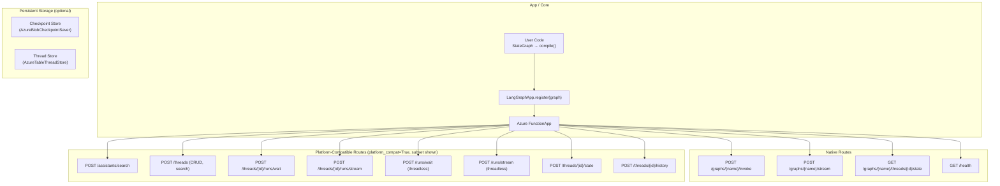

# DESIGN.md

## Design Principles

1. **Thin Adapter, Not a Framework** — We wrap LangGraph, not replace it. All graph logic stays in LangGraph.
2. **Zero Boilerplate** — `register()` + `function_app` is the entire API surface.
3. **LangGraph Conventions First** — Input/output contracts follow LangGraph's patterns (messages, config, stream_mode).
4. **Azure Functions Native** — Use the v2 programming model directly, no intermediate web framework.
5. **Checkpointer Agnostic** — Users bring their own checkpointer; we pass config through.

## Stability policy

This project follows a **rolling 0.x** development model: core adapter APIs aim
for backward compatibility across minor releases while newer surfaces may still
evolve. The canonical **per-surface stability table** (Stable / Beta /
Experimental) lives near the top of [`README.md`](README.md) and is the single
source of truth; the `Development Status :: 3 - Alpha` classifier reflects the
youngest surfaces, not the stable core.

## Architecture

### Core adapter and deployment extensions

The core path is `LangGraphApp` → `register()` → `function_app`, with a
LangGraph checkpointer attached at compile time when graph state is needed.
`ThreadLock` is the writer-exclusion protocol; the default `InProcessThreadLock`
is **single-process only**, including when one Azure instance has multiple
workers. Checkpoint backends and thread locking remain **Beta** under the
README stability policy, not Stable merely because the core uses them.

Distributed topology is a separate decision: the shipped Blob lease lock is a
low-cost option, not a mandatory backend. Platform `ThreadStore` CAS maintains
thread metadata/run ownership and is not acquired by native or trigger runs.
Mixed surfaces must share the distributed lock configuration and graph/thread
keys. Durable is an opt-in execution/polling lifecycle; Service Bus sessions
are sender-configured ordering within one queue/subscription. Neither is a
universal single-writer workaround. The
[production guide](docs/production-guide.md#distributed-deployment) owns wiring,
guards, lease lifetime, cancellation and recovery guidance.



## Key Decisions

### 1. Compiled graphs as intended input
Registration enforces only the `InvocableGraph` protocol (requiring `invoke()`), so any object satisfying the protocol works. In practice, users call `.compile()` before registering because compiled graphs carry configured checkpointers and validated graph structure. The library does not import or check for `CompiledStateGraph` directly.

### 2. SSE streaming as buffered response
This adapter buffers all stream events and returns them as a single SSE-formatted response. This is **the adapter's current implementation choice** given its classic `HttpRequest`/`HttpResponse` model — not an Azure Functions platform limitation. This is functional but not truly streaming.

Future versions may adopt the app-wide FastAPI/ASGI streaming model (`azurefunctions-extensions-http-fastapi`, runtime 4.34.1+) to enable true streaming; because that mode cannot be mixed with the classic-model routes this package uses today, it is a dedicated architecture spike rather than a drop-in.

**⚠️ User expectation**: The SSE endpoints use "stream" in their path names and return `text/event-stream` content type, but responses are **buffered end-to-end**. Users should expect complete SSE-formatted responses delivered at once, not incremental token-by-token delivery. True incremental streaming exists on Azure Functions Python v2 but requires the app-wide FastAPI/streaming model, which is incompatible with the current classic-model surface — so it is tracked as a separate architecture spike, not a platform blocker.

### 3. Thread ID in request body config (native routes)
For native routes (`/graphs/{name}/invoke`, etc.), `thread_id` is passed in `config.configurable.thread_id`, not as a URL path parameter. This keeps the native API surface minimal and compatible with LangGraph's client patterns. Platform-compatible routes use path parameters (`/threads/{thread_id}/...`) to match the LangGraph Platform REST API.

### 4. No mandatory Durable Functions dependency
The default adapter remains HTTP-first with no Durable dependency. The shipped
experimental `async_runs="durable"` opt-in adds long-running execution and
polling via the `durable` extra, not global thread serialization. Graphs execute
inside activities, never orchestrators; checkpoints and writer exclusion remain
separate responsibilities.

### 5. Per-graph auth override (v0.2)
Each graph registration can override the app-level `auth_level`. This enables mixed-auth deployments where public-facing graphs use `ANONYMOUS` while admin graphs require `FUNCTION` keys. The override is stored per-registration and applied at route creation time.

### 6. State endpoint via StatefulGraph protocol (v0.2)
Graphs that implement `get_state(config)` (i.e., graphs compiled with a checkpointer) expose a `GET /graphs/{name}/threads/{thread_id}/state` endpoint. This uses a new `StatefulGraph` protocol added to `protocols.py`, keeping the protocol-based design consistent.

### 7. Azure Blob Storage checkpointer (v0.4)

**Context**: LangGraph's built-in `MemorySaver` loses state on process restart. Azure Functions are stateless — each invocation may run on a different instance. Users need durable checkpoint persistence.

**Decision**: Implement `AzureBlobCheckpointSaver` as an optional extra (`azure-functions-langgraph[azure-blob]`). Each checkpoint is stored as a hierarchy of blobs: `{thread_id}/{checkpoint_ns}/{checkpoint_id}/checkpoint.bin`, with separate blobs for channel values and pending writes. A `latest.json` hint blob accelerates lookups.

**Consequences**: Checkpoint data survives restarts and scales across instances. Blob Storage provides high throughput and automatic geo-replication. The `azure-storage-blob` dependency is optional — import fails with a helpful message if not installed.

**Non-goals**: Concurrent-writer conflict resolution (single-writer assumed).
Sync I/O and optional native async Blob I/O are supported.

**⚠️ Concurrency constraint**: The checkpointer assumes a single writer per
thread. The write order (durable dirty hint → values → metadata → checkpoint
commit marker → clean hint) supports crash recovery under that assumption, not concurrent-write conflict
resolution. Use a distributed `ThreadLock` for shared writers, or an explicitly
single-writer topology. Platform Table CAS covers Platform operations only;
queueing alone does not serialize a thread. See the
[deployment decision table](docs/production-guide.md#distributed-deployment).

Only version-1 clean hints are trusted for direct latest reads. Dirty, legacy,
missing, malformed or dangling hints trigger an authoritative marker scan.
Readers never clear dirty intent: a paused writer could still commit after the
scan. The next successful writer reconciles and publishes a clean monotonic
pointer. Failed dirty-intent persistence prevents checkpoint uploads; marker
failure leaves the prior committed checkpoint visible. Orphan collection skips
untrusted publication, including its per-orphan recheck. This adds one dirty
upload per write and scans during recovery, not on every healthy read (pending
write listing remains necessary). Legacy writers must be drained before rollout;
mixed old/new writers do not provide this recovery guarantee. Arbitrary external
rollback of a valid clean pointer is not detectable by the bounded fast path.

### 8. Azure Table Storage thread store (v0.4)

**Context**: `InMemoryThreadStore` loses thread metadata on restart. Thread lifecycle (create, search, count, delete) needs to persist across Azure Functions instances.

**Decision**: Implement `AzureTableThreadStore` as an optional extra (`azure-functions-langgraph[azure-table]`). Single-partition design (`PartitionKey="thread"`) with client-side filtering for metadata subset matching and status filters.

**Consequences**: Thread records persist across restarts. Table Storage is low-cost and low-latency for key-value lookups. Client-side filtering works well for <100K threads; at scale, the single partition may become a bottleneck.

**Non-goals**: Server-side metadata querying (Azure Table OData filters don't support nested JSON), multi-partition sharding.

**Scale envelope**: The single-partition design works well for up to ~100K threads. At that scale:
- Azure Table Storage throughput limit of ~2,000 entities/sec per partition applies.
- Client-side metadata filtering for `search()` and `count()` becomes progressively expensive as all entities must be scanned.
- Consider migrating to a multi-partition design, Azure Cosmos DB, or a dedicated database when approaching these limits.

#### Benchmark findings: search and count at scale (#767)

> **Provenance: the fake-client and Azurite numbers below are NOT Azure Storage measurements: they include no real network latency, throttling or transaction billing, and none establishes a supported thread count.** Real Azure Storage measurements are reported separately in "Real Azure measurements" after the findings.

Reproduce with `tools/benchmark_table_store.py` (see its docstring): `hatch run table:python tools/benchmark_table_store.py --sizes 1000,10000,100000` (fake), `... --azurite --azurite-port 10112 --sizes 1000,10000` against an Azurite table service you start yourself (the script creates uniquely named `bench<size>r<8 hex>` tables per run, never reuses an existing table, and deletes only the tables it created) and `... --prototype-check`. Synthetic threads: about 80% `idle`, 10% `busy`, 7% `interrupted`, 3% `error`; metadata `tenant` (50 values, about 2% selectivity), `kind`, `user`. "Requests" are modeled as one per started page of 1,000 entities, the Table query page limit. Medians of 3 runs, one machine; compare ratios, not absolute values.

Fake client (entities read, modeled requests, peak traced Python allocation, median latency, which here is client-side CPU only):

| Threads | `search(limit=10)` unfiltered | `search(status="idle", limit=10, offset=0.6N)` | `search(metadata={"tenant": "t7"}, limit=10)` | `count(status="busy")` | `count(metadata={"tenant": "t7"})` |
|---:|---|---|---|---|---|
| 1,000 | 1,000 / 1 / 1.6 MiB / 8 ms | 814 / 1 / 1.3 MiB / 6 ms | 1,000 / 1 / 1.6 MiB / 7 ms | 85 / 1 / 0.1 MiB / 1 ms | 1,000 / 1 / 1.6 MiB / 7 ms |
| 10,000 | 10,000 / 10 / 16 MiB / 88 ms | 8,016 / 9 / 13 MiB / 76 ms | 10,000 / 10 / 16 MiB / 92 ms | 967 / 1 / 1.5 MiB / 10 ms | 10,000 / 10 / 16 MiB / 92 ms |
| 100,000 | 100,000 / 100 / 161 MiB / 1,233 ms | 80,067 / 81 / 129 MiB / 947 ms | 100,000 / 100 / 158 MiB / 1,150 ms | 10,113 / 11 / 16 MiB / 128 ms | 100,000 / 100 / 158 MiB / 1,187 ms |

Azurite on loopback through the real SDK (same columns; latency includes SDK deserialization and emulator time): at 1,000 threads an unfiltered `search(limit=10)` took about 72 ms and a tenant-filtered `count()` about 63 ms; at 10,000 threads they took about 724 ms and 715 ms (peak traced allocation 29 MiB). `count(status="busy")` read only the 967 matching rows (about 62 ms), because the status filter is applied server-side.

Findings (all emulator/fake-derived):

- Cost scales linearly with the partition (or status) size, not with `limit` or `offset`. A `limit=10` search and a high-offset search read the same number of entities as an unbounded scan of the same filter; scan amplification (entities read per entity returned) was 100 at 1,000 threads, 1,000 at 10,000 and 10,000 at 100,000 for `limit=10`.
- Only the `status` filter reduces entities read, and only in proportion to the status's share of threads. Metadata filters never reduce reads (the metadata is a JSON string property).
- Peak traced Python allocation (`tracemalloc`, additional to the interpreter and library baseline; not process memory) is about 1.6 KiB per scanned thread in the fake because the whole result list is materialized before sorting; about 3 KiB per thread at 10,000 threads under Azurite with the real SDK.

Thresholds used for guidance (emulator-derived; superseded by the real-Azure thresholds below): treat more than 1 modeled page (1,000 entities) read per request as scan amplification worth reviewing, and an interactive endpoint whose emulator latency exceeds about 500 ms (reached at about 10,000 threads under Azurite for unfiltered or metadata-filtered search and count) as unacceptable until measured on real Azure. A 100,000-thread single partition read about 100,000 entities (100 modeled pages) and about 1 s of client CPU in the fake for one search, so the `~100K` envelope above should not be read as an interactive-search guarantee. Target workload for the current design: low thread counts (thousands), searches that carry a selective `status`, and `get`/`create`/`update` by `thread_id` (point operations are unaffected).

Operational guidance: keep `limit`/`offset` pagination cheap by narrowing with `status` where possible; avoid unfiltered high-frequency `count()` on large tables; measure on your own storage account before relying on search latency at more than a few thousand threads. See "Real Azure measurements" below for the measured numbers, the transaction-cost estimate and the restated thresholds.

**Real Azure measurements (2026-11-05).** Provenance: a temporary Standard_LRS StorageV2 account in `koreacentral` (deleted after the run), `azure-data-tables` 12.7.0, `azure-core` 1.41.0, Python 3.11.15, run through `python tools/benchmark_table_store.py --connection-string-env VAR --sizes 1000,10000,50000,100000 --reps 3` from a developer machine outside Azure (connection setup 7 to 41 ms and a complete HTTPS GET about 70 to 140 ms, from five unauthenticated `curl` GETs during the run). **Latency therefore includes client-to-Azure round trips and the client's SDK deserialization; an Azure-hosted Function in the same region would see lower per-page latency, which was not measured.** Entities read, requests and traced allocations are independent of client location.

Requests are **measured**, not modeled. The harness counts every HTTP request sent through the SDK transport (retries included) and keeps the count of every execution of every workload: each of the 3 timed repetitions (the runs behind the latency figures) and the separate memory pass, 28 rows x 4 = 112 executions. In all 112 the measured count equalled the modeled one request per started 1,000-entity page (at least one per query), so no retry and no extra page request was sent in any timed repetition or memory pass. The 112 executions sent 3,592 query requests; the transport total for the whole run was 5,210, which is exactly those 3,592 plus 1,610 seeding batch transactions (10, 100, 500 and 1,000 batches of up to 100 entities for the four sizes) plus 8 table create and delete requests, so seeding needed no retries either. This is the third run of the harness against Azure: in the first the request counter reported 0 and in the second it covered only the memory pass, so this run supersedes both for requests. All three runs agreed exactly on entities read, peak traced allocation and results, while the median latency of the same row differed between pairs of runs by a median factor of 1.25 and by up to 2.1x (the unfiltered 100,000-thread search took 25.0 s, 18.4 s and 20.2 s), so treat latency as an order of magnitude, not a benchmark. The table is this third run; cells are entities read / requests (measured, identical in every execution) / peak traced Python allocation of the memory pass / median latency of 3 repetitions. **The memory column is `tracemalloc`'s peak, started only for the separate memory pass: it counts the additional Python allocations of one search or count on top of the interpreter and imported libraries, and excludes that baseline and untraced native allocations. It is not process RSS.**

| Threads | `search(limit=10)` unfiltered | `search(status="idle", limit=10, offset=0.6N)` | `search(metadata={"tenant": "t7"}, limit=10)` | `count(status="busy")` | `count(metadata={"tenant": "t7"})` |
|---:|---|---|---|---|---|
| 1,000 | 1,000 / 1 / 4.8 MiB / 224 ms | 814 / 1 / 3.9 MiB / 184 ms | 1,000 / 1 / 4.8 MiB / 196 ms | 85 / 1 / 0.4 MiB / 37 ms | 1,000 / 1 / 4.8 MiB / 200 ms |
| 10,000 | 10,000 / 10 / 28.5 MiB / 1.9 s | 8,016 / 9 / 23.1 MiB / 1.4 s | 10,000 / 10 / 28.3 MiB / 1.7 s | 967 / 1 / 4.6 MiB / 254 ms | 10,000 / 10 / 28.3 MiB / 1.9 s |
| 50,000 | 50,000 / 50 / 134 MiB / 8.7 s | 40,061 / 41 / 107 MiB / 6.5 s | 50,000 / 50 / 133 MiB / 8.4 s | 5,052 / 6 / 15.4 MiB / 1.3 s | 50,000 / 50 / 133 MiB / 9.6 s |
| 100,000 | 100,000 / 100 / 265 MiB / 20.2 s | 80,067 / 81 / 211 MiB / 22.7 s | 100,000 / 100 / 263 MiB / 16.7 s | 10,113 / 11 / 28.5 MiB / 2.4 s | 100,000 / 100 / 263 MiB / 20.0 s |

Real-Azure findings:

- The scan-amplification model is confirmed: every search or count without a `status` match reads the whole partition, with one request per 1,000 entities, and `limit`/`offset` do not reduce reads. Cost is about 160 to 280 ms per 1,000-entity page from this client in this run (120 to 340 ms across the three runs), so latency is linear in partition size (about 0.17 to 0.20 s per 1,000 threads for full scans of 10,000 threads or more in this run; 0.13 to 0.25 s across the three runs).
- Peak traced Python allocation is about 2.7 to 3.1 KiB per scanned entity for scans of 5,000 entities or more (the SDK entity objects plus the materialized list), larger than the fake's 1.6 KiB; at about 1,000 entities it is 4.8 to 4.9 KiB per entity, presumably because fixed per-query allocations are a larger share of a small result (not investigated). A 100,000-thread unfiltered search allocates about 265 MiB at its peak. These are additional Python allocations measured with `tracemalloc` (see the table note), not process RSS: the baseline of a deployed Functions worker (interpreter, host integration, this package, the application's graphs), untraced native allocations and allocator overhead come on top and were not measured, and the figure is incurred per concurrent search. It is therefore not an instance-sizing bound; it shows that one broad search needs memory proportional to the partition.
- Only `status` narrows reads, in proportion to its share, so `count(status="busy")` (about 10% of rows) reads about a tenth of the entities (11 requests instead of 100 at 100,000 threads) but still takes 2.4 s (2.0 to 3.4 s across the three runs).

Restated thresholds (real Azure, from an out-of-Azure client; re-measure in-region): an interactive request should stay below about 1 s, which at 160 to 280 ms per page is reached after roughly 4 to 6 pages (about 4,000 to 6,000 entities) from this client; the measured point nearest it is `count(status="busy")` at 50,000 threads, 5,052 entities in 6 requests, 1.3 s (1.0 to 1.4 s across the three runs). Unfiltered and metadata-filtered search/count therefore cross it between 1,000 and 10,000 threads (0.2 s at 1,000, 1.7 to 1.9 s at 10,000 in this run); a `status`-narrowed query crosses it at the size where its status share reaches that range (`status="busy"` count: 0.25 s at 10,000, 1.3 s at 50,000 in this run). Memory is a second bound: budget about 3 KiB of additional traced Python allocation per scanned thread per concurrent search, plus the worker's baseline and untraced native allocations, which were not measured; measure process RSS on the target instance size before sizing. These supersede the Azurite-derived 500 ms/10,000-thread rule above; guidance for the target workload (thousands of threads, selective `status`, point operations) is unchanged, and the `~100K` partition envelope must not be read as an interactive-search guarantee.

Transaction cost estimate (offline method, not a bill): estimated cost = transactions / 10,000 x list price per 10,000 for the meter. Price source: the Azure Retail Prices API (read-only GET) `https://prices.azure.com/api/retail/prices?$filter=serviceName eq 'Storage' and armRegionName eq 'koreacentral' and contains(productName,'Table') and contains(skuName,'LRS') and priceType eq 'Consumption'`, retrieved 2026-11-05, USD. It lists, for Tables in `koreacentral`: legacy `Standard LRS` read, write, scan and list operations at 0.00036 per 10,000 (effective 2016-04-11) and `Account Encrypted LRS` meters at 0.00675 (read), 0.122 (scan and list), 0.0338 (write) and 0.101 (batch write) per 10,000 (effective 2021-03-01). Which meter a given account is billed on, and whether a paged query counts as read or scan, was not established from these sources, so the table brackets the estimate between the lowest and highest query-capable meters; see the [Table Storage pricing page](https://azure.microsoft.com/en-us/pricing/details/storage/tables/) and note that Microsoft documents every operation including reads as a transaction. An entity group transaction (one batch of up to 100 entities) is documented as a single billable transaction ([performance checklist](https://learn.microsoft.com/en-us/azure/storage/tables/storage-performance-checklist)), which is how the seeding batches are counted here.

| Operation (requests measured) | Low (0.00036 / 10K) | High (0.122 / 10K) |
|---|---:|---:|
| One unfiltered search at 10,000 threads (10) | USD 0.00000036 | USD 0.000122 |
| One unfiltered search at 100,000 threads (100) | USD 0.0000036 | USD 0.00122 |
| 1,000 such searches per day at 100,000 threads (100,000 transactions) | USD 0.0036 per day | USD 1.22 per day |
| This benchmark run (5,210 requests counted at the transport: 3,592 queries, 1,610 seeding batches, 8 table create and delete) | USD 0.00019 | USD 0.064 |

At the high bound the dollar cost of a broad search is small in absolute terms but scales as requests per search times search rate; the dominant impacts at scale are latency and memory (traced allocation, see above), not the bill.

Recommendation on an implementation follow-up (not implemented here): **split one follow-up, and only that one.** The measured impact warrants it for deployments beyond a few thousand threads (about 1.3 to 1.9 s at 10,000 and 8 to 10 s at 50,000 for a `limit=10` search from this client across the three runs; about 265 MiB of traced Python allocation at 100,000), but the evidence does not justify a broad rewrite. The smallest follow-up is an opt-in time-ordered index partition per status (`RowKey` = inverted `created_at` + thread id, the shape `--prototype-check` verifies for explicit statuses only). For a metadata-free `search(status=<explicit>, offset=0, limit=10)` it would read about `offset + limit` entities, one request, instead of up to the whole status share (for example 1 request instead of 81 for `status="idle"` at 100,000 threads, measured scan above; the index figure is modeled, not measured). It does **not** by itself cover an unfiltered `search(status=None)`: separate per-status partitions give no global newest-first order and the prototype does not check that case. For it there are two options: (a) merge reads of the four status partitions (`idle`, `busy`, `interrupted`, `error`): about one request per partition at offset 0, each reading up to `offset + limit` entities, so about 4 requests (40 entities for `limit=10`) instead of about 100 at 100,000 threads, with a high offset costing 4 x (`offset + limit`) entities; or (b) a global time-ordered index, which needs one more write per create/update and one extra partition to keep consistent. Both are modeled estimates and the merge's ordering/tie-break equivalence is not yet prototyped. It does not help `count()` or metadata filters and needs a maintainer decision on the second-write/consistency cost first (the index and thread rows cannot share one transaction across partitions). Metadata-filtered search and `count()` remain full scans and should be documented as such until promoted metadata properties or per-status counters are justified by a real workload. The decision to open that issue is the maintainer's.

Bounded alternatives evaluated (no production change, public `ThreadStore` semantics unchanged):

| Option | Effect | Cost / risk |
|---|---|---|
| Server-side `status` filter | Already used; reduces reads to the status share | None |
| Promote selected metadata keys to Table properties and filter server-side | Would cut reads for those keys | Schema/write-path change, migration of existing rows, only for pre-declared keys; changes what is queryable |
| Time-ordered index partition per status (`RowKey` = inverted `created_at` + thread id) | Newest-first search without metadata filter can stop after `offset + limit` rows | Second write per create/status change without cross-partition atomicity (needs batch transactions within one partition only, so index and thread rows cannot share a transaction); migration; does not help `count()` or metadata filters |
| Per-status counters | `count(status=...)` without scan | Contention on counter rows; drift on partial failures |
| Multi-partition sharding | Spreads per-partition throughput | Every search must fan out; does not reduce scan work |

The index-partition option was prototyped only inside the benchmark (`--prototype-check`, not production code): on 5,000 synthetic threads including `created_at` ties, 24 combinations of status, `limit` (including 0), `offset` (including beyond the end) returned thread ids identical in order to `search()`, and `count()` equalled the index cardinality. This verifies ordering, tie-break (`RowKey` ascending on equal `created_at`), limit and count semantics for the prototype only; it does not measure write amplification or failure-recovery behavior. Real-Azure impact is now measured (see "Real Azure measurements"); the follow-up recommendation is stated there and no implementation is part of this change.

### 9. Threadless runs (v0.4)

**Context**: The LangGraph SDK supports `runs.wait(None, ...)` and `runs.stream(None, ...)` for fire-and-forget executions that don't need a persistent thread.

**Decision**: Add `POST /runs/wait` and `POST /runs/stream` endpoints. These clone the registered graph with `checkpointer=None`, producing a stateless execution. Client-supplied `thread_id` in config is rejected with 422 to prevent semantic confusion.

**Consequences**: SDK clients can run graphs without pre-creating threads. No checkpoint is saved, so the execution is truly ephemeral. The thread store is not modified by threadless runs.

**Non-goals**: Persisting threadless run results, associating threadless runs with thread records.

### 10. Protocol-based capability detection (v0.4)

**Context**: v0.4 adds `update_state()` and `get_state_history()` endpoints, but not all graphs support these operations.

**Decision**: Add `UpdatableStateGraph` and `StateHistoryGraph` protocols to `protocols.py`, each with `@runtime_checkable`. Route handlers use `isinstance()` checks to return 409 when a graph doesn't support the operation.

**Consequences**: Graceful degradation — graphs without these capabilities still work for all other endpoints. New protocols follow the same pattern as existing `StatefulGraph` and `StreamableGraph`.

### 11. Ecosystem responsibility boundaries

**Context**: The Azure Functions Python DX Toolkit has grown to multiple packages with overlapping capabilities.

**Decision**: Establish clear responsibility boundaries:
- `azure-functions-langgraph` owns LangGraph runtime exposure (graph deployment, invoke, stream, threads, runs, state)
- `azure-functions-validation-python` owns request/response validation and serialization
- `azure-functions-openapi-python` owns API documentation (OpenAPI spec generation, Swagger UI)

**Consequences**: OpenAPI support is delegated to the dedicated `azure-functions-openapi-python` package. A bridge module (`azure_functions_langgraph.openapi`) allows users to register LangGraph endpoints with the external openapi package.

**Non-goals**: Absorbing validation or documentation concerns into this package.

### 13. Auth level default

**Context**: Oracle design review flagged that `LangGraphApp` defaulting to `ANONYMOUS` creates a security risk - users copy example code into Azure without changing auth settings. The official Azure Functions Python `FunctionApp` class defaults to `FUNCTION`.

**Decision**: `LangGraphApp` defaults to `AuthLevel.FUNCTION`. Passing `auth_level=ANONYMOUS` is an explicit opt-in that emits an unconditional `UserWarning`, so an accidental anonymous surface is loud in test/CI output. All examples set `auth_level` explicitly.

**Consequences**: Deployed endpoints require a function key out of the box, matching the official Azure Functions `FunctionApp` default and closing the copy-paste-into-Azure security gap. The health surfaces are gated separately (`GET /api/health` liveness is `ANONYMOUS` by default and exposes only `{"status": "ok"}`; `GET /api/health/details` inherits `auth_level`, so the graph inventory is protected by default).

**Decision history**: The original v0.5 plan was to keep `ANONYMOUS` as the default through v0.5.x-v0.6.x for backward compatibility and only switch to `FUNCTION` in v1.0. That plan was superseded: `FUNCTION` became the default in **v0.7.3** (#243), ahead of v1.0, because the security risk of an anonymous default outweighed the backward-compatibility concern.

**Non-goals**: Environment-dependent defaults (surprising behavior), `DeprecationWarning` emission (ignored by default, creates noise without protection).

### 14. Retain bounded Blob lease renewal (0.13 evaluation, #697)

**Decision:** Keep `AzureBlobLeaseThreadLock`, its default 60-second finite lease
with `auto_renew=True`, and the existing `ThreadLock.acquire` / owner-token
`release` protocol unchanged. Retain the renewal daemon and bounded worker pool;
do not replace them with a fixed lease or an infinite default in 0.13.

**Evidence:** Evaluated against `ef72421` (2026-10-25), including the fixes for
#384 (retry transient renewal failures and retain lost local ownership), #387
(isolate slow renewals with bounded concurrency), and #642 (release acquisitions
that cross terminal close). Controlled two-instance tests in
`tests/test_blob_lease_evaluation.py` advance service time through 180 seconds:
healthy renewal excludes a contender; expiration without renewal, or after
renewal failure, admits a second owner while the first graph can still write.
An acquisition wait timeout is not an execution deadline, and cancelling a
running synchronous worker cannot stop it. Failed close recovers through finite
expiry but leaves an infinite lease requiring operator intervention.

**Alternatives evaluated:**

| Alternative | Benefit | Safety / operational cost | Outcome |
| --- | --- | --- | --- |
| Retain / streamline bounded renewal | No extra service; supports work longer than 60 seconds; finite crash recovery | Best effort under network loss; worker threads cannot be forcibly stopped; no checkpoint write fence | Retain existing implementation, no speculative concurrency rewrite |
| Fixed finite lease for explicitly bounded work | Removes renewal bookkeeping | Must enforce a deadline including graph, tools, checkpoint I/O and cleanup, cancel and join all work before expiry, and atomically reject stale writes at storage; not provided by the current protocol/checkpointer | Existing explicit opt-out only, not a safe automatic migration |
| Non-expiring lease (`-1`) | Removes renewal and natural-expiry overlap | A crash strands ownership; break/release must follow verified worker quiescence or write fencing; operational recovery is mandatory | Existing opt-in only, not the default |

Azure permits finite leases of 15–60 seconds or an infinite lease. Its lease
protects the **marker blob**, not the separate checkpoint blobs. The opaque
release token protects owner bookkeeping, not checkpoint writes. Neither
renewal, opt-out, nor infinite leases automatically fence in-flight writes;
manual breaks and premature `close()` can also admit a new owner. Checking a
lease before writing is not an atomic write fence. An HTTP response timeout
(including the Functions 230-second limit) does not terminate graph execution.

**Consequences / migration:** No runtime, dependency, protocol, default or version
change; no migration is required. This evaluation adds tests and operating
guidance, not a stronger mutual-exclusion guarantee. Removing automatic renewal
would require evidence of enforced cancellation **and** storage-side fencing
before changing the default, plus explicit migration/release documentation.
Do not present the retained lock as partition-proof or as real-Azure
certification. Worker count is bounded, but hung SDK calls can exhaust that
pool; queued submissions are not an admission-bounded queue. The tick wait
timeout does not cancel network I/O. Keep SDK timeouts/retries bounded and
drain graph work before closing the lock.

See the [production lease lifecycle and recovery guidance](docs/production-guide.md#blob-lease-safety-and-recovery)
and the authoritative [Azure lease semantics](https://learn.microsoft.com/en-us/rest/api/storageservices/lease-blob)
and [Functions HTTP limits](https://learn.microsoft.com/en-us/azure/azure-functions/functions-bindings-http-webhook-trigger#limits).

### 15. Blob stale-writer decision record (#765)

**Status: decided. Storage-level fencing is deferred, not rejected.** This section records the evidence, the property worth protecting, what was decided and what would change the decision. An earlier and much larger candidate (a per-thread manifest with attempt-isolated payloads) was reviewed for eight rounds and never reached a complete, implementable design. Its full text is kept only in this pull request's history, at [commit `ca57aaf`](https://github.com/yeongseon/azure-functions-langgraph-python/blob/ca57aaf0dd59fbeadc59b0c956867c6c10c9069e/DESIGN.md); it is **not** an accepted design.

**Evidence (real Azure, 3 of 3 runs, 2026-11-05).** A throwaway probe, kept outside the repository, ran `AzureBlobLeaseThreadLock(lease_duration=15, auto_renew=False)` for two owners on separate instances over one lock container. A took the lock and wrote a checkpoint, A's lease lapsed, B polled `acquire()` until it succeeded (15.3 s, 15.3 s and 15.4 s) and wrote under the same parent, and then the stale owner A acted:

| Stale owner A's action | Result (identical in all 3 runs) |
|---|---|
| lease renew | 409 `LeaseIdMismatchWithLeaseOperation` |
| upload to the marker blob with its old lease id | 412 `LeaseIdMismatchWithBlobOperation` |
| `AzureBlobCheckpointSaver.put()` | **accepted** (62 to 67 ms) |

Afterwards both branches existed under the same parent and `latest.json` pointed at the stale writer's checkpoint. The service rejected every lease-conditional write the stale owner made, but the saver's uploads are unconditional (`overwrite=True`), so the lease never reaches them. The probe drove the lock and the saver directly with synthetic, deliberately ordered checkpoint ids. It is one controlled interleaving per run: not a measured production incidence rate, and not Azurite evidence. Fake-backed tests that pin the same behavior are in `tests/test_lease_loss_characterization.py`; the operating envelope is in `docs/production-guide.md`.

**What is and is not established.** Established: a stale owner's checkpoint write is accepted and can become the default head, because the lease does not condition checkpoint uploads. Not established: how often this happens in production. While renewal succeeds (nominally every `lease_duration / 3`, 60 s by default), a long graph does not expire the lease by itself. Exposure needs renewal to be interrupted (host suspension, repeated failure, an explicit break or close), another owner to take over, and the old execution to keep running. The renewal interval is nominal, not a detection deadline, and nothing stops the running graph, because a Python thread cannot be killed. A fork is not corruption by itself, since LangGraph supports branching from history; the defect is a stale branch becoming the default resume lineage.

**The property worth enforcing.** After B acquires ownership, operations carrying A's previous ownership identity cannot change the default resume checkpoint, its referenced state or its pending writes; authorized historical branching stays allowed. This does not require preventing every stale byte, or an atomic transaction over all checkpoint and write blobs.

**Decision.**

1. Keep lease renewal (#697). Make no single-writer claim for the Blob backends beyond exclusion while ownership holds; the documented residual risk stands.
2. Defer a storage-level fence. No design reviewed so far enforces the property at bounded cost without a new indexed storage protocol (migration, reclamation, retry and deletion semantics), and each review of the manifest candidate found interactions it did not specify.
3. Re-scope #790 to a bounded mitigation: an opt-in guard, bound to the original lock token, that rejects Blob writes after the lock has detected loss (`ThreadLeaseLostError`, deliberately not `StaleCheckpointWriterError`). It reduces writes after detected loss and is **not** fencing: detection lags, and a check can pass just before an upload. It adds no storage format, migration, reclamation or backend, and never retries graph or tool execution.
4. For shared production state that must not be written by an overlapping owner, prefer an existing transactional backend (the PostgreSQL integration; Cosmos DB is also available, but its helper path is deprecated for credential handling) over a larger Blob protocol. A transactional saver prevents partial writes; it does not by itself reject a logically stale graph. Applications that need the property above must verify backend-specific fencing or prevent takeover until old workers have stopped.

**Scope of the guard (#790).** An optional lock capability returns a guard bound to the original lock token. It reaches the saver through a private configurable key at every boundary that acquires the lock and then runs the graph or mutates thread state (native handlers, Platform runs and thread updates, true streaming, the Durable activity, the Service Bus trigger), through one shared helper. The saver checks the guard before every upload, including pending writes, and a run checks it before reporting success; a missing, released or mismatched token is rejected as well as a lost one. The saver must never look up "the current owner of this thread", which could hand a stale owner the new owner's identity. Tests keep an unguarded characterization of the stale write and reproduce the residual check-then-upload window. Deletion (`delete_thread`, retention) stays unsafe against active writers and needs quiesced maintenance.

**Detection today.** The lock already logs a warning when it marks a lease lost (`locks/azure_blob.py`). Alert on it and correlate it with run-lifecycle telemetry. Treat a match as suspected overlap, not proven corruption.

**Candidates considered and not adopted.**

- *A per-thread manifest in the leased marker blob with attempt-isolated payloads* (the earlier version of this section). It could enforce the property, but it is an unbounded indexed storage protocol: it needs a legacy bootstrap, cross-attempt references, two-phase reclamation, a retention floor and a fence handoff at every lock-owning boundary. Two interactions stayed unspecified. First, a `put_writes()` batch can reach the saver before its own checkpoint commits, because LangGraph schedules the two independently except in durability `"exit"` (read in `langgraph/pregel/_loop.py` of 1.0.0, 1.1.4 and 1.2.20). Second, a legacy-layout `delete_thread()`, which deletes everything under `threads/{thread}/`, can race the manifest bootstrap. Not adopted.
- *The whole thread record inside the leased blob.* The leanest design that would be a genuine storage fence: every mutation is one lease-and-ETag-conditioned replacement, so there is no separate payload publication, no cross-blob reference and no online legacy bootstrap. The cost is whole-record rewrites and a bounded history and state size, with no measurement of whether that is usable. Worth investigating only for explicitly bounded workloads, on fresh storage (legacy data would stay in the existing saver and be imported offline).
- *An epoch-conditional commit, or a fence in the `ThreadLock` protocol itself.* Not designed beyond a sketch; not pursued.

**When to revisit.** Revisit storage fencing when there is a concrete requirement for the property above and a reason the existing backends cannot meet it. Evidence that would favor the bounded whole-record design: measured serialized thread sizes and history, acceptable whole-record latency and cost, and passing lease-conditioned save, pending-write and delete tests on real Azure, including ambiguous responses and LangGraph's real background scheduling. Evidence that would favor a manifest design: a complete protocol with deterministic fault tests for every interaction above, real-Azure proof of conditional publication, measured growth and reclamation, cutover and rollback proof, and a named maintainer for it. A production incident raises urgency, not confidence in an incomplete design.

**Not covered.** Neither a fence nor a guard stops a stale graph from running or from causing side effects outside the checkpoint store (tool calls, external APIs); at most it limits what reaches the checkpoint store.

Reproduction: the probe is a small script that runs `AzureBlobLeaseThreadLock` and the real saver against a temporary container. It is intentionally not part of the repository; its core and sanitized output are in the description of pull request #791.

## Module Structure

```
src/azure_functions_langgraph/
├── __init__.py              # Package init, lazy imports, __version__
├── app.py                   # LangGraphApp class, route registration
├── _handlers.py             # Native route handlers (invoke, stream, state)
├── _validation.py           # Transport-agnostic request validators
├── contracts.py             # Pydantic request/response models
├── protocols.py             # Protocol interfaces (LangGraphLike, StatefulGraph, etc.)
├── py.typed                 # PEP 561 marker
├── platform/                # LangGraph Platform API compatibility layer (v0.3+)
│   ├── __init__.py
│   ├── contracts.py         # Platform API Pydantic models (Thread, Run, Assistant, etc.)
│   ├── routes.py            # SDK-compatible HTTP route handlers
│   ├── stores.py            # ThreadStore protocol + InMemoryThreadStore
│   └── _sse.py              # SSE event formatting
├── checkpointers/           # Persistent checkpoint storage (v0.4+)
│   ├── __init__.py          # Lazy-loading package
│   └── azure_blob.py        # AzureBlobCheckpointSaver (Azure Blob Storage)
└── stores/                  # Persistent thread storage (v0.4+)
    ├── __init__.py          # Lazy-loading package
    └── azure_table.py       # AzureTableThreadStore (Azure Table Storage)
```

## Testing Strategy

Authorization assurance distinguishes host-level keys from per-principal resource
policy. See [the security threat model](docs/security.md#current-route-boundaries)
for the exact callback surfaces, including native RUN enforcement (#687/#722). Negative tests
exercise registered handlers with real checkpoint state; they do not implement
identity verification or claim host-key enforcement under local Core Tools.

- Unit tests use `FakeCompiledGraph` and `FakeStatefulGraph` mock objects
- SDK compatibility tests use real `langgraph_sdk.SyncLangGraphClient` via `httpx.MockTransport`
- Integration tests use real `StateGraph` compiled graphs with `MemorySaver` and mocked Azure backends
- Persistent storage integration tests verify end-to-end flows with restart simulation
- No real LLM calls in any tests
- Extensive unit + SDK-compatibility + integration suite; coverage tracked in CI (see `pyproject.toml` for the current gate). Historical snapshot: 645 tests, 91%+ coverage as of v0.4.0.
- Coverage threshold enforced at 95% (`fail_under = 95`)


## Streaming: buffered SSE and the true-streaming migration (#378)

The `/stream` endpoints — native `POST /api/graphs/{name}/stream` and the
Platform-compatible `POST /threads/{id}/runs/stream` and `POST /runs/stream` —
return **buffered** SSE. Chunks emitted by the graph are collected during
execution and flushed as SSE events *after the run completes*; clients never
receive partial tokens incrementally. This is a deliberate design choice, not a
bug and not an Azure platform limitation. It is tracked for future migration in
[issue #378](https://github.com/yeongseon/azure-functions-langgraph-python/issues/378).

### Why buffered today

This package registers **classic** `HttpRequest`/`HttpResponse` routes via the
Azure Functions Python v2 `FunctionApp` programming model. In that model a
handler returns a single, fully-formed `HttpResponse`, so the SSE body must be
assembled in memory before it is returned. `max_stream_response_bytes` is only a
safety cap on that in-memory buffer — it does not enable incremental delivery.

### The concrete constraint

Azure Functions Python *does* support true HTTP streaming (runtime **4.34.1+**)
through the `azurefunctions-extensions-http-fastapi` extension. That extension
switches the **entire function app** to the FastAPI/ASGI model: routes become
ASGI routes served by a FastAPI/Starlette app rather than classic
`HttpRequest`/`HttpResponse` handlers. The two models **cannot be mixed** within
one function app, so adopting true streaming is an app-wide architectural change,
not a per-endpoint toggle.

### Design questions for the migration (tracked in #378)

- **Opt-in coexistence.** Can true streaming be offered as an opt-in — e.g. a
  dedicated ASGI sub-app or a separate streaming entrypoint — without forcing
  every consumer of this package onto the ASGI model? If not, the migration is a
  breaking change gated on a major version.
- **Breaking-change surface.** Moving to ASGI re-touches route registration,
  per-graph `auth_level` handling (Functions auth vs. ASGI middleware), the
  health endpoints, and the native-endpoint per-thread locking — each must be
  re-established under the FastAPI/ASGI model.
- **Streaming semantics.** Under true streaming, `stream_mode`, backpressure, and
  the meaning of `max_stream_response_bytes` (a hard buffer cap today) all need
  redefinition — likely a soft flush threshold or removal.
- **Release promise.** Core (classic, buffered) vs. Platform-compat streaming
  guarantees must stay separable so the buffered contract does not silently
  change under existing users.

Actual implementation of the ASGI migration is **out of scope for #378** — that
issue establishes the tracker and the design constraints; implementation follows
in a dedicated issue/PR once an approach is agreed.

## Sources

- [Azure Functions Python developer reference](https://learn.microsoft.com/en-us/azure/azure-functions/functions-reference-python)
- [Azure Functions HTTP trigger](https://learn.microsoft.com/en-us/azure/azure-functions/functions-bindings-http-webhook-trigger)
- [Supported languages in Azure Functions](https://learn.microsoft.com/en-us/azure/azure-functions/supported-languages)
- [Azure Blob Storage documentation](https://learn.microsoft.com/en-us/azure/storage/blobs/)
- [Azure Table Storage documentation](https://learn.microsoft.com/en-us/azure/storage/tables/)
- [LangGraph documentation](https://langchain-ai.github.io/langgraph/)

## See Also

- [azure-functions-validation-python — Architecture](https://github.com/yeongseon/azure-functions-validation-python) — Request/response validation pipeline
- [azure-functions-openapi-python — Architecture](https://github.com/yeongseon/azure-functions-openapi-python) — OpenAPI spec generation
- [azure-functions-logging-python — Architecture](https://github.com/yeongseon/azure-functions-logging-python) — Structured logging with contextvars
- [azure-functions-doctor-python — Architecture](https://github.com/yeongseon/azure-functions-doctor-python) — Pre-deploy diagnostic CLI
- [azure-functions-scaffold-python — Architecture](https://github.com/yeongseon/azure-functions-scaffold-python) — Project scaffolding CLI
