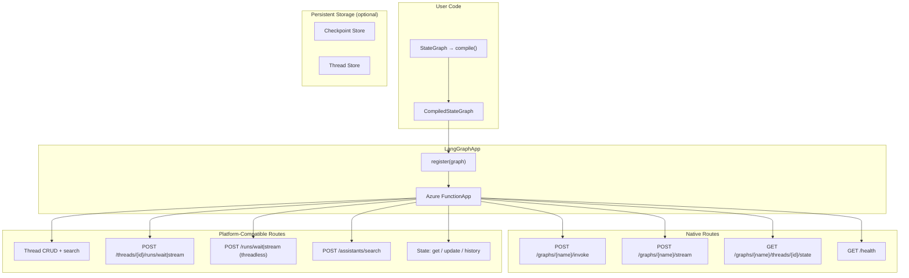
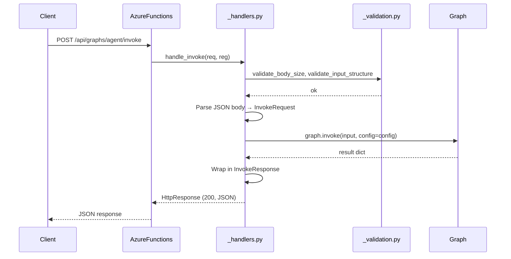
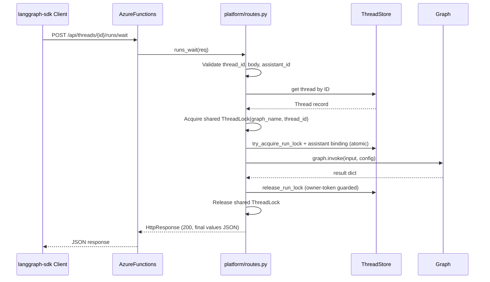
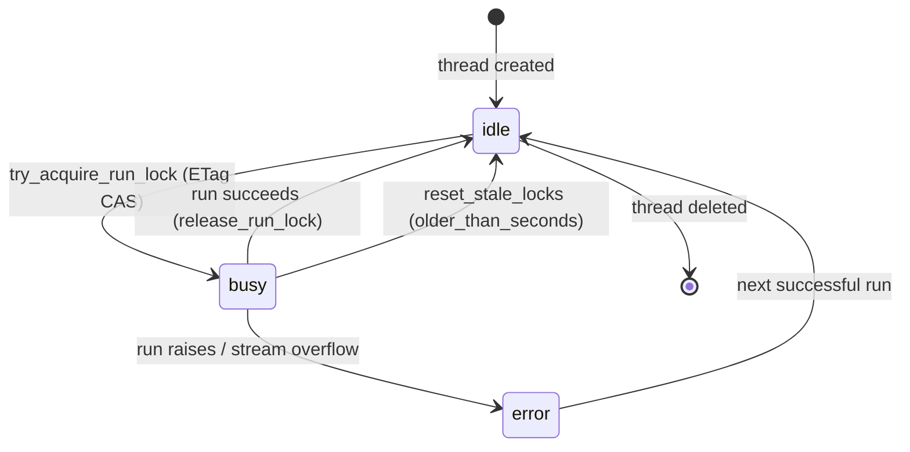
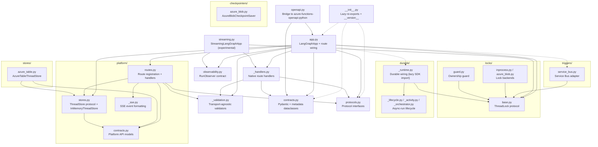

# Architecture

## Overview

`azure-functions-langgraph` is a thin deployment adapter. It bridges LangGraph compiled graphs and Azure Functions HTTP endpoints without adding intermediate abstractions.



Platform-compatible routes are registered when `platform_compat=True`, enabling the official `langgraph-sdk` Python client to communicate with Azure Functions–hosted graphs.

## Core adapter vs Experimental Platform Compatibility

The surface deliberately splits into two layers so the package's identity — **the
most natural way to deploy an already-built LangGraph graph on Azure Functions** —
stays crisp:

- **Core adapter.** Stable native HTTP contracts (`invoke` / `stream` / `state` /
  health) and auth, with checkpointer pass-through. Checkpoint backends and
  thread locking remain **Beta**, not Stable; see the canonical
  [per-surface stability table](https://github.com/yeongseon/azure-functions-langgraph-python/blob/main/README.md#azure-functions-langgraph).
- **Experimental Platform Compatibility (optional).** The `langgraph-sdk`-compatible
  thread / run / assistant / state routes under `platform/`. Registered **only**
  when `platform_compat=True`.

**`platform_compat=False` is the default, and that default *is* the boundary** — you
opt into the Platform surface explicitly. The package is a deployment adapter, not a
reimplementation of LangGraph Platform on Azure Functions.

> **Store terminology.** Three distinct concepts, often conflated: the
> **checkpointer** (`AzureBlobCheckpointSaver`) persists *graph execution state*
> (LangGraph `BaseCheckpointSaver`); **`AzureTableThreadStore`** is a *Platform
> thread-metadata registry* (thread records, status, run locks) serving the
> Platform-compatible routes; and LangGraph **`BaseStore`** (long-term cross-thread
> memory) is **not implemented by this package**. `AzureTableThreadStore` is not a
> `BaseStore`.

## Core state and thread exclusion

The first-use path is `LangGraphApp` → `register(graph=...)` → `function_app`.
Compile with a LangGraph checkpointer when you need graph state, and pass
`config.configurable.thread_id` on native requests. No Platform thread registry,
broker or Durable orchestration is needed for that path.

`thread_lock` accepts the `ThreadLock` protocol (`azure_functions_langgraph.locks`):
`acquire(graph_name, thread_id, timeout=0.0)` returns an opaque owner token or
`None` on contention (the `graph_name` argument is a *lock scope*: the graph name, or a
key derived from the checkpointer's storage when it reports one, so graphs sharing
checkpoint storage share one lock; see
[Lock scope and shared checkpointers](production-guide.md#lock-scope-and-shared-checkpointers)); `release(graph_name, thread_id, token)` relinquishes that
ownership. Native invoke/stream use it for checkpointed graphs with a thread ID.
The default `InProcessThreadLock` excludes concurrent writers for that key
**inside one Python process only**, not across workers on one instance or
across instances. Persistence alone does not provide writer exclusion.

### Production and distributed extensions

Choose these separately after the core path works:

- **Shared writers:** a distributed `ThreadLock`, such as the shipped low-cost
  `AzureBlobLeaseThreadLock`, with lease-loss and shutdown planning. An opt-in
  write guard (`guard_checkpoint_writes`) can reject Blob checkpoint writes after
  the lock *detects* loss; it reduces writes after detected loss and is not
  fencing.
- **Platform compatibility:** `platform_compat=True` and a `ThreadStore` for
  thread metadata/status. Azure Table CAS coordinates Platform operations, not
  every writer to the checkpointer.
- **Long-running execution:** optional Durable create/poll/cancel; activities
  still use the configured thread lock and at-least-once delivery.
- **Message delivery:** optional Service Bus; sender-configured sessions order
  one queue/subscription, not HTTP or other queues writing the same thread.

The [production deployment decision table](production-guide.md#distributed-deployment)
owns backend wiring, guards, operation/lease lifetime, run-lock recovery and
mixed-surface requirements. These are deployment choices, not core dependencies
or an automatic backend switch. Thread locking stays **Beta**.

## Design Objectives

- **Thin adapter, not a framework** — wrap LangGraph, don't replace it. All graph logic stays in LangGraph.
- **Zero boilerplate** — `register()` + `function_app` is the entire API surface.
- **LangGraph conventions first** — input/output contracts follow LangGraph's patterns (messages, config, stream_mode).
- **Azure Functions native** — use the v2 programming model directly, no intermediate web framework.
- **Checkpointer agnostic** — users bring their own checkpointer; config is passed through.

## High-Level Flow

### Invoke



### Classic stream (buffered)

```mermaid
sequenceDiagram
    participant Client
    participant AzureFunctions
    participant Handlers as _handlers.py
    participant Graph

    Client->>AzureFunctions: POST /api/graphs/agent/stream
    AzureFunctions->>Handlers: handle_stream(req, reg)
    Handlers->>Handlers: validate_body_size, validate_input_structure
    Handlers->>Handlers: Parse JSON body → StreamRequest
    loop Collect chunks (buffered)
        Graph-->>Handlers: event dict
        Handlers->>Handlers: Serialize to SSE, add len to buffered_bytes
        alt buffered_bytes + chunk > max_stream_response_bytes
            Handlers->>Handlers: Append "event: error", break out of loop
        end
    end
    Handlers->>Handlers: Append "event: end"
    Handlers-->>AzureFunctions: HttpResponse (200, text/event-stream; Cache-Control, X-Accel-Buffering)
    AzureFunctions-->>Client: Buffered SSE response (in-band error if overflow)
```

> **Streaming is buffered end-to-end; the SSE log is returned as a single
> response.** The graph runs to completion and every event is accumulated, then
> flushed as one `text/event-stream` response with `Cache-Control: no-cache` and
> `X-Accel-Buffering: no` headers (no `Content-Location` is set).
> If the buffer would exceed `max_stream_response_bytes`, the run is halted and a
> terminal `event: error` + `event: end` is injected in-band (still HTTP 200).

`StreamingLangGraphApp` is the separate experimental true-streaming transport.
It uses `azurefunctions-extensions-http-fastapi` and an async generator to flush
native SSE frames as the graph produces them. Because Azure Functions streaming
enables the FastAPI/ASGI model app-wide, it cannot be mixed with the classic
`LangGraphApp` routes in the same function app. Its real-Azure e2e test measures
first-frame arrival before completion in the release certification workflow.

### Platform: Thread Run (SDK-compatible)



Platform run responses (wait and stream, threaded and threadless) set no `Content-Location` header: the Platform router registers no GET route for a run resource, so such a link would dangle.

### Platform: Thread lifecycle (state machine)



A Platform thread's store run lock admits one owner. With `AzureTableThreadStore`,
acquisition is an atomic ETag compare-and-swap; release is owner-token guarded
and can fail. A concurrent run attempt while `busy`
returns **409** (`multitask_strategy=reject`). If a host is terminated mid-run the
thread stays `busy` until `reset_stale_locks()` reclaims it. See the
[production guide](production-guide.md) for the operational runbook.

## Module Boundaries (key import edges)



### `app.py`

The core module. Contains:

- `LangGraphApp` — main class (dataclass) that holds graph registrations and builds an `azure.functions.FunctionApp`.
- `_GraphRegistration` — internal record for a registered graph (includes `request_model`/`response_model` since v0.5).
- Route wiring — delegates to `_handlers.py` for native routes and `platform/routes.py` for SDK-compatible routes.
- `get_app_metadata()` — returns an immutable `AppMetadata` snapshot with per-graph route metadata (v0.5+).
- `health()` — anonymous liveness handler returning `{"status": "ok"}`; `health_details()` returns the registered-graph inventory (protected by default).


### `openapi.py` *(v0.5+)*

Bridge module between `azure-functions-langgraph` and `azure-functions-openapi-python`:

- `register_with_openapi(app)` — reads `app.get_app_metadata()` and calls `register_openapi_metadata()` for each route.
- `_validate_model()` — ensures model arguments are Pydantic `BaseModel` subclasses.
- `_build_request_body()` — converts a Pydantic model to an OpenAPI request body dict via `model_json_schema()`.

This module lazily imports `azure-functions-openapi-python` and raises `ImportError` if the package is not installed.
### `_handlers.py`

Standalone request handlers extracted from `LangGraphApp`:

- `handle_invoke()` / `handle_invoke_async()` — parse request, validate, call `graph.invoke()` / `graph.ainvoke()`, return JSON.
- `handle_stream()` / `handle_stream_async()` — parse request, validate, call `graph.stream()` / `graph.astream()`, collect chunks into buffered SSE.
- `handle_state()` / `handle_state_async()` — retrieve thread state via `graph.get_state()` (sync registrations) or `graph.aget_state()` (`async_mode=True` registrations whose graph exposes it) for `StatefulGraph` instances.
- `_error_response()` — consistent error response builder for native routes.

### `_execution_plan.py`

Private, transport-neutral request-to-execution planning shared by `_handlers.py` (classic `HttpRequest`/`HttpResponse`) and `streaming.py` (FastAPI true streaming). It owns the rules that must not drift between those adapters: `thread_id` extraction and checkpointed-graph thread requirement, `version` negotiation (a 422 when the graph method cannot accept it), `input`/`config` structure and config-policy admission, the run's execution-config/thread identity (`plan_run_config`) and optional request/response-model validation at `register()`. It returns plain values (`Rejection`, `RunPlan`, error strings) and imports no transport type; each adapter encodes them as its own error response. Nothing in it is public API.

**What is deliberately not shared** (each stays in its adapter because the behavior is transport- or binding-specific):

- Request decoding and response encoding: `HttpRequest.get_json()`/`HttpResponse` versus an ASGI `Request` body and `JSONResponse`/`StreamingResponse`.
- Authorization invocation and ordering inside the adapter (sync versus awaited, and the streaming `StreamingAuthorizationContext`); the shared layer never calls an authorizer.
- Lock acquisition/release lifecycle and cancellation handling (blocking thread lock versus `async_thread_lock`, and deferred stream ownership until ASGI execution).
- SSE framing: native routes buffer the whole stream into one response; the streaming transport emits chunks incrementally and handles client disconnect and mid-stream errors.
- Platform SDK routes (`platform/`): their own `RunCreate` parsing, thread-store CAS and run lock, and Platform response encoding. They only reuse the graph-clone helper below.
- Per-registration caching of the threadless graph clone: `_get_threadless_graph` still clones per request. A cached clone would freeze the registration-time graph, whereas a per-request clone observes later mutation of the registered graph object, and copy immutability, absence of request-specific state and invalidation on re-registration cannot be shown for an arbitrary `CloneableGraph`. The copy is shallow and the source graph is not mutated.

### `_topology.py`

Private, immutable hosting-topology plan and its single build-time validation pass. `LangGraphApp` and `StreamingLangGraphApp` derive one frozen `TopologyPlan` from the final configuration (constructor arguments, registrations, the thread store and lock actually wired, and the environment) when `app.function_app` is built, before any route exists. Hard errors cover only configurations that are unsafe by construction or by the operator's declaration (a graph with a stricter `auth_level` than the app on Platform/Durable routes; `AZFUNC_LANGGRAPH_LOCK_BACKEND` / `AZFUNC_LANGGRAPH_THREAD_STORE` declaring a distributed deployment while a process-local lock, thread store or `InMemorySaver` is wired); anything that merely suggests scale-out is a `RuntimeWarning`. Rule table and override guidance: [production guide](production-guide.md#topology-validation-880). Nothing in it is public API.

### `_validation.py`

Transport-agnostic input validators (pure functions returning error message or `None`):

- `validate_graph_name()`, `validate_body_size()`, `validate_input_structure()`, `validate_thread_id()`.
- Shared by both native handlers and platform routes.

### `_json.py`

JSON serialization of graph output for the native routes, Table JSON and Durable activities. Imports `langchain_core.messages` directly to serialize LangChain message objects, which is why `langchain-core` is a declared runtime dependency. Platform routes use their own encoder, `platform/_serialization.py`, which emits flat SDK-shaped message objects and rejects `NaN`/infinities instead of emitting non-standard JSON; native serialization is unchanged.

### `contracts.py`

Pydantic v2 models for request/response validation:

- `InvokeRequest`, `InvokeResponse`, `StreamRequest` — graph operation models.
- `HealthResponse`, `GraphInfo` — health endpoint models.
- `ErrorResponse` — consistent error format.
- `StateResponse` — thread state values, next steps, metadata, config, timestamps.

Stdlib metadata dataclasses (v0.5+):

- `RouteMetadata` — frozen dataclass describing a single HTTP route (path, method, parameters, models).
- `RegisteredGraphMetadata` — frozen dataclass grouping routes for a registered graph.
- `AppMetadata` — top-level snapshot; `graphs` is `MappingProxyType`, nested parameter dicts are also immutable.

### `protocols.py`

`typing.Protocol` interfaces with `@runtime_checkable`:

- `InvocableGraph` — has `invoke(input, config)`.
- `StreamableGraph` — has `stream(input, config, stream_mode)`.
- `LangGraphLike` — combines both (matches `CompiledStateGraph`).
- `StatefulGraph` — has `get_state(config)`.
- `UpdatableStateGraph` — has `update_state(config, values)`.
- `StateHistoryGraph` — has `get_state_history(config)`.

Using protocols avoids a hard import dependency on `langgraph` at the library level. Any object with the right methods works.

### `streaming.py`

`StreamingLangGraphApp` — the separate **experimental** true-streaming transport (`streaming` extra, `azurefunctions-extensions-http-fastapi`). It reuses the native handlers' validation and the `locks/` and `observability` contracts, but serves async-generator SSE and cannot be mixed with `LangGraphApp` routes in one function app. `streaming_authorization.py` holds its opt-in RUN authorization and `_stream_response.py` defers stream ownership until ASGI execution.

### `locks/`

Per-thread writer exclusion for native, streaming, Durable and trigger runs:

- `base.py` — `ThreadLock` protocol (`acquire(graph_name, thread_id, timeout)` returns an opaque token or `None`; `release(..., token)`).
- `inprocess.py` — `InProcessThreadLock`, the default; single Python process only.
- `azure_blob.py` — `AzureBlobLeaseThreadLock`, a distributed lock built on Blob leases with bounded renewal (`azure-blob` extra).
- `guard.py` — opt-in ownership guard (`OwnershipGuard`, `guard_checkpoint_writes`) so a checkpoint saver can reject writes after the lock *detects* loss; not fencing.
- `_async.py` — cancellation-safe adaptation of synchronous locks for async callers.
- `_scope.py` — lock-scope resolution: a checkpointer that exposes `lock_scope_identity` (today `AzureBlobCheckpointSaver`) maps every graph on that storage to one scope; other graphs keep their name.

### `durable/`

Optional Durable Functions async-run control plane (`durable` extra, enabled with `async_runs="durable"`): create/get/cancel handlers (`_lifecycle.py`), a deterministic orchestrator (`_orchestrator.py`) and an activity that executes the graph (`_activity.py`), with pure state models in `_state.py`. Only `_runtime.py` touches `azure.durable_functions`, imported lazily. Graphs run inside activities, never orchestrators.

### `triggers/`

Event-driven adapters. `service_bus.py` drives a graph from an Azure Service Bus trigger (`ServiceBusMessageLike`, `default_message_mapper`, `ThreadContentionError`); `_session_topology.py` validates the session-exclusive topology.

### `observability.py` and `observability_otel.py`

`RunObserver` / `RunContext` run-lifecycle contract with no-op and logging observers; `observability_otel.py` adds an optional OpenTelemetry observer (`otel` extra).

### `platform/`

LangGraph Platform API compatibility layer (v0.3+), registered only when `platform_compat=True`:

- `routes.py` — route registration. Handlers live in `_threads.py`, `_runs.py` and `_assistants.py` (threads, runs, assistants, state operations), with shared helpers in `_common.py` (including the graph-aware `authorize` check) and run-lock renewal in `_store_renewal.py`.
- `_serialization.py` — Platform JSON encoding (flat SDK message shapes, strict finite JSON).
- `contracts.py` — Platform API Pydantic models (Thread, Run, Assistant, Interrupt, etc.).
- `stores.py` — `ThreadStore` protocol + `InMemoryThreadStore` default implementation.
- `_sse.py` — SSE event formatting for platform streaming endpoints.

### `checkpointers/`

Persistent checkpoint storage (v0.4+):

- `azure_blob.py` — `AzureBlobCheckpointSaver` (optional extra: `azure-functions-langgraph[azure-blob]`). Stores checkpoints as blob hierarchies under `threads/{thread_id}/ns/{checkpoint_ns}/checkpoints/{checkpoint_id}/`, with `checkpoint.bin` as the commit marker.
- `postgres.py`, `sqlite.py`, `cosmos.py` — DX helpers over the optional LangGraph checkpoint packages (`postgres`, `sqlite`, `cosmos` extras).

### `stores/`

Persistent thread storage (v0.4+):

- `azure_table.py` — `AzureTableThreadStore` (optional extra: `azure-functions-langgraph[azure-table]`). Single-partition design with client-side filtering.

## Public API Boundary

Exported symbols (via `__all__`, all lazy-loaded via `__getattr__`):

- `LangGraphApp` — main class for graph registration and route creation
- `__version__` — package version string
- `InvokeRequest`, `InvokeResponse`, `StreamRequest` — request/response contracts
- `HealthResponse`, `GraphInfo`, `ErrorResponse`, `StateResponse` — endpoint models
- `RouteMetadata`, `RegisteredGraphMetadata`, `AppMetadata`, `get_langgraph_metadata` — metadata dataclasses and toolkit metadata accessor
- `InvocableGraph`, `AsyncInvocableGraph`, `StreamableGraph`, `AsyncStreamableGraph`, `LangGraphLike`, `StatefulGraph`, `CloneableGraph` — protocol interfaces
- `RunObserver`, `RunContext`, `NoOpRunObserver`, `LoggingRunObserver`, `OTelRunObserver`, `RunRejectedReason`, `RunTransport` — run observability
- `StreamingLangGraphApp` — experimental true-streaming app (`streaming` extra)
- `default_message_mapper`, `ServiceBusMessageLike`, `ThreadContentionError` — Service Bus trigger helpers

Lazy imports via `__getattr__` are a deliberate design choice: importing the package does not require `azure-functions` or `langgraph` to be installed, enabling use in environments where only contracts or protocols are needed.

Everything else (handlers, validators, platform internals, storage implementations) is implementation detail. Lock backends are imported from `azure_functions_langgraph.locks`, the checkpointer and thread store from `.checkpointers` / `.stores`.

## Key Design Decisions

### Compiled graphs as intended input

Users typically call `.compile()` before registering. Registration enforces only the `InvocableGraph` protocol (requiring `invoke()`), so any object satisfying the protocol works — but compiled graphs are the primary expected input because they carry configured checkpointers and validated graph structure.

### Protocol-based graph acceptance

Rather than importing `CompiledStateGraph` from `langgraph`, the library uses `typing.Protocol`. Registration requires only the `InvocableGraph` protocol (`invoke()`); objects that fail this check are rejected at registration time with `TypeError`. Native stream endpoints additionally require `stream_enabled=True` on the registration and the graph to satisfy `StreamableGraph` (`stream()`). Platform stream routes check only `StreamableGraph` via `isinstance()`. Stream routes return **501 Not Implemented** when the graph does not support the required streaming protocol. This approach means no hard dependency on `langgraph` at import time and testing with mock graphs is straightforward.

### Protocol-based capability detection (v0.4)

`UpdatableStateGraph` and `StateHistoryGraph` protocols enable graceful degradation — graphs without these capabilities return 409 instead of failing. Route handlers use `isinstance()` checks with `@runtime_checkable`.

### Buffered SSE

The classic `LangGraphApp` collects all stream events into memory and returns them as a single SSE-formatted response. This is an implementation choice, not an Azure Functions platform limitation: buffered SSE is the contract for its classic `azure.functions.HttpRequest`/`HttpResponse` model.

**⚠️ User expectation**: Classic SSE endpoints are buffered end-to-end. The separate experimental `StreamingLangGraphApp` provides true incremental native streaming on Azure Functions runtime 4.34.1+ through `azurefunctions-extensions-http-fastapi`. That transport switches the **entire function app** to FastAPI/ASGI and therefore cannot be mixed with classic routes in one app.

### Platform compatibility layer (v0.3)

When `platform_compat=True`, the library registers routes that mirror the LangGraph Platform REST API, enabling the official `langgraph-sdk` Python client to work with Azure Functions–hosted graphs. This adds thread lifecycle management, SDK-compatible run endpoints, assistant listing, and state operations.

### Azure Blob Storage checkpointer (v0.4)

`AzureBlobCheckpointSaver` provides durable checkpoint persistence across Azure Functions instances. Installed as optional extra (`[azure-blob]`). Supports sync I/O and optional native async Blob I/O; single-writer assumed.

**⚠️ Concurrency constraint**: The checkpointer assumes a single writer per
thread. Its write order (values → metadata → checkpoint commit marker → latest
hint) supports recovery under that assumption, not concurrent-write conflict
resolution. Shared writers must use a distributed `ThreadLock` or an explicitly
single-writer topology. Queue delivery alone does not serialize a thread, and
Platform Table CAS does not cover native or trigger writers. See the
[deployment decision table](production-guide.md#distributed-deployment).

### Azure Table Storage thread store (v0.4)

`AzureTableThreadStore` provides persistent thread metadata across restarts. Installed as optional extra (`[azure-table]`). Single-partition design works well for <100K threads.

**Scale envelope**: The single-partition design works well for up to ~100K threads. At that scale:
- Azure Table Storage throughput limit of ~2,000 entities/sec per partition applies.
- Client-side metadata filtering for `search()` and `count()` becomes progressively expensive as all entities must be scanned.
- Consider migrating to a multi-partition design, Azure Cosmos DB, or a dedicated database when approaching these limits.

### Threadless runs (v0.4)

`POST /runs/wait` and `POST /runs/stream` clone the graph with `checkpointer=None` for truly ephemeral executions. Client-supplied `thread_id` in config is rejected with 422 to prevent semantic confusion.

### Single-writer constraint for thread operations

Platform run acquisition binds the first assistant atomically with store
ownership; `InMemoryThreadStore` uses an in-process lock and
`AzureTableThreadStore` uses ETag CAS. Conflicting assistant bindings are
rejected. Platform state updates also acquire the shared `ThreadLock` and store
run lock. Native HTTP and trigger runs use the shared lock, not the Platform
store lock. See [mixed-surface concurrency](production-guide.md#interaction-with-platform-compatible-runs)
before sharing checkpoint state across routes or apps.

### Metadata API and OpenAPI bridge (v0.5)

`LangGraphApp.get_app_metadata()` returns a frozen `AppMetadata` snapshot describing all registered routes. External consumers (e.g. `azure-functions-openapi-python`) read this instead of reaching into internal state. The bridge module `openapi.py` forwards metadata to `azure-functions-openapi-python`'s `register_openapi_metadata()` for spec generation. All metadata objects are deeply immutable: `AppMetadata.graphs` is `MappingProxyType`, route parameter dicts are also `MappingProxyType`, and all dataclasses are frozen.

### Per-graph auth override (v0.2)

Each graph registration can override the app-level `auth_level` for that graph's **native** routes, enabling mixed-auth deployments. Platform-compatible and Durable routes are shared by every graph and are protected by the app-level `auth_level` only, so building an app (or registering late after `function_app` was exported) with a graph *stricter* than the app level while those routes are enabled raises `ValueError`. Looser graphs and native-only apps are unaffected. See [Mixed per-graph auth](security.md#mixed-per-graph-auth-with-platform-or-durable-routes).

### Thread ID in request body (native routes)

For native routes, `thread_id` is passed in `config.configurable.thread_id`, not as a URL path parameter. This keeps the native API surface minimal and matches LangGraph's client expectations. Platform-compatible routes (`/threads/{thread_id}/...`) do use path parameters to match the LangGraph Platform REST API.

## Non-Goals

1. **No runtime orchestration** — This package exposes LangGraph graphs as Azure Functions HTTP endpoints. It does not orchestrate graph composition, tool management, or agent logic. Those concerns belong in LangGraph itself.

2. **No validation framework** — Request/response validation beyond transport-level safety checks (body size, input depth/node count, graph name format) belongs in `azure-functions-validation-python`. This package validates only what is needed for safe HTTP handling.

3. **No OpenAPI ownership** — API documentation and spec generation belong in `azure-functions-openapi-python`. This package provides metadata for the bridge module but never generates OpenAPI specs itself.

4. **No LangGraph Platform replacement** — This is a deployment adapter, not a competing platform. It mirrors SDK shapes for client compatibility, not to replicate LangGraph Platform functionality.

5. **No custom storage engines** — Storage implementations (`AzureBlobCheckpointSaver`, `AzureTableThreadStore`) are adapters for Azure services. They are not a generic storage framework.

## Related Documents

- [Usage Guide](usage.md)
- [Configuration](configuration.md)
- [API Reference](api.md)
- [Getting Started](getting-started.md)
- [Testing](testing.md)
- [Troubleshooting](troubleshooting.md)

## Sources

- [Azure Functions Python developer reference](https://learn.microsoft.com/en-us/azure/azure-functions/functions-reference-python)
- [Azure Functions HTTP trigger](https://learn.microsoft.com/en-us/azure/azure-functions/functions-bindings-http-webhook-trigger)
- [Supported languages in Azure Functions](https://learn.microsoft.com/en-us/azure/azure-functions/supported-languages)
- [Azure Blob Storage documentation](https://learn.microsoft.com/en-us/azure/storage/blobs/)
- [Azure Table Storage documentation](https://learn.microsoft.com/en-us/azure/storage/tables/)
- [LangGraph documentation](https://langchain-ai.github.io/langgraph/)

## See Also

- [azure-functions-validation-python — Architecture](https://github.com/yeongseon/azure-functions-validation-python) — Request/response validation pipeline
- [azure-functions-openapi-python — Architecture](https://github.com/yeongseon/azure-functions-openapi-python) — OpenAPI spec generation
- [azure-functions-logging-python — Architecture](https://github.com/yeongseon/azure-functions-logging-python) — Structured logging with contextvars
- [azure-functions-doctor-python — Architecture](https://github.com/yeongseon/azure-functions-doctor-python) — Pre-deploy diagnostic CLI
- [azure-functions-scaffold-python — Architecture](https://github.com/yeongseon/azure-functions-scaffold-python) — Project scaffolding CLI
