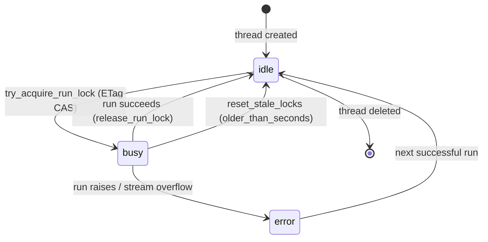
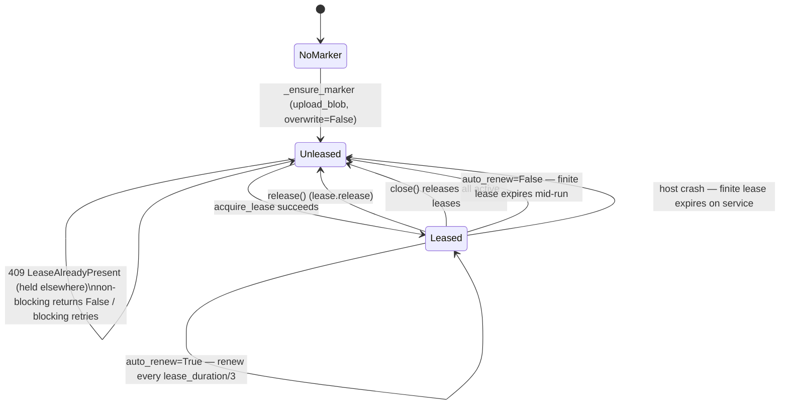

# Production Guide

This guide focuses on production hardening for `azure-functions-langgraph` deployments on Azure Functions.

Start with the [core adapter model](architecture.md#core-state-and-thread-exclusion)
and [Quickstart](getting-started.md). Production is not synonymous with
distributed deployment: choose the extra infrastructure only when your topology
or delivery requirements need it. The [distributed deployment section](#distributed-deployment)
separates writer exclusion, Platform metadata, long-running execution and
message ordering; none replaces the others.

## Authentication & Authorization
### Default auth behavior

`LangGraphApp` defaults to function-key HTTP access:

```python
# src/azure_functions_langgraph/app.py
auth_level: func.AuthLevel = func.AuthLevel.FUNCTION
```

This default is intentionally secure: deploying a `LangGraphApp()` without any auth configuration will require a function key on every request.

If you opt into `ANONYMOUS` at the app level, the library emits an unconditional `UserWarning` at construction time (regardless of environment). This ensures the choice is always visible in test output, CI logs, and startup output.

```python
# Opting into anonymous access (e.g. local dev) emits UserWarning:
# UserWarning: LangGraphApp is using ANONYMOUS auth. ...
app = LangGraphApp(auth_level=func.AuthLevel.ANONYMOUS)
```

⚠️ `ANONYMOUS` is convenient for local development but too permissive for internet-facing production APIs.

### Set a production-safe app-level auth level

`FUNCTION` is the default (recommended baseline). Use `ADMIN` only for tightly controlled internal surfaces.

```python
import azure.functions as func

from azure_functions_langgraph import LangGraphApp

app = LangGraphApp()  # default: FUNCTION
app = LangGraphApp(auth_level=func.AuthLevel.ADMIN)  # only if truly internal
```

### Per-graph auth override

You can override auth for specific graphs via `register()`:

```python
import azure.functions as func

app = LangGraphApp(auth_level=func.AuthLevel.FUNCTION)

# Production default for private endpoints
app.register(graph=internal_graph, name="internal", auth_level=func.AuthLevel.FUNCTION)

# Explicitly public endpoint (only when intended)
app.register(graph=public_graph, name="public", auth_level=func.AuthLevel.ANONYMOUS)
```

Use per-graph overrides to keep a strict default while exposing narrowly scoped public routes.

⚠️ **Scope**: Per-graph `auth_level` overrides apply only to **native routes** (`/api/graphs/{name}/invoke`, `/api/graphs/{name}/stream`).
When `platform_compat=True` is enabled, all platform-compatible routes (`/api/threads/...`, `/api/runs/...`) use the **app-level** `auth_level` regardless of per-graph overrides.

### API Management integration pattern

For production, a common pattern is:

1. Set Function routes to `FUNCTION` auth.
2. Place Azure API Management (APIM) in front of the Function App.
3. Require client auth at APIM (JWT/OAuth2/subscription key/mTLS).
4. Keep Function keys private between APIM and Function App.
5. Apply APIM rate limits, IP filtering, and request validation policies.

This creates a layered security model: edge auth and governance in APIM, key-based gate at the Function layer.

- [Azure Functions authentication and authorization](https://learn.microsoft.com/en-us/azure/azure-functions/security-concepts)

## Observability
### Run telemetry with the built-in `RunObserver` (recommended)

The package emits **run-lifecycle domain signals** through a pluggable
[`RunObserver`](https://github.com/yeongseon/azure-functions-langgraph-python/blob/main/src/azure_functions_langgraph/observability.py). Every native
invoke/stream run (and every Platform `runs/wait` / `runs/stream` run) notifies
the observer on `started`, `completed`, `failed`, and `rejected`, carrying an
immutable `RunContext` of **correlation identifiers and timing only** — never
input, output, config, headers, or secrets.

For zero-boilerplate telemetry, wire the built-in, dependency-free
`LoggingRunObserver`:

```python
import logging
from azure_functions_langgraph import LangGraphApp, LoggingRunObserver

logging.getLogger("azure_functions_langgraph.observability.run").setLevel(logging.INFO)

app = LangGraphApp(observer=LoggingRunObserver())
```

It emits one structured log record per lifecycle event under a single `extra`
key (`langgraph_run`) containing `graph_name`, `endpoint`, `run_id`,
`thread_id`, `assistant_id`, `stream_mode`, `transport`, `has_checkpointer`,
`invocation_id`, `lock_backend`, `trigger_type`, `duration_ms`, a derived `status`, and — on failure — the
exception `error_type` (class name only). Azure Functions' native Application
Insights integration surfaces these fields under `customDimensions`. See
[`examples/observability_app_insights/`](../examples/observability_app_insights/)
for a full KQL walkthrough (run count, latency percentiles, error rate, and
per-thread correlation).

**Boundary.** The package owns the *domain signal* only. It does **not** own log
formatting, App Insights ingestion, OpenTelemetry exporters, tracer-provider
setup, sampling policy, or PII redaction — those stay in your logging
configuration. Observer failures are isolated and can never fail a graph run.
To write your own observer instead, see
[`examples/run_observer/`](../examples/run_observer/).

### Custom logging integration

If you also instrument your own nodes, these practices pair well with the
observer above:

- Emit structured fields (`graph_name`, `thread_id`, `assistant_id`, `run_id`, `status_code`, `duration_ms`).
- Log explicit lifecycle markers: request received, graph started, graph completed/failed.
- Include error categories (`validation_error`, `execution_error`, `storage_error`) to simplify alerting.

[`azure-functions-logging-python`](https://github.com/yeongseon/azure-functions-logging-python) provides structured logging helpers that pair well with this package — use it to *route/format* the records the observer produces.

### Application Insights correlation

Azure Functions automatically wires requests/dependencies into Application Insights when enabled in the Function App.
Use this to correlate:

- incoming HTTP request
- graph invocation log records
- downstream dependency calls (LLM/API/storage)
- final success/error outcome

This enables end-to-end traceability for each run.

The identifiers are related but not interchangeable:

- **Functions invocation ID** identifies one Azure Functions worker invocation.
  It is not currently available to generated HTTP handlers: adding an optional
  `func.Context` parameter makes current Python workers reject the function at
  indexing time, while making it required would break direct/test invocation
  compatibility. `RunContext.invocation_id` therefore remains `None` for HTTP,
  and request payload fields can never set or override it.
- **Request/run ID** is this package's sanitized `X-Request-ID` value (or an
  generated opaque value). It is `RunContext.run_id` and correlates responses,
  SSE error metadata, and run-observer records.
- **W3C trace ID** comes from an ambient OpenTelemetry context established by
  operator-supplied Functions/OpenTelemetry instrumentation. The package does
  not parse `traceparent` or create that request context. When one is already
  active, `OTelRunObserver` explicitly preserves it so run and rejection spans
  are children of the active request span; without external instrumentation,
  they are root spans.
- **Application Insights `operation_Id`** is the backend representation of the
  W3C trace ID for correlated telemetry. It is not the Functions invocation ID
  or the request/run ID; query those separately as span attributes or custom
  dimensions when cross-checking a single invocation.

`StreamingLangGraphApp` likewise uses a FastAPI/ASGI extension contract that
exposes the ASGI request but not a `func.Context`. Request/run-ID and ambient
W3C trace correlation still works on both HTTP surfaces when instrumentation
has populated the ambient context.

### Health endpoint

`GET /health` (exposed as `GET /api/health` with the default Functions route
prefix) is a minimal **liveness probe** — it returns `{"status": "ok"}` and
nothing else, confirming only that the app process is up.

⚠️ This is a **liveness endpoint**, not a dependency-readiness check.
It does not probe Blob Storage, Table Storage, or downstream LLM availability.
For deep health checks, implement a custom endpoint or use Azure Monitor availability tests.

Configure `readiness_checks` to opt into `GET /api/health/ready` for dependency
traffic gating. The route is protected by the app auth level by default and can
use an independent `readiness_auth_level`. Callbacks may be synchronous or
asynchronous and must return a boolean. `readiness_timeout_seconds` (default
five seconds) is one **total deadline for the complete probe**, measured from
submitting the component checks until the response is assembled; it is not a
per-component timeout. It must be finite and greater than zero.

```python
app = LangGraphApp(
    readiness_checks={"table": check_table, "model": check_model},
    readiness_timeout_seconds=5,
)
```

Responses expose only component names with `ok` or `failed`: HTTP 200 means all
checks passed, while HTTP 503 means one failed, raised, or timed out. Exception
text, endpoints, and credentials are never returned. Prefer Azure Monitor or
provider-native monitoring when you need historical alerting, external network
vantage points, or detailed dependency diagnostics.

Readiness work is bounded per `LangGraphApp` instance by a dedicated executor
with at most four worker threads and at most one in-flight invocation per
component. If a synchronous callback exceeds the probe deadline, Python cannot
forcibly stop its thread; later probes report that component as failed and reuse
the same in-flight invocation instead of creating more workers. A finished
invocation is refreshed on the next probe. Consequently, a permanently hung
callback can occupy one of the four readiness workers until the host process
exits. Every operator-owned network callback must configure its own SDK timeout
shorter than the total probe deadline. Async callbacks are awaited, but should
also apply cancellation/timeouts to their dependency operations.

The liveness probe uses `health_auth_level`, which defaults to `ANONYMOUS`
independently of `auth_level` — so it stays reachable as an unauthenticated
probe even when the rest of the app requires a function key. It never
enumerates registered graphs.

### Health details endpoint

`GET /health/details` (exposed as `GET /api/health/details`) returns the
registered-graph inventory — graph names, descriptions, and checkpointer
status. Because that information is more sensitive than a liveness signal, it
uses `health_details_auth_level`, which defaults to the app-level `auth_level`
(`FUNCTION`). The inventory is therefore **protected by default**; set
`health_details_auth_level=func.AuthLevel.ANONYMOUS` to expose it publicly.

```json
{
  "status": "ok",
  "graphs": [
    {
      "name": "my_agent",
      "description": "Customer support agent",
      "has_checkpointer": true
    }
  ]
}
```

Use this endpoint for liveness checks and deployment validation.

Monitor health check success rates, response-time percentiles (P50/P95/P99), and HTTP error rates by endpoint and graph name.

## Timeouts & Cancellation
### Azure Functions timeout limits

Execution timeout is governed by Azure Functions plan and `host.json`:

| Plan | Default timeout | Maximum timeout |
|------|-----------------|-----------------|
| Consumption | 5 minutes | 10 minutes |
| Flex Consumption | 30 minutes | Unlimited (configurable) |
| Premium | 30 minutes | Unlimited (configurable) |
| Dedicated (App Service) | 30 minutes | Unlimited |

### Runtime behavior in this package

Graph execution is synchronous from the HTTP handler perspective.
`graph.invoke()` and `graph.stream()` run until completion (or failure).

- No package-level timeout wrapper is applied around graph calls.
- No package-level timeout wrapper is applied around graph calls on the synchronous HTTP path. For a built-in async run lifecycle with a cancellation endpoint, see "Async runs via Durable Functions" below.

⚠️ If a graph exceeds platform timeout, the request fails at the Functions host boundary.

⚠️ **HTTP response ceiling**: Azure Functions enforces a hard **230-second** limit on HTTP response time regardless of `functionTimeout`.
Graph invocations that exceed 230 seconds will fail with a gateway timeout even if `functionTimeout` allows longer execution.
For workloads approaching this limit, consider async patterns (queue trigger + status polling) instead of synchronous HTTP.

### Async runs via Durable Functions (experimental)

For workloads that exceed the synchronous HTTP ceiling, opt into the built-in
Durable Functions-backed async run lifecycle with
`LangGraphApp(async_runs="durable")` (requires the `durable` extra). This adds a
create / poll / cancel control plane so callers no longer hold an HTTP
connection open for the duration of the run:

- `POST /api/graphs/{name}/runs` — start a run, returns `202` with a `run_id`
- `GET /api/runs/{run_id}` — poll normalized status
- `POST /api/runs/{run_id}/cancel` — request termination of a run (see
  [Cancellation](#cancellation-of-durable-runs) for what that does and does not mean)

The graph executes inside a Durable **activity**, never the orchestrator, so
replay determinism is preserved. Durable history is not a replacement for
LangGraph checkpoints. See the README "Durable async run lifecycle" section and
[`examples/durable_async_agent/`](../examples/durable_async_agent/).

This is an **execution and polling** choice, not a concurrency workaround.
Activities acquire the app's `ThreadLock` only for checkpointed graphs with a
thread ID. They do not acquire the Platform `ThreadStore` run lock. Multiple
orchestrations can target the same checkpoint, and at-least-once activity
delivery still requires idempotent side effects. Cancellation terminates the
orchestration; it does not forcibly stop an already-running activity or Python
worker thread. Bound tools and storage calls and apply the
[mixed-surface requirements](#interaction-with-platform-compatible-runs).

#### Cancellation of Durable runs

Durable termination is **asynchronous** and ends the *orchestration*. It does not
interrupt an Activity that is already running, so the graph and its tools can keep
executing, and writing checkpoints, after the cancel call returns and even after
`GET /api/runs/{run_id}` reports `cancelled`. The cancel endpoint therefore claims
only what it observed:

| Situation | Response | `terminate` called |
| --- | --- | --- |
| Unknown run | `404 {"run_id", "error": "run not found"}` | no |
| Run still in flight (pending, running, suspended) | `202 {"run_id", "status": "cancel_requested"}` | yes |
| Run already finished (success, error or cancelled) | `200 {"run_id", "status": <that status>}` | no |
| Status lookup or termination call failed | `502 {"run_id", "error": {"code": "cancel_failed", ...}}` | attempted if it got that far |

- `cancel_requested` means *the termination call returned without reporting a
  failure; termination and worker stoppage are not confirmed*. It is not a
  lifecycle status and `GET` never returns it. The run can still complete normally
  (the Durable client returns normally for HTTP 202 and 410 alike, so a request that
  reached the host just after the run ended is acknowledged like an accepted one), so
  **poll `GET` until the status is terminal** and read the outcome
  there: `cancelled` if the termination took effect, `success` or `error` if the
  run finished first. Repeating the request is safe: while the run is in flight it
  asks again, and once it is terminal it answers `200` without calling `terminate`.
- A `cancelled` status from `GET` means the **orchestration** is terminated. It is
  not proof that the Activity or its tools stopped, and Durable status cannot prove
  that no worker side effect remains.
- A `502` carries a generic message only; the backend error is logged. After a
  failed termination call the outcome is unknown: poll `GET`.
- Right after a create, a `404` from `GET` or cancel does not prove that the run was
  not created: the orchestration may not be visible yet. Retry a few times before
  treating it as unknown.
- **Thread ownership.** For a checkpointed graph with a thread ID the Activity holds
  the app's `ThreadLock` while its graph call runs, also after the orchestration was
  terminated and, for a synchronous graph, also if the host cancels the Activity's
  task (a synchronous call cannot be interrupted, so ownership is kept until it
  returns). A new run for the
  same thread is rejected until then (its Activity reports contention and `GET`
  shows `error`). This holds only within the supported ownership lifetime: a lock
  that is lost, for example a Blob lease that could not be renewed, is not a fence
  (see the [Blob guard](#opt-in-guard-for-blob-checkpoint-writes-790)).
- **Non-idempotent tools.** Cancellation cannot roll back external effects or stop a
  tool call that is in flight, and Activity delivery is at-least-once. Give
  side-effecting tools an idempotency key or deduplicate them in the application;
  do not use cancellation as a safeguard against a duplicate or unwanted effect.
- **Redelivery, replay and retries.** These are three different things. A *redelivery*
  re-runs the Activity (and so the whole graph) with the same `run_id` and payload; a
  checkpointer does not stop it, because the adapter always invokes with the payload
  input and nodes' external effects can repeat. *Orchestrator replay* re-drives
  only the deterministic orchestrator and does not re-run the Activity. An
  *application retry* is a new run with a new `run_id`. Use an idempotency key derived
  from the stable `run_id` with a provider that enforces it atomically; see
  [`examples/durable_async_agent/`](../examples/durable_async_agent/) and
  `tests/test_durable_replay_idempotency.py` for the pattern and its limits.

- **Migration.** Earlier releases answered `202 {"status": "cancelled"}` at once.
  A client that treated that body as final must now poll `GET` until the status is
  terminal, and one that accepted only `202` must also accept `200` (the run had
  already finished). The Durable lifecycle is experimental and may change between minor
  releases; this change is marked breaking so release notes flag it.

### Configure timeout explicitly

Set `functionTimeout` in `host.json` to a value aligned with your plan and workload SLO.

```json
{
  "version": "2.0",
  "functionTimeout": "00:10:00",
  "logging": {
    "applicationInsights": {
      "samplingSettings": {
        "isEnabled": true,
        "excludedTypes": "Request"
      }
    }
  }
}
```

Production guidance:

1. Keep graph completion comfortably under timeout limits.
2. Cap upstream LLM/tool call timeouts so they fail fast.
3. Break long workflows into resumable steps via checkpointers.
4. Route very long orchestration to Durable Functions patterns when needed.

## Request & Input Limits

`LangGraphApp` enforces the following defaults to protect against oversized or deeply nested payloads:

| Limit | Default | Config parameter |
|-------|---------|------------------|
| Request body size | 1 MiB | `max_request_body_bytes` |
| Stream response size | 1 MiB | `max_stream_response_bytes` |
| Input JSON depth | 32 levels | `max_input_depth` |
| Input JSON nodes | 10,000 | `max_input_nodes` |

Override these in `LangGraphApp` constructor if your workload requires larger payloads:

```python
app = LangGraphApp(
    max_request_body_bytes=2 * 1024 * 1024,  # 2 MiB
    max_stream_response_bytes=4 * 1024 * 1024,  # 4 MiB
)
```

Requests exceeding these limits are rejected before graph execution begins.

## Streaming Behavior
### Current behavior (critical)

Endpoints registered by the classic `LangGraphApp` with `stream` in the path and
`Content-Type: text/event-stream` return SSE-formatted payloads, but the adapter
buffers them until graph execution completes.

This affects native and platform routes such as:

- `POST /api/graphs/{name}/stream`
- `POST /api/threads/{thread_id}/runs/stream`
- `POST /api/runs/stream`

⚠️ Clients receive the complete SSE body at once, not incremental chunks.

⚠️ **Buffered SSE response limit**: Stream responses are capped at **1 MiB** (`max_stream_response_bytes=1_048_576` by default).
If the accumulated SSE payload exceeds this limit, an `event: error` is injected into the SSE body rather than an HTTP 413/500.
Adjust `max_stream_response_bytes` in `LangGraphApp` if your graph produces large streaming output.

### Why this happens

This is a deliberate constraint of the classic `HttpRequest`/`HttpResponse`
adapter, which returns one fully formed response body; it is not a general Azure
Functions worker limitation. For true incremental delivery, use the separate
`StreamingLangGraphApp`, which uses the app-wide FastAPI/ASGI transport available
with Azure Functions runtime 4.34.1+.

> For how the Azure Functions Python worker loads and binds handlers, see the toolkit's
> [how the worker binds handlers](https://yeongseon.dev/azure-functions-python/platform/how-the-worker-binds-handlers/) reference — how invocation_id / handler binding works.

### Operational recommendation

For long-running production runs, prefer:

- `POST /api/threads/{thread_id}/runs/wait`
- `POST /api/runs/wait`

over the corresponding `/stream` routes to avoid UX and latency expectation mismatch.

⚠️ **Note**: Thread and run routes (`/api/threads/...`, `/api/runs/...`) are only available when `platform_compat=True` is set in `LangGraphApp`.

### True-stream cancellation and lock ownership

Configure `StreamingLangGraphApp(authorize=policy)` to check a verified ASGI
principal, graph entitlement and thread ownership on every native invoke/stream
request. Function keys grant app access, not resource ownership; the default
`authorize=None` remains permissive. The callback uses the typed
`StreamingAuthorizationContext`, not the classic `HttpRequest` context. See
[the security contract and adoption example](security.md#true-stream-authorization).
Sync callbacks must be nonblocking; use bounded async I/O for external policy
storage. Validation runs first, then authorization once before any graph or
checkpoint I/O, lock acquisition, or deferred response construction. Denials are
sanitized JSON 401/403/500, not SSE frames, and omit thread IDs from observer
rejection metadata. No API migration is required unless adopting the opt-in.

Authorization is admission-only: recheck current credentials on subsequent
requests/reconnects. An already-admitted response is not reauthorized when its
body executes, and an already-running stream is not revoked mid-flight.

`StreamingLangGraphApp` treats HTTP response lifetime and graph execution
lifetime as separate concerns. A disconnect cancels response production, but a
synchronous `graph.stream()` may already be running `next()` in a worker thread;
Python cannot terminate that thread safely.

Constructing a stream response does not acquire a lock, start a graph iterator,
or open an observer span. Ownership begins when the ASGI transport executes the
response (or a caller explicitly consumes its body). Acquisition still precedes
response headers, so contention returns JSON HTTP 409 rather than an SSE error
inside HTTP 200. The transport closes the prepared iterator even when header
delivery fails before the first body pull. An abandoned, never-executed response
therefore has no active token or span needing asynchronous finalization.

The adapter therefore retains the thread-lock token until the single in-flight
`next()` finishes, closes the iterator only after that worker has quiesced,
releases the token exactly once, emits one failed observer outcome, and then
propagates cancellation. This ordering applies before the first frame, between
frames, during frame production, and when the response iterator is explicitly
closed. Success emits `completed`; graph errors and the event cap emit an SSE
error plus `end` and report `failed`.

Each synchronous stream tracks at most one worker at a time—disconnects do not
spawn replacement workers. The trade-off is deliberate: if user code blocks
forever, cleanup and lock release also wait forever. This is not thread
termination or exactly-once business-side-effect protection. Bound every
synchronous LLM, tool, and storage operation with its own timeout, and account
for worker-process termination and distributed lease-loss behavior separately.
Async graphs use native async-generator cancellation and cleanup; they do not
cross the synchronous iterator bridge.

## Distributed deployment

### Choose by requirement, not by backend

| Requirement | Start with | Boundary |
| --- | --- | --- |
| Native HTTP in one Python process | `LangGraphApp`, a checkpointer when state is needed, default `InProcessThreadLock` | Single-process exclusion only; one Azure instance is not necessarily one process |
| Shared checkpoint writers across processes/hosts | A distributed `ThreadLock`; `AzureBlobLeaseThreadLock` is the shipped low-cost Blob-backed choice | Requires shared lock keys/storage and lease-loss/recovery planning; custom backends remain supported |
| Platform thread CRUD, metadata and run status | Opt-in `platform_compat=True` plus a distributed `ThreadStore`, such as `AzureTableThreadStore` | Table run-lock CAS is additional to, not a substitute for, mixed-surface exclusion |
| Long execution without holding an HTTP connection | Opt-in Durable create/poll/cancel lifecycle | Not global serialization or exactly-once execution |
| Queued delivery and per-session message ordering | Service Bus; sessions only when explicitly configured | Scoped to one queue/subscription, not cross-route exclusion |

There is no automatic backend selection. Set the scale-out guards below to
catch accidental local defaults. Keep checkpoint storage, Platform metadata
and lock storage conceptually separate even when they share an Azure account.
Thread locking remains **Beta**; Durable and Service Bus remain **Experimental**.

<a id="concurrency--scale"></a>

### Thread-assistant binding and TOCTOU race

Platform runs bind a thread to its first assistant while acquiring the store's
run lock. `AzureTableThreadStore` uses ETag CAS for this transition; a conflicting
assistant is rejected rather than silently overwriting the binding. A custom
`ThreadStore` must preserve its atomic acquisition contract. This does not
coordinate native or trigger writers, which do not use the Platform store.

### Blob checkpointer single-writer assumption

Pending writes are replayed in `(task_path, task_id, write_index)` order on
both synchronous and native async Blob reads. Legacy write blobs without
`task_path` metadata use the empty path, preserving their task-ID/index order;
new writes already persist URL-encoded task paths. This ordering does not
provide concurrent-writer exclusion.

`AzureBlobCheckpointSaver` is designed around single-writer-per-thread semantics.
The implementation documents concurrent-writer conflict resolution as a non-goal.

⚠️ **Operator impact**: Concurrent writes to the same thread/checkpoint namespace from multiple instances can produce inconsistent checkpoint state.
If your deployment runs multiple Function App instances, ensure each thread's writes are serialized (see Recommended production pattern below).

### Azure Table thread store scale envelope

`AzureTableThreadStore` uses a single partition key (`PartitionKey="thread"`) with client-side metadata filtering.
This is a design-envelope approximation, not an enforced limit, and generally works well up to roughly 100K threads (~500 entities/sec throughput).

Beyond that envelope, consider a sharded or higher-scale backend such as Cosmos DB.

### Concurrency controls

Only `multitask_strategy="reject"` is supported.
Concurrent run submissions for the same thread are rejected with HTTP 409 — no queuing or interruption is implemented.

**Operator impact**: If your workload has bursts of concurrent requests targeting the same thread,
implement client-side retry with backoff, or use the queue-based worker pattern below.

#### Thread lifecycle (state machine)



A Platform-compatible thread holds at most one in-flight run. Acquisition is an
atomic ETag compare-and-swap; a concurrent attempt returns **409**. Release is
best-effort, so a host terminated mid-run leaves the thread `busy` until
`reset_stale_locks(older_than_seconds=...)` reclaims it. This is **not** an
automatic background task — you must invoke it periodically yourself (e.g. from a
Timer-triggered function or cron); set the threshold comfortably above your longest
expected run.

### Service Bus sessions and mixed surfaces

`register_service_bus(..., session=True)` opts into session-aware binding and
derives checkpoint `thread_id` from `msg.session_id`. A supplied
`thread_id_factory` must return exactly the same ID; absent/empty/mismatched
IDs fail before graph execution. Conflicting
`binding_kwargs={"is_sessions_enabled": False}` is rejected. The default
non-session path and Basic-tier support are unchanged.

This opt-in deliberately **retains ThreadLock acquisition by default**. No topology is
automatically proven exclusive, and this adapter cannot fence other apps or
queues. Serial processing within a
session is host configuration, not inferred from the session ID. Provision a
session-enabled Standard/Premium entity and set sender `SessionId=thread_id`
before delivery. Configure host message/session renewal budgets and retries;
failures propagate for redelivery and delivery remains at-least-once.

Queue-based execution is an optional delivery pattern, not mandatory production
infrastructure and not automatic per-thread serialization:

1. Provision a **session-enabled** queue or subscription (Service Bus Standard
   or Premium); send related messages with the same application-chosen
    `SessionId` and opt into `session=True` on
   `register_service_bus`. Sessions are off by default.
2. Configure serial processing within each session and derive the checkpoint
    thread ID from the session ID (an optional factory must agree). The adapter
    does not assign a sender's session ID.
3. Session ownership orders messages for **that queue/subscription** only.
   Another queue, subscription, HTTP route or Durable activity can still write
   the same checkpoint. Use the shared distributed `ThreadLock` for those
   writers; align graph name, thread ID, container and marker prefix across apps.
4. Budget lock waiting (`lock_timeout=5.0` by default), graph execution, result
   handling and settlement within broker lock/renewal and Functions limits.
   Broker renewal is host-owned; the adapter does not renew message/session
    locks. At-least-once delivery still requires idempotency and dead-letter handling.

**Isolated session-only topology (experimental).**
`register_service_bus(..., session=True, session_exclusive=True)` explicitly
asserts that one session-enabled entity is the **only writer** of its checkpoint
namespace, including writers in other deployments. Only use it when the broker
guarantees exclusive session ownership for the entire graph and result-handler
execution, and the host processes one message at a time per session. This bypasses
the application ThreadLock, not broker locks. The app rejects native HTTP graph
registration in either order, Platform compatibility, Durable runs, another
Service Bus registration, and batch cardinality. Health routes remain available.
These local checks cannot discover another app, a manually invoked activity,
shared storage used under another graph name, or a session lease lost mid-run.
Keep the default shared **distributed** lock whenever that external isolation or
full-lifetime session ownership cannot be guaranteed. A session ID alone is not
proof; lease expiry can allow a second owner while old user code still executes.

Offline broker-double tests prove adapter routing, application-lock bypass,
same-session exclusion under the double's contract, independent sessions, failure
propagation and redelivery. They cannot prove broker behavior; the live results
below are the evidence for that, and renewal/failover safety must never be
inferred from the double.

#### Live broker proof (2026-11-05, koreacentral, Standard tier)

**Scope and limits.** One Service Bus Standard namespace in `koreacentral`,
session-enabled queue and topic subscription, two **local** Functions hosts
(Core Tools 4.8.0 on Python 3.11.15, `azure-functions` 1.26.0,
`azure-servicebus` 7.15.0, `azure-functions-langgraph` 0.12.2, `langgraph`
1.2.20, extension bundle `[4.*, 5.0.0)`) competing on the same entities, a
probe graph that records per-message start/end timestamps, and a
`MemorySaver` checkpointer. These are point-in-time observations from a
short run, not deployed Function Apps, not Premium tier, not other regions and
not scale-controller behavior. Delivery stays **at-least-once; handlers must be
idempotent**. Entities: `lockDuration` PT1M / `maxDeliveryCount` 10 for the
ordering, handoff and renewal runs; PT30S / 3 for the failure and lock-loss
runs; dead-lettering on. Host settings are the flat `extensions.serviceBus`
keys `maxConcurrentSessions` (8), `maxAutoLockRenewalDuration` (PT5M, or PT20S
for lock loss) and `sessionIdleTimeout` (PT10S); see the
[binding settings](https://learn.microsoft.com/en-us/azure/azure-functions/functions-bindings-service-bus).
Unless noted, each result held on both the queue and the subscription.
The probe's handler had to be patched to run on this runtime: the adapter
registered the trigger parameter as `msg: Any`, which the Python worker refused to
load (`FunctionLoadError`, [#796](https://github.com/yeongseon/azure-functions-langgraph-python/issues/796)),
so the probe annotated it with `azure.functions.ServiceBusMessage`. The results below
are broker and host observations; they do **not** validate loading the unmodified
0.12.2 handler, which is fixed separately in
[#798](https://github.com/yeongseon/azure-functions-langgraph-python/pull/798).

| Scenario | Observed |
|---|---|
| Serial within a session, parallel across sessions (4 sessions x 6 messages, then 8 x 4; 2 s of work each) | Per-session executions never overlapped and completed in send order on both entities, in two runs. Different sessions overlapped heavily (36-132 overlapping interval pairs per run). A session stayed on one host for the whole run; sessions were spread across both hosts in the 8-session run but not always in the 4-session run, so do not assume balanced distribution. |
| Competing-host handoff, host killed mid-session | The other host resumed each affected session about 1 s after the kill (queue and subscription), in order, with no loss. The in-flight message ran **twice** (killed attempt never finished) and its delivery count stayed 1, so delivery count is not a reliable duplicate signal. |
| Competing-host handoff, host frozen (`SIGSTOP`), queue only | The other host took over after about 59 s (the PT1M lock duration) with delivery count 2. When the frozen host resumed (110 s) its old execution finished while the new owner had already run the same message, and its settlement failed with "The session lock has expired". |
| Failure and redelivery (`maxDeliveryCount` 3) | A message that raised once was redelivered immediately (delivery count 2) and succeeded; later messages in the session waited for it. A message that always raised was retried three times, then dead-lettered with `MaxDeliveryCountExceeded`; the rest of the session continued. |
| Auto-renewal within limits (150 s of work, PT1M lock, PT5M renewal) | The run outlived the lock duration 2.5x with no redelivery, no second owner and delivery count 1; the next messages in the session started 0.05-0.1 s after it ended. |
| Session-lock **loss** (120 s of work, PT30S lock, PT20S renewal) | The lock expired about 50 s in and the broker redelivered the same session while the first execution was still running. **Different host:** the second host started the same message at +50 s while the first was still executing (about 70 s of overlap; both completed). **Same host:** the default in-process `ThreadLock` rejected the second delivery (`ThreadContentionError`, retried every ~5 s). In both runs the first execution's settlement failed (session lock expired) after its graph had succeeded, and the queue finished with the message dead-lettered after three deliveries although its graph had completed. In one run the other messages queued behind it were also dead-lettered without ever executing. |
| Session-exclusive (`session_exclusive=True`), queue only | Ordering and parallelism results matched the default. Under lock loss the bypassed application lock allowed **three** concurrent executions of one message (two on the second host) and the next messages in the session ran while the first message was still executing. |

**What this confirms.** The documented warning stands: lease expiry can give a
second owner while old user code still executes, and a session ID plus host
configuration does not prevent it. The default shared lock reduces but does not
remove the risk (it only sees executions in the same process or lock backend).
`session_exclusive=True` removes the application-level guard and therefore
stays an opt-in, experimental assertion; the live run cannot and does not prove
safety under lock loss.

**Operational guidance.**

- Set the host's `maxAutoLockRenewalDuration` above the worst-case graph runtime
  (including lock waiting, result handling and settlement) and keep
  `functionTimeout` consistent with it; the entity `lockDuration` maximum is five
  minutes ([locks and settlement](https://learn.microsoft.com/en-us/azure/service-bus-messaging/message-transfers-locks-settlement)), so rely on renewal rather than lock duration for long runs.
- Treat a settlement failure as "work may have been done": make graph side effects
  idempotent and monitor the dead-letter queue, including for messages that look
  innocent.
- Use a distributed `ThreadLock` backend whenever more than one host can serve a
  session; keep `session_exclusive=True` for topologies you can fence otherwise.

See [Service Bus sessions](https://learn.microsoft.com/en-us/azure/service-bus-messaging/message-sessions)
and the [trigger example](../examples/service_bus_agent/). A plain queue with a
`thread_id` property does not by itself serialize a thread.

<a id="recommended-production-pattern"></a>

### Distributed thread locking

The native invoke/stream endpoints (`POST /api/graphs/{name}/invoke` and `.../stream`) guard checkpointed runs with a thread ID using a **per-thread lock** keyed by `(lock scope, thread_id)`, where the lock scope is the graph name unless the graph's checkpointer reports a storage identity (see [Lock scope and shared checkpointers](#lock-scope-and-shared-checkpointers)). The default `InProcessThreadLock` is single-process only: separate workers, even on one instance, have separate locks.

For shared writers across processes, `LangGraphApp` accepts any object satisfying the [`ThreadLock`](https://github.com/yeongseon/azure-functions-langgraph-python/blob/main/src/azure_functions_langgraph/locks/base.py) protocol via `thread_lock`. `AzureBlobLeaseThreadLock` is the shipped low-cost distributed choice, requiring only a Blob container rather than an additional database or broker. It is not universally required: a custom backend or an explicitly single-writer topology may fit your deployment. Finite leases naturally expire (15–60 s) after renewal stops; infinite leases require explicit recovery.

> ℹ️ **Background renewal.** `AzureBlobLeaseThreadLock` renews leases in the background by default: a per-instance daemon thread renews every active lease at `lease_duration / 3` intervals until `close()` (or process exit). Pass `auto_renew=False` to opt out — a finite lease then silently expires mid-execution as it did before renewal support, and construction emits a `UserWarning` so the trade-off is visible. Infinite leases (`lease_duration=-1`) never need renewal but must be broken manually if a host crashes.
>
#### Lock scope and shared checkpointers

Two graphs that write the same checkpoint storage collide on a `thread_id` (and checkpoint namespace), so they must not run at once. The thread lock is therefore keyed by a *lock scope* derived from the graph's **own checkpointer**, never from which graphs happen to be registered:

- A checkpointer may expose an optional `lock_scope_identity` string naming its physical storage. The bundled `AzureBlobCheckpointSaver` reports `azure-blob:<account>/<container>` (checkpoint blobs are not prefixed, so the container is the collision scope). Every graph on that storage gets the scope `storage-<hash of the identity>`, regardless of graph name, of other registrations, of the app (`LangGraphApp` or `StreamingLangGraphApp`) and of the process. Registering another graph later cannot change an existing graph's scope.
- A graph with no checkpointer, a LangGraph sentinel (`True`/`False`), or a checkpointer that exposes no `lock_scope_identity` (SQLite, Postgres, Cosmos DB and custom savers today) keeps its **graph name** as the scope, exactly as before. Sharing between such graphs **cannot be detected**: do not rely on the lock to serialize two such graphs that write the same database or file; share one graph, or serialize them another way. Custom savers may opt in by exposing a deterministic `lock_scope_identity` property.
- HTTP graphs and Service Bus triggers resolve a lock by name. Registering the same name on both surfaces with checkpointers on *different* storage raises `ValueError`, because one name cannot map to two scopes. Use distinct names.
- Each acquired token is bound to the scope it was acquired under; release and ownership guards always use that scope.
- The same scope is used by every surface that takes the thread lock: native invoke/stream, `StreamingLangGraphApp`, Platform runs and state updates, Service Bus and Durable activities. Platform `ThreadStore` CAS is unchanged and remains additional to the thread lock.
- The lock is per thread, so it also covers every checkpoint namespace of that thread (a superset of the physical collision scope).
- Owner-token release and `OwnershipGuardProvider` behave as before; only the `graph_name` argument handed to the backend is the scope. `AzureBlobLeaseThreadLock` therefore sees the scope in its key (marker blob `thread-locks/<scope>/<thread_id>`).

Limits: this adds no storage-side fencing. The lease-loss limits described below still apply and nothing here provides exactly-once checkpoint writes. A checkpointer that does not report an identity, or two storages that alias the same data under different account/container names, are not detected.

> ⚠️ **Rolling deployments and mixed fleets.** The lock key changes for **every graph whose checkpointer reports an identity** (today: every graph using `AzureBlobCheckpointSaver`), even a graph that shared nothing: before, writers locked `<graph>`; now they lock `storage-<hash>`. Graphs without an identity keep their key. During a rollout, an old instance locks `<graph>` while a new instance locks `storage-<hash>`, so **previously serialized writes to the same thread can overlap** between old and new instances, including for a single graph, and old instances still do not exclude each other across graphs. For the Blob backend the marker blob also differs. Mixed old/new fleets (or a rollback) have the same exposure in reverse. Drain or pause writes for the affected threads while rolling out, or stop all old instances before starting new ones. After the rollout every instance agrees. Changing which checkpointer a graph uses later changes its scope the same way.

#### Lease lifecycle (AzureBlobLeaseThreadLock)



With `auto_renew=True` (default) a daemon thread keeps the lease alive, so
execution time is not bounded by `lease_duration`. With `auto_renew=False` a
finite lease silently expires mid-execution (construction emits a `UserWarning`)
and another instance may acquire the same lock. Infinite leases
(`lease_duration=-1`) never expire and must be broken manually after a crash.
The `acquire(..., timeout=...)` budget bounds contention waiting, not graph
execution, checkpoint I/O, network calls or cleanup. SDK request budgets and
lease lifetime must be considered separately.

#### Blob lease safety and recovery

The [0.13 evaluation (#697)](https://github.com/yeongseon/azure-functions-langgraph-python/issues/697)
retains automatic bounded renewal and the compatible `ThreadLock` protocol.
There is **no default change or migration**. A fixed 60-second lease is not a
safe replacement for graphs that may run longer. The
[Functions HTTP response limit](https://learn.microsoft.com/en-us/azure/azure-functions/functions-bindings-http-webhook-trigger#limits)
does not stop execution; a disconnected client or acquisition `timeout` is not
a graph deadline either.

| Configuration | Lifecycle | Failure / recovery |
| --- | --- | --- |
| Finite, `auto_renew=True` (default) | Acquire marker lease; renew on ticks of `lease_duration / 3`; owner-token release after work finishes | Transient failures retry on later ticks; three consecutive failures or definitive loss mark local ownership lost. Another host may acquire once the service lease expires/is broken, even while the old graph runs. |
| Finite, `auto_renew=False` | Acquire, warn, no daemon/pool; release if work finishes before expiry | Lease can expire mid-run with no notification or cancellation. Only consider for explicitly bounded work with enforceable cancellation, completed cleanup and storage-side stale-write fencing; this adapter does not supply that fence. |
| Infinite, `lease_duration=-1` | Acquire, no daemon/pool regardless of `auto_renew`; explicit release/close | No natural expiry; crash or failed release can strand the lease indefinitely. Use the recovery procedure below. |

The lease covers a **lock marker**, not the graph's checkpoint blobs. The
opaque token passed to `release()` prevents stale local release, not stale
checkpoint writes. None of these modes automatically stops or fences an
in-flight graph. A lost entry remains locally occupied until release, protecting
that lock object only, not another host or even a separately constructed lock.
An infinite lease can also lose exclusion through an operator break or early
close. Do not treat a pre-write ownership check as a fence: a lease can expire
between that check and the write; rejection must be atomic with the write. The
[opt-in guard](#opt-in-guard-for-blob-checkpoint-writes-790) is such a check: it
reduces writes after *detected* loss and is not a fence.

Renewal uses a bounded 16-worker pool and a tick wait timeout, so one stalled
call need not stall unrelated leases when capacity remains. The timeout does
**not** abort a running SDK request, and repeated hangs can exhaust workers and
accumulate queued work. Configure client `connection_timeout`, `read_timeout`
and retry budgets to fit the lease safety margin; Azure's operation `timeout`
is server-side, not an end-to-end client deadline. Slow ticks plus retries are
not a guarantee of two successful retries before expiry. Alert on renewal-loss
warnings and stop accepting conflicting work while investigating.

`close()` is terminal and best-effort: it signals shutdown, joins the daemon
for at most five seconds, cancels queued renewals without waiting for running
SDK calls, clears local entries, and attempts to release non-lost leases.
Release errors are logged at DEBUG and swallowed; a locally lost lease is not
released on the service and may still be held after a late successful renew.
Finite leases eventually expire after the final renewal; infinite leases do
not. Shutdown must **drain graph execution and checkpoint writes before close**;
closing the lock does not cancel them. Async cancellation helpers retain sync
worker ownership until completion, but cannot kill a hung Python thread.

**Infinite-lease crash recovery (operator procedure):**

1. Quiesce ingress and all workers that could execute the affected thread,
   including other instances, old deployments and background tools. Establish
   that the old writer cannot resume; if that cannot be established, keep
   ingress paused rather than breaking a possibly live owner's lease.
2. Identify the exact marker in the configured container/prefix:
   `{blob_prefix}{percent_encoded_graph_name}/{percent_encoded_thread_id}`.
   Confirm deployment/storage identity and preserve diagnostics. Do not break
   every lease in the container or delete checkpoint data.
3. With an authorized Blob client, call
   `BlobLeaseClient(marker_blob_client).break_lease(lease_break_period=0)`.
   A break requires no owner lease ID; allow any service-reported break period
   to finish before reacquisition. Scope operator access to the lock container.
4. Inspect/reconcile partially written state and non-idempotent side effects,
   then restart workers and resume ingress. `reset_stale_locks()` on the Table
   store does not break Blob marker leases. Never automate a break based only
   on elapsed time: that recreates the unsafe fixed-lease failure mode.

Controlled two-instance fake-lease tests cover long execution, renewal loss,
failed close, acquisition timeout and running-worker cancellation. They model
service time without sleeping through a real TTL and are **not** real-Azure
certification. Existing transient-failure, isolated-renewal and close/acquire
race regressions remain unchanged. See
[Azure lease limits and break semantics](https://learn.microsoft.com/en-us/rest/api/storageservices/lease-blob)
and the [Python BlobLeaseClient API](https://learn.microsoft.com/en-us/python/api/azure-storage-blob/azure.storage.blob.blobleaseclient).

#### Operating envelope for long-running graphs (characterized, #765)

Each statement below is pinned by a named test in
`tests/test_lease_loss_characterization.py`. The tests run two fake lock hosts
and the real `AzureBlobCheckpointSaver` over in-memory containers with virtual
service time, so this is **mock/fake-only evidence, not real-Azure
certification**, and the tests pin *current* behavior rather than a guarantee.

| Observed behavior (current) | Test |
| --- | --- |
| Once A's lease expires and B acquires the lock, a checkpoint `put` still running in A is accepted. A and B then hold two branches under the same parent, and the "latest" lookup can resolve to the stale writer's checkpoint id. | `test_lock_exclusion_ends_at_expiry_but_stale_graph_can_still_write_checkpoints` |
| The saver makes no conditional write: a stale owner writing the same checkpoint id replaces the new owner's content (last writer wins). | `test_same_checkpoint_id_is_last_writer_wins_without_conditional_write` |
| A stale owner's `put_writes` attach to the new owner's checkpoint as pending writes. | `test_stale_pending_writes_are_attached_to_the_new_owners_checkpoint` |
| After a definitive renewal loss the local entry is marked lost, a `WARNING` is logged, and the same lock object refuses to re-acquire that key. Nothing stops the graph still running under the old token. | `test_definitive_renewal_loss_marks_lost_and_keeps_key_locally_occupied` |
| Releasing or closing a lost entry (with the right token; a wrong token leaves the entry in place) drops only local bookkeeping. It never releases the service lease, so a newer owner keeps it and a third contender stays excluded. | `test_lost_cleanup_never_disturbs_the_newer_owner` (`release` and `close` variants) |
| Transient renewal failures do not mark ownership lost immediately. Until the failure threshold is reached, the old host still believes it owns the key although another host already holds the service lease; local state lags the service. | `test_transient_renewal_misses_mark_lost_only_after_threshold_and_handoff_follows` |

A controlled **real-Azure** probe (three runs on 2026-11-05; a throwaway script
kept outside the repository) showed the same effect against a real storage
account. After the first owner's 15-second lease lapsed, a second owner acquired
the lock and wrote. The first owner's lease renewal was then rejected (HTTP 409,
`LeaseIdMismatchWithLeaseOperation`) and so was its upload to the lock marker
with the old lease id (HTTP 412, `LeaseIdMismatchWithBlobOperation`), but its
checkpoint `put()` was accepted and `latest.json` pointed at the stale writer's
checkpoint. The service enforces the lease on the marker blob only; the saver's
uploads are unconditional. This is one controlled interleaving per run, not a
production incidence rate, and not Azurite evidence. See
[DESIGN.md, section 15](https://github.com/yeongseon/azure-functions-langgraph-python/blob/main/DESIGN.md#15-blob-stale-writer-decision-record-765).

What this means for operators:

- The Blob lease gives mutual exclusion for **lock acquisition** only. It is
  not checkpoint-level fencing: there is no enforceable write exclusion for a
  graph that outlives its lease.
- By default the renewal-loss `WARNING` log and the local lost flag are
  **telemetry**: they neither cancel the graph nor block its checkpoint writes.
  Alert on them, and treat the affected thread's checkpoints as possibly forked.
  The [opt-in guard](#opt-in-guard-for-blob-checkpoint-writes-790) turns the lost
  flag into a rejection of later checkpoint writes, which narrows that exposure
  but does not close it.
- Drain graph execution and checkpoint writes before calling `close()`;
  closing the lock does not cancel them (see above).
- Do not describe the Blob-lease and Blob-checkpointer combination as a
  universal single-writer guarantee.
- **Decision
  ([DESIGN.md, section 15](https://github.com/yeongseon/azure-functions-langgraph-python/blob/main/DESIGN.md#15-blob-stale-writer-decision-record-765),
  #791).** Lease renewal stays. A storage-level fence is deferred, not rejected:
  no design reviewed so far enforces it at bounded cost without a new storage
  protocol. The mitigation (#790) is the opt-in guard described in
  [Opt-in guard for Blob checkpoint writes](#opt-in-guard-for-blob-checkpoint-writes-790):
  it rejects Blob checkpoint writes after the lock has *detected* loss. It is
  off by default and it is not fencing: detection lags, a check can pass just
  before an upload, and nothing stops the stale graph or its side effects
  outside the checkpoint store.
- **Alerting.** The lock logs lease-state changes at `WARNING` on the logger
  `azure_functions_langgraph.locks.azure_blob`. "Transient failure renewing
  Azure Blob lease ..." is an early sign: the lease is not yet considered lost.
  "... is lost (definitive lease-loss on renew) ..." and "... failed renewal N
  consecutive times; treating as lost ..." mean the lock now treats ownership as
  lost and another instance may acquire it. Alert on those two, correlate them
  by graph and thread ID with the run telemetry of the same thread, and treat a
  match as a suspected overlap, not proven corruption. With the opt-in guard
  enabled, the first operation it rejects in each acquisition is also logged at
  `WARNING` (see below); alert on that as well.
- **Deleting a thread.** `delete_thread()` and `adelete_thread()` remove every
  blob under the thread's prefix with no lease condition, so run them only while
  no writer for that thread can be active.
- **Other checkpoint backends.** The PostgreSQL and Cosmos DB helpers wrap the
  upstream savers and pass them no lease or ownership identity, so choosing them
  does not by itself reject a stale owner's write: whatever atomicity the
  upstream backend provides concerns partial writes, not a logically stale
  graph. The #791 decision prefers the PostgreSQL integration (the Cosmos DB
  helper is deprecated for credential handling) over a larger Blob protocol
  where overlapping owners must not write the same state, but verify
  backend-specific fencing, or prevent takeover until the old workers have
  stopped, if you need that property.

```python
import azure.functions as func
from azure.identity import DefaultAzureCredential
from azure.storage.blob import ContainerClient

from azure_functions_langgraph import LangGraphApp
from azure_functions_langgraph.locks import AzureBlobLeaseThreadLock

container = ContainerClient(
    account_url="https://<account>.blob.core.windows.net",
    container_name="langgraph-locks",
    credential=DefaultAzureCredential(),
)
# Provision this container once via deployment infrastructure, not on cold start.

app = LangGraphApp(
    auth_level=func.AuthLevel.FUNCTION,
    thread_lock=AzureBlobLeaseThreadLock(
        container_client=container,
        lease_duration=60,  # seconds; 15–60 or -1 for infinite
        blob_prefix="thread-locks/",
    ),
)
```

Install `azure-functions-langgraph[azure-blob,azure-identity]` for this wiring.
Grant `Storage Blob Data Contributor` scoped to the lock container. The backend
creates marker blobs as well as acquiring leases; `Storage Blob Delegator`
alone does not grant those data operations. Keep the client/credential alive
with the lock; drain graph work before closing the lock and then its clients.

**Scale-out matrix.**

| Backend | Distributed? | Infra required | Failure mode | Use case |
| --- | --- | --- | --- | --- |
| `InProcessThreadLock` (default) | No | None | Lock lost on worker restart; racing processes get separate locks | Local dev, explicitly single-process deployment |
| `AzureBlobLeaseThreadLock` | Yes — Azure Blob lease CAS | One Blob container | Finite expiry after renewal stops; renewal loss can admit another writer while old work continues | Shared writers across processes/hosts; default finite lease is 60 seconds with renewal, not a graph deadline |
| Custom `ThreadLock` implementation | Yours to design | Yours to provision | Yours to reason about | Redis, Cosmos DB, Postgres advisory locks, etc. |

**Safety guard — `AZFUNC_LANGGRAPH_LOCK_BACKEND`.** In multi-instance environments, set this environment variable to `distributed` (or any non-empty value other than `inprocess`). When the value indicates a distributed backend is required and `thread_lock` resolves to the default `InProcessThreadLock`, `LangGraphApp.__post_init__` raises `RuntimeError` at construction — turning a silent-race deployment mistake into a fail-fast startup error. Set the value to `inprocess` (or leave it unset) in single-instance environments; the guard passes for any wired custom backend regardless of the environment value.

**Safety guard — `AZFUNC_LANGGRAPH_THREAD_STORE` (platform-compat).** The thread *store* has the same scale-out footgun as the lock: when `platform_compat=True` and no store is supplied, `LangGraphApp` defaults to the per-instance `InMemoryThreadStore`, so on Azure scale-out (Consumption / Elastic Premium) each worker keeps its own threads and state diverges across instances. Two layered guards mirror the lock-backend precedent:

- **Warn by default on Azure.** When the process looks Azure-hosted (the host sets `WEBSITE_INSTANCE_ID` / `WEBSITE_SITE_NAME`) and the final configured store is still the in-memory default, building `app.function_app` emits a `RuntimeWarning` pointing at `AzureTableThreadStore`. Local development (`func start`, where those markers are absent) stays warning-free.
- **Fail-fast when declared.** Set `AZFUNC_LANGGRAPH_THREAD_STORE=distributed` (or any non-empty value other than `inmemory`) in Function App settings. Validation runs when `app.function_app` is built, after the public `app.thread_store` setter can supply the production store, and raises before routes can be served if the final configured store is still `InMemoryThreadStore`. Since 0.13.0 (#742) the check is also triggered by `AZFUNC_LANGGRAPH_LOCK_BACKEND` set to any non-empty value other than `inprocess` (for example `distributed`), even when a distributed `thread_lock` is already wired, because a distributed lock does not share Platform thread records; before 0.13.0 only `AZFUNC_LANGGRAPH_THREAD_STORE` triggered it. It applies only with `platform_compat=True`.

```python
# Multi-instance production: fail-fast if the in-memory default slips through.
# App setting: AZFUNC_LANGGRAPH_THREAD_STORE=distributed
app = LangGraphApp(platform_compat=True, auth_level=func.AuthLevel.FUNCTION)
app.thread_store = AzureTableThreadStore.from_connection_string(...)  # required
func_app = app.function_app  # validates the final store, then builds routes
```

Set `thread_store` before the first `function_app` access. The setter remains
supported after an earlier access as well: it invalidates the cached
`FunctionApp`, and the next `function_app` access validates the replacement
store and rebuilds all routes against it. Keep the exported module-level
Functions app assignment last so Azure never receives the superseded route
object.

#### Opt-in guard for Blob checkpoint writes (#790)

Off by default. When enabled, the Blob lock hands every run a small **guard bound
to that run's own lock token**, and `AzureBlobCheckpointSaver` checks it
immediately before **every** blob upload (`put`, `put_writes`, `aput`,
`aput_writes`, including the async fallback that runs the sync code in a
thread). Once the lock has *detected* that the token no longer owns the thread,
the write is refused with `ThreadLeaseLostError` instead of being sent. The
adapter also checks the guard once more when a run finishes, so a run that ended
after detected loss is not reported as a success.

**This reduces writes after detected loss. It is not fencing.** Detection lags,
a check can pass an instant before the upload it protects, and nothing stops the
stale graph or its side effects outside the checkpoint store.

```python
lock = AzureBlobLeaseThreadLock(
    container_client=lock_container,
    guard_checkpoint_writes=True,  # default False
)
checkpointer = AzureBlobCheckpointSaver(
    container_client=checkpoint_container,
    require_ownership_guard=True,  # optional, default False: fail closed
)
app = LangGraphApp(thread_lock=lock)
```

**What counts as detected loss** (`ThreadLeaseLostError.reason`):

| `reason` | Meaning |
| --- | --- |
| `lost` | Renewal failed definitively (lease id mismatch, lease gone, HTTP 412) or three consecutive renewals failed. |
| `released` | The token was already released, or the lock was closed. |
| `superseded` | The same key is now held under a newer token in this process. |
| `missing` | Only with `require_ownership_guard=True`: a write arrived with no guard. |

**What is not detected.** The lock reports only what it already tracks. It does
not infer expiry from elapsed time, because the renewal timestamp is recorded by
the local renewal thread, not by the service. A frozen or suspended host, a
starved renewal thread, a renewal call that is slow but has not failed yet,
`auto_renew=False` and infinite leases (`lease_duration=-1`) can therefore leave a
lost lease undetected until the next failed renewal tick, or for good. Creating
the lock with `guard_checkpoint_writes=True` together with either of the last two
emits a `UserWarning` for that reason.

**Where it applies.** Every boundary that takes the lock token and then runs the
graph or changes thread state: native invoke and stream (sync and async),
Platform runs and `POST /threads/{id}/state`, `StreamingLangGraphApp`, the Durable
activity, and Service Bus triggers (not `session_exclusive=True`, which takes no
lock). Reads, `delete_thread()`, `adelete_thread()` and the retention helpers are
not guarded.

**What the caller sees when the guard rejects** (the error can surface while the
run executes or when it finishes):

| Surface | Outcome |
| --- | --- |
| Native invoke, true-streaming invoke | `500` `Graph execution failed`; `on_run_failed` receives the `ThreadLeaseLostError`. |
| Native stream, true streaming, Platform `runs/stream` | An `event: error` frame, then `event: end` (the HTTP status is already 200); Platform thread status ends `error`. |
| Platform `runs/wait` | `500`; thread status `error`. |
| Platform `POST /threads/{id}/state` | `500` `Internal error updating thread state`; thread status `error`. |
| Durable activity | `activity_status: "error"` with `error.type` `ThreadLeaseLostError` and a fixed message. |
| Service Bus | The exception propagates, so the Functions runtime applies its normal retry and dead-letter policy; the result handler does not run. |

The error message is a fixed sentence without thread ID, graph name or token, so
it is safe to return to a client; use the exception attributes for diagnostics.

**Read the error correctly.**

- It reports a locally detected condition. It is **not proof** that a stale write
  happened, and it does **not** undo checkpoints the run already committed: the
  run may have persisted all of its state before the loss was noticed.
- Do not blindly retry non-idempotent work after it. A redelivered Service Bus
  message or a client retry starts a new execution that can repeat tool calls and
  side effects the first one already performed.
- The guard rejects checkpoint writes; it does not stop the node that is running.
  With LangGraph's default `durability="async"` saves happen in the background,
  so a rejected save can surface after the next superstep has started; with
  `durability="exit"` saves happen once per graph execution, when it exits (a
  checkpointed subgraph exits separately), and that save is the one rejected.
  Effects outside the checkpoint store are unaffected either way.
- A check can pass an instant before the upload it protects and the upload can
  still be accepted. The fake-backed `test_a_check_can_pass_just_before_an_upload_that_is_then_accepted`
  reproduces that window.

**`require_ownership_guard=True`.** The saver then fails closed: a write that
arrives without a guard is rejected with `reason="missing"` before anything is
uploaded. Enable it only when every writer of that checkpoint container holds a
guard-capable lock. These writes carry no guard and are rejected: runs under a
lock without the capability (`InProcessThreadLock`, a custom lock) or with
`guard_checkpoint_writes=False`, Service Bus `session_exclusive=True` runs, and
direct writes outside the adapter that bring no guard of their own (a
maintenance script, or your own `graph.invoke(...)` whose config has none).
Platform state updates are covered by the adapter. A direct
`graph.update_state(...)` outside it can lose a guard you did pass:
`as_node="__copy__"` rebuilds its config from the stored checkpoint, so it is
rejected with `reason="missing"`, which is the gap this mode makes visible.

**Operating it.**

- Alert on the lease-lost warnings above and on `Ownership guard rejected an
  operation for <graph>/<thread> ...` (logger
  `azure_functions_langgraph.locks.azure_blob`, `WARNING`, normally once per
  guard, that is once per run; concurrent first rejections can log it twice, and
  later rejections log at `DEBUG`). Correlate by graph and thread ID with the run
  telemetry; the failed run's observer event carries `ThreadLeaseLostError`.
- Drain graph work before `close()`: after `close()` every guard reports
  `released`, so a straggling checkpoint write is rejected.
- Turning it off restores the previous behavior: set
  `guard_checkpoint_writes=False` (the default) **and**, if you enabled it,
  `require_ownership_guard=False` (also the default). Both are constructor
  settings, not live switches, so redeploy. A saver that still requires a guard
  rejects every unguarded write with `reason="missing"`. There is no storage
  format change, so there is no migration and no rollback restriction.
- A custom `ThreadLock` can take part by implementing
  `ownership_guard(graph_name, thread_id, token)` (`OwnershipGuardProvider`) and
  returning an object whose `check()` is cheap and never blocks.
- Locks and checkpoint backends keep their Beta label; this opt-in feature
  carries the same tier.

### Interaction with Platform-compatible runs

The shared `thread_lock` guards native checkpointed invoke/stream, checkpointed
Durable activities and Service Bus runs with a thread ID, plus threaded
Platform runs and Platform state updates. Platform runs/state updates acquire
the store run lock **after** the shared lock. `AzureTableThreadStore` uses ETag
CAS for status/assistant binding, but native and trigger runs do not acquire it.
If the store run lock cannot be taken because of an unexpected storage error, a
state update attempts to release the shared lock and returns a sanitized HTTP
500; the original error is logged. A release that itself fails is logged and
does not replace that response, and the shared lock is then left to its backend's
own recovery (for a Blob lease, see the recovery procedure above). If the store
committed the acquisition before the error surfaced, the thread stays `busy`
until `reset_stale_locks` reclaims it. A state update is one synchronous
`update_state` call, and the handler does **not** start the store-lock renewal
worker that runs use, so it does not refresh the row while the update executes:
keep `reset_stale_locks(older_than_seconds=...)` above the longest state update
you expect, not only above the longest run. If the row is reclaimed anyway, or
another run acquires the thread, while `update_state` is running, the update's
own release is refused as stale and the handler answers the sanitized HTTP 500
`Internal error releasing thread state lock` instead of success; the update
itself is not rolled back. The bundled stores report this exactly, even when the
reclaim left the thread at the status the update asked for, and a custom store
that cannot say so is judged by the returned thread alone (see the adapter
reference).

A state update goes back to the thread's prior status (`idle`, `interrupted` or
`error`), so it reads the thread **again after taking the shared lock** and before
the store lock overwrites the status with `busy`. Under a distributed
`ThreadLock` a run holds that lock for its whole duration, so the second read
shows the status the run left and the update keeps it. With the process-local
default lock a run in another instance does not hold it, and a run that starts
and finishes between the second read and the store acquisition can still have its
terminal status replaced; use a distributed lock when several instances write one
thread. A thread that reads `busy` on either read is refused with `409`.

- **Native-only:** choose a checkpointer and distributed `ThreadLock` for shared
  writers. A Platform `ThreadStore` is not required.
- **Platform-only:** use a distributed store for shared thread metadata and its
  atomic run-lock contract. Wire a distributed `ThreadLock` when requiring
  cross-process exclusion through that common protocol.
- **Mixed surfaces/apps:** use the same distributed lock backend, marker
  container/prefix and `(graph_name, thread_id)` mapping for every checkpoint
  writer, plus a distributed store for the Platform surface. A Table run lock
  alone does not cover native HTTP, Durable or Service Bus. Separate graph names
  sharing one checkpoint namespace do not automatically share a lock key.

Direct checkpointer writes, maintenance jobs and external graph callers must
join the same exclusion scheme or run only while writers are quiesced. Neither
store-owner tokens nor Blob marker leases atomically fence checkpoint writes
after lease loss. Preserve the cancellation/drain warnings above.

### Platform run-lock recovery

Table run locks and Blob marker leases are distinct resources. Platform run
handlers renew store ownership every 20 seconds; renewal failure is retained
for cleanup and returns a sanitized HTTP 500 instead of successful completion.
A release the store refuses as stale (the run no longer owned the thread, for
example after a reclaim or a newer owner) is reported the same way: HTTP 500 and
one failed observer event, not a completion. The store's stale-token no-op itself
is unchanged. The bundled stores report exactly whether the release was applied, so
this holds even when a reclaim left the thread at the status the run asked for, or
another run acquired it and finished first; a custom store that cannot say so is
judged by the returned thread alone (see the adapter reference).
Owner-token checks and ETag CAS prevent an old release from clearing a newer
store owner; release retries conflicts up to three times, and a renewal that
loses its conditional write to an unrelated write (for example a metadata
update) re-reads the row and tries again, for at most three attempts, while it
still owns the thread. An isolated write therefore does not fail a live run;
three conflicting writes in a row still fail the renewal and the run ends with
the sanitized HTTP 500. A release or renewal
also requires the thread to still be `busy`. Failed persistence or
release can leave a row `busy`. A host crash may skip cleanup entirely.

Schedule `thread_store.reset_stale_locks(older_than_seconds=600)` from a Timer
function only with a threshold comfortably above the longest expected run, and
establish that a reclaimed writer cannot still mutate checkpoints. It is not an
automatic task and CAS is not a checkpoint write fence. A candidate whose
fresh re-read exposes no usable ETag is skipped rather than reset unsafely. A reset **revokes the
previous owner's token** atomically with the new status, so a worker that comes
back after the sweep cannot overwrite the recovery status or publish stale
`values` through a late release, and its renewal fails. It does not stop that
worker's graph. This operation does
**not** break Blob marker leases; use the separate Blob recovery procedure
above. See [maintenance_timer](../examples/maintenance_timer/) and the
[README run-lock contract](https://github.com/yeongseon/azure-functions-langgraph-python/blob/main/README.md#run-lock-semantics).

### Upgrade and deployment caveats

**Upgrading to 0.13.0.** The release has three breaking changes. Each fails loudly
(an HTTP 400 or a startup `RuntimeError`) instead of changing behavior silently:
client `config` is restricted on classic native routes (#740) and on true-stream
routes (#770), and `platform_compat=True` with a scale-out guard now requires a
shared thread store (#742, see the guards above). Read
[Adapter Reference, Upgrading](adapter-reference.md#upgrading) before deploying it;
it also lists the behavior changes to check.

The 0.13 evaluation retained automatic bounded Blob lease renewal; do not
migrate to fixed leases on the assumption that HTTP timeouts stop a graph.
When adding workers or a second surface, configure shared storage/locks before
admitting writes and set both guards when Platform storage is used. For Table
JSON chunking, upgrade all readers before writers: older versions cannot read
chunked entities. Do not change lock container, prefix or graph/thread naming
mid-rollout while old writers remain active.


## Storage Configuration

### Azure Blob checkpointer

Install optional dependency:

```bash
pip install azure-functions-langgraph[azure-blob]
```

Configure with connection string from environment and construct a container client:

```python
import os

from azure.storage.blob import BlobServiceClient
from azure_functions_langgraph.checkpointers.azure_blob import AzureBlobCheckpointSaver

conn = os.environ["AZURE_STORAGE_CONNECTION_STRING"]
service = BlobServiceClient.from_connection_string(conn)
container = service.get_container_client("langgraph-checkpoints")

checkpointer = AzureBlobCheckpointSaver(container_client=container)
```

Use `langgraph-checkpoints` as the default production container name unless you have environment-specific naming requirements.

If you already manage Azure clients elsewhere, pass a prepared container client directly.

### Azure Table thread store

Install optional dependency:

```bash
pip install azure-functions-langgraph[azure-table]
```

Configure with connection string and table name:

```python
import os

from azure_functions_langgraph.stores.azure_table import AzureTableThreadStore

conn = os.environ["AZURE_STORAGE_CONNECTION_STRING"]
thread_store = AzureTableThreadStore.from_connection_string(
    connection_string=conn,
    table_name="langgraphthreads",
)
```

Use `langgraphthreads` as the default production table name unless you need a custom naming scheme.

### Checkpoint retention

`AzureBlobCheckpointSaver` lists checkpoints via blob prefix scans, so per-thread cost grows with the number of stored checkpoints. For long-lived threads, schedule a Timer-triggered Function to prune old checkpoints:

```python
import os

import azure.functions as func
from azure.storage.blob import ContainerClient

from azure_functions_langgraph.checkpointers.azure_blob import AzureBlobCheckpointSaver
from azure_functions_langgraph.stores.azure_table import AzureTableThreadStore

retention_app = func.FunctionApp()


@retention_app.schedule(
    schedule="0 0 3 * * *",
    arg_name="timer",
    run_on_startup=False,
    use_monitor=True,
)
def prune_checkpoints(timer: func.TimerRequest) -> None:
    del timer
    container = ContainerClient.from_connection_string(
        os.environ["AZURE_STORAGE_CONNECTION_STRING"],
        "langgraph-checkpoints",
    )
    saver = AzureBlobCheckpointSaver(container_client=container)

    threads = AzureTableThreadStore.from_connection_string(
        os.environ["AZURE_STORAGE_CONNECTION_STRING"],
        table_name="langgraphthreads",
    )
    for thread in threads.search(limit=10_000):
        saver.delete_old_checkpoints(thread.thread_id, keep_last=50)
```

Both helpers only delete checkpoint marker, metadata, and write blobs. They intentionally preserve channel value blobs (under `values/`) and the `latest.json` pointer so retained checkpoints remain fully usable.

> **Note** — `delete_old_checkpoints` / `delete_checkpoints_before` are safe but **not exhaustive**. Channel value blobs that were referenced *only* by the now-deleted checkpoints become orphaned and are not removed. For long-running threads with frequent checkpointing, those orphans can dominate the storage footprint over time. Run `collect_orphaned_values()` (below) on a schedule as the second step.

#### Latest checkpoint crash recovery

Each `put()` / native `aput()` persists a versioned dirty `latest.json` **before**
uploading values or metadata, then commits `checkpoint.bin`, and finally
publishes a clean monotonic pointer. If dirty-intent persistence fails, no new
checkpoint data is uploaded. Failure before the marker leaves the prior state
visible; hint failure or process exit after the marker leaves the new committed
state discoverable by a fresh saver. A failed `put()` therefore does **not**
imply rollback: reconcile committed state before retrying non-idempotent work.
Explicit checkpoint-ID reads and history ordering are unchanged.

Healthy version-1 clean hints load directly without listing checkpoint history
(pending-write listing still occurs). Dirty, missing, invalid, dangling and
legacy unversioned hints require a marker-prefix scan, whose cost grows with
history. Readers do not clear dirty intent because a paused writer may still
commit; the next successful write reconciles and republishes clean. Until then,
recovery reads continue scanning and orphan GC skips the namespace. Drain old
writers before upgrading: legacy writers do not publish dirty intent, so mixed
versions cannot guarantee this recovery contract.

This corrects crash/interrupted-publication visibility under the existing
single-writer assumption, not arbitrary external rollback of a valid clean hint
or multi-writer fencing. No reproduced cloud incident is claimed; deterministic
fault-injection and Azurite checks are distinct from real-Azure certification.

#### Garbage-collecting orphaned channel values

After pruning checkpoints, `collect_orphaned_values()` walks the surviving checkpoints, builds the set of `(channel, version)` pairs they reference, and removes any `values/` blob outside that set. Default is **dry-run** so you can audit first:

```python
audit = saver.collect_orphaned_values(thread_id="conversation-1")
print(audit.would_delete)

result = saver.collect_orphaned_values(thread_id="conversation-1", dry_run=False)
print(f"Deleted {len(result.deleted)} orphaned value blobs")
```

The helper is concurrency-safe by two complementary mechanisms: a recent-write grace period (default `grace_period_seconds=300`) defers deletion of any value blob whose `last_modified` is within the window — protecting the gap between a value blob upload and the corresponding `latest.json` finalization — and a per-orphan re-scan immediately before each delete preserves any older value blob that a newly finalized checkpoint started referencing after the snapshot.

The helper **fails closed** per namespace: if `latest.json` is dirty, legacy, missing or invalid, or any surviving checkpoint blob is unreadable / fails deserialization, the namespace is skipped (recorded in `result.skipped_namespaces`) so uncertain publication or an unavailable store cannot trigger destructive deletion. Publication trust is rechecked before each orphan deletion; coordinate maintenance with writers and retain the grace period, since this is not an atomic multi-writer fence.

If you want absolute cutoffs instead of "keep N", use `delete_checkpoints_before(thread_id, before_checkpoint_id=...)`. Checkpoint ids are lexicographically sortable, so `before_checkpoint_id` can be the id of any boundary checkpoint your application picks (e.g. the last successful production checkpoint of a previous day).

#### Operational guidance for orphan GC

The per-orphan re-scan ensures correctness but has **O(orphans × surviving_checkpoints)** blob-list cost. For namespaces with thousands of orphans, this translates to significant Azure Storage transactions.

**Recommended cadence:**

| Thread profile | Retention + GC frequency | Notes |
|---|---|---|
| Short-lived (< 100 checkpoints) | Weekly or on-demand | Low orphan count; cost negligible |
| Long-lived (1,000+ checkpoints) | Daily, off-peak hours | Prune first (`delete_old_checkpoints`), then GC |
| High-throughput (many concurrent threads) | Nightly Timer trigger | Batch across threads; respect `grace_period_seconds` |

**Best practices:**

1. **Always dry-run first**: `collect_orphaned_values(thread_id, dry_run=True)` — inspect `result.candidates` count before committing.
2. **Prune checkpoints before GC**: Fewer surviving checkpoints = cheaper re-scan per orphan.
3. **Keep `grace_period_seconds` ≥ 300**: Protects against race with in-flight checkpoint writes.
4. **Monitor `result.skipped_namespaces`**: Non-empty means something is wrong with checkpoint blobs — investigate before retrying.
5. **Budget estimate**: Each orphan candidate triggers 1 list operation + 1 delete (if confirmed). At ~$0.004/10,000 transactions, a namespace with 10,000 orphans costs ~$0.008 per GC run.

### Connection string security

Do not hardcode storage secrets in source code or deployment artifacts.

Use one of these patterns:

- App Settings with Key Vault references
- Managed identity with Azure SDK identity-based auth
- Secret rotation policy with zero-downtime rollout

⚠️ Treat `AZURE_STORAGE_CONNECTION_STRING` as a high-value credential.

### Postgres checkpointer

The `create_postgres_checkpointer` helper opens a **single `psycopg` connection** for the lifetime of the worker process. This is intentional for Azure Functions' single-threaded, event-driven model, but production deployments must account for connection reliability and pooling at the infrastructure layer.

#### PgBouncer (recommended)

Azure Database for PostgreSQL Flexible Server exposes a built-in [PgBouncer](https://learn.microsoft.com/en-us/azure/postgresql/flexible-server/concepts-pgbouncer) on port 6432. Enable it in the Azure Portal under **Server parameters → pgbouncer.enabled**.

When PgBouncer is in **transaction pooling** mode, disable prepared statements:

```python
from azure_functions_langgraph.checkpointers.postgres import create_postgres_checkpointer

checkpointer = create_postgres_checkpointer(
    conn_string=os.environ["POSTGRES_CONN_STRING"],
    prepare_threshold=None,  # required for transaction-pooling PgBouncer
)
```

| PgBouncer Mode | `prepare_threshold` | Notes |
|---|---|---|
| Transaction pooling | `None` | Prepared statements not preserved across server reassignment |
| Session pooling | `0` (default) | Safe — connection affinity maintained |
| Disabled (direct) | `0` (default) | No proxy overhead |

#### Connection resilience

psycopg does **not** auto-reconnect on transient failures (network blip, Azure maintenance, failover). The worker process will crash on the next checkpoint write, and Azure Functions will restart it — which triggers a cold start and a fresh connection.

For most Consumption/Premium plan deployments this is acceptable because:

1. Cold starts are infrequent (minutes apart).
2. `create_postgres_checkpointer(setup=True)` re-runs migrations idempotently on restart.
3. Azure Functions' built-in retry and scale-out mask brief unavailability.

If you need **in-process reconnect** without a full cold start (e.g. Dedicated plan with long-lived workers), wrap with a retry at the application layer:

```python
import os
import functools
from azure_functions_langgraph.checkpointers.postgres import create_postgres_checkpointer

_checkpointer = None


def get_checkpointer():
    global _checkpointer
    if _checkpointer is None:
        _checkpointer = create_postgres_checkpointer(
            conn_string=os.environ["POSTGRES_CONN_STRING"],
        )
    return _checkpointer
```

If the connection is lost, the next invoke will fail, the Functions runtime logs the error, and a subsequent cold start re-establishes the connection. For tighter control, consider a health-check Timer trigger that validates the connection and forces a restart via `sys.exit(1)` when stale.

#### Connection pool (when to consider)

The built-in helper uses a single connection. This is sufficient when:

- Each function invocation is short-lived (< 30 s).
- The plan is Consumption or Premium (short worker lifetime, auto-scale handles throughput).
- PgBouncer handles multiplexing at the infrastructure layer.

A true application-side connection pool (`psycopg_pool.ConnectionPool`) is rarely needed because Azure Functions' concurrency model routes one invocation at a time per worker. If you are on a Dedicated (App Service) plan with `FUNCTIONS_WORKER_PROCESS_COUNT > 1`, consider a pool — but first verify PgBouncer alone isn't sufficient.

#### Azure-specific timeouts

Set these App Settings to avoid silent connection drops:

| Setting | Recommended | Why |
|---|---|---|
| `PGCONNECT_TIMEOUT` | `10` | Fail fast on unreachable DB during cold start |
| `PGOPTIONS` | `-c statement_timeout=30000` | Kill runaway queries (30 s) |
| `WEBSITE_TCP_KEEPALIVE` | `1` | Enable TCP keepalive on Azure networking layer |

For Azure Database for PostgreSQL Flexible Server, also ensure:

- **SSL mode**: `require` (default; never disable in production).
- **Firewall**: Allow the Function App's outbound IPs or use VNet integration + private endpoint.
- **Connection limit**: Flexible Server defaults to `max_connections = 50-100` depending on SKU. With PgBouncer, a single Functions worker needs only 1 backend connection.


## Sources

- [Azure Functions Python developer reference](https://learn.microsoft.com/en-us/azure/azure-functions/functions-reference-python)
- [Azure Functions host.json reference](https://learn.microsoft.com/en-us/azure/azure-functions/functions-host-json)
- [Azure Functions authentication and authorization](https://learn.microsoft.com/en-us/azure/azure-functions/security-concepts)
- [Azure Blob Storage documentation](https://learn.microsoft.com/en-us/azure/storage/blobs/)
- [Azure Table Storage documentation](https://learn.microsoft.com/en-us/azure/storage/tables/)
- [Azure Functions scale and hosting](https://learn.microsoft.com/en-us/azure/azure-functions/functions-scale)
- [Azure Database for PostgreSQL Flexible Server PgBouncer](https://learn.microsoft.com/en-us/azure/postgresql/flexible-server/concepts-pgbouncer)
- [psycopg 3 documentation](https://www.psycopg.org/psycopg3/docs/)

## See Also

- [DESIGN.md](https://github.com/yeongseon/azure-functions-langgraph-python/blob/main/DESIGN.md) — Key design decisions and constraints
- COMPATIBILITY.md — SDK version compatibility policy
- [azure-functions-logging-python](https://github.com/yeongseon/azure-functions-logging-python) — Structured logging
- [azure-functions-doctor-python](https://github.com/yeongseon/azure-functions-doctor-python) — Pre-deploy diagnostics
- [azure-functions-openapi-python](https://github.com/yeongseon/azure-functions-openapi-python) — API documentation
- [azure-functions-validation-python](https://github.com/yeongseon/azure-functions-validation-python) — Request/response validation
