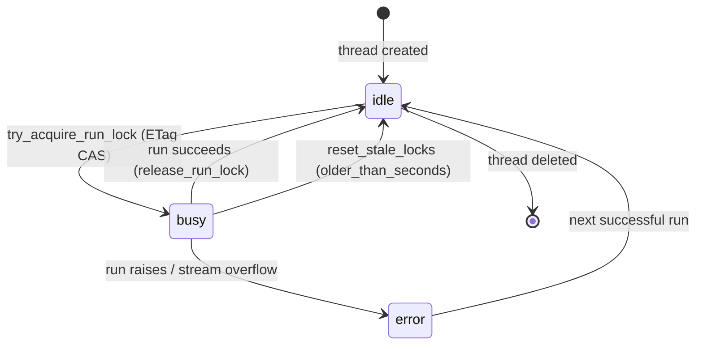
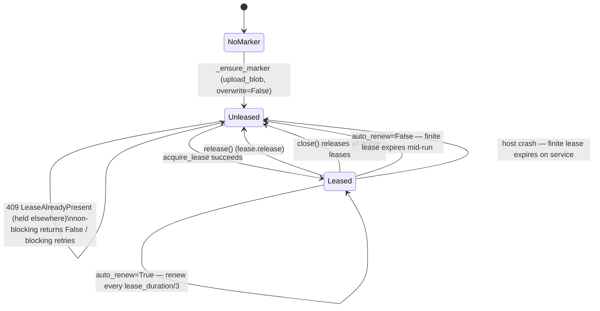

# Production Guide

This guide focuses on production hardening for `azure-functions-langgraph` deployments on Azure Functions.

Start with the [core adapter model](architecture.md#core-state-and-thread-exclusion)
and [Quickstart](getting-started.md). Production is not synonymous with
distributed deployment: choose the extra infrastructure only when your topology
or delivery requirements need it. The [distributed deployment section](#distributed-deployment)
separates writer exclusion, Platform metadata, long-running execution and
message ordering; none replaces the others.

## Authentication & Authorization
### Default auth behavior

`LangGraphApp` defaults to function-key HTTP access:

```python
# src/azure_functions_langgraph/app.py
auth_level: func.AuthLevel = func.AuthLevel.FUNCTION
```

This default is intentionally secure: deploying a `LangGraphApp()` without any auth configuration will require a function key on every request.

If you opt into `ANONYMOUS` at the app level, the library emits an unconditional `UserWarning` at construction time (regardless of environment). This ensures the choice is always visible in test output, CI logs, and startup output.

```python
# Opting into anonymous access (e.g. local dev) emits UserWarning:
# UserWarning: LangGraphApp is using ANONYMOUS auth. ...
app = LangGraphApp(auth_level=func.AuthLevel.ANONYMOUS)
```

⚠️ `ANONYMOUS` is convenient for local development but too permissive for internet-facing production APIs.

### Set a production-safe app-level auth level

`FUNCTION` is the default (recommended baseline). Use `ADMIN` only for tightly controlled internal surfaces.

```python
import azure.functions as func

from azure_functions_langgraph import LangGraphApp

app = LangGraphApp()  # default: FUNCTION
app = LangGraphApp(auth_level=func.AuthLevel.ADMIN)  # only if truly internal
```

### Per-graph auth override

You can override auth for specific graphs via `register()`:

```python
import azure.functions as func

app = LangGraphApp(auth_level=func.AuthLevel.FUNCTION)

# Production default for private endpoints
app.register(graph=internal_graph, name="internal", auth_level=func.AuthLevel.FUNCTION)

# Explicitly public endpoint (only when intended)
app.register(graph=public_graph, name="public", auth_level=func.AuthLevel.ANONYMOUS)
```

Use per-graph overrides to keep a strict default while exposing narrowly scoped public routes.

⚠️ **Scope**: Per-graph `auth_level` overrides apply only to **native routes** (`/api/graphs/{name}/invoke`, `/api/graphs/{name}/stream`).
When `platform_compat=True` is enabled, all platform-compatible routes (`/api/threads/...`, `/api/runs/...`) use the **app-level** `auth_level` regardless of per-graph overrides.

### API Management integration pattern

For production, a common pattern is:

1. Set Function routes to `FUNCTION` auth.
2. Place Azure API Management (APIM) in front of the Function App.
3. Require client auth at APIM (JWT/OAuth2/subscription key/mTLS).
4. Keep Function keys private between APIM and Function App.
5. Apply APIM rate limits, IP filtering, and request validation policies.

This creates a layered security model: edge auth and governance in APIM, key-based gate at the Function layer.

- [Azure Functions authentication and authorization](https://learn.microsoft.com/en-us/azure/azure-functions/security-concepts)

## Observability
### Run telemetry with the built-in `RunObserver` (recommended)

The package emits **run-lifecycle domain signals** through a pluggable
[`RunObserver`](https://github.com/yeongseon/azure-functions-langgraph-python/blob/main/src/azure_functions_langgraph/observability.py). Every native
invoke/stream run (and every Platform `runs/wait` / `runs/stream` run) notifies
the observer on `started`, `completed`, `failed`, and `rejected`, carrying an
immutable `RunContext` of **correlation identifiers and timing only** — never
input, output, config, headers, or secrets.

For zero-boilerplate telemetry, wire the built-in, dependency-free
`LoggingRunObserver`:

```python
import logging
from azure_functions_langgraph import LangGraphApp, LoggingRunObserver

logging.getLogger("azure_functions_langgraph.observability.run").setLevel(logging.INFO)

app = LangGraphApp(observer=LoggingRunObserver())
```

It emits one structured log record per lifecycle event under a single `extra`
key (`langgraph_run`) containing `graph_name`, `endpoint`, `run_id`,
`thread_id`, `assistant_id`, `stream_mode`, `transport`, `has_checkpointer`,
`invocation_id`, `lock_backend`, `trigger_type`, `duration_ms`, a derived `status`, and — on failure — the
exception `error_type` (class name only). Azure Functions' native Application
Insights integration surfaces these fields under `customDimensions`. See
[`examples/observability_app_insights/`](../examples/observability_app_insights/)
for a full KQL walkthrough (run count, latency percentiles, error rate, and
per-thread correlation).

**Boundary.** The package owns the *domain signal* only. It does **not** own log
formatting, App Insights ingestion, OpenTelemetry exporters, tracer-provider
setup, sampling policy, or PII redaction — those stay in your logging
configuration. Observer failures are isolated and can never fail a graph run.
To write your own observer instead, see
[`examples/run_observer/`](../examples/run_observer/).

### Custom logging integration

If you also instrument your own nodes, these practices pair well with the
observer above:

- Emit structured fields (`graph_name`, `thread_id`, `assistant_id`, `run_id`, `status_code`, `duration_ms`).
- Log explicit lifecycle markers: request received, graph started, graph completed/failed.
- Include error categories (`validation_error`, `execution_error`, `storage_error`) to simplify alerting.

[`azure-functions-logging-python`](https://github.com/yeongseon/azure-functions-logging-python) provides structured logging helpers that pair well with this package — use it to *route/format* the records the observer produces.

### Application Insights correlation

Azure Functions automatically wires requests/dependencies into Application Insights when enabled in the Function App.
Use this to correlate:

- incoming HTTP request
- graph invocation log records
- downstream dependency calls (LLM/API/storage)
- final success/error outcome

This enables end-to-end traceability for each run.

The identifiers are related but not interchangeable:

- **Functions invocation ID** identifies one Azure Functions worker invocation.
  It is not currently available to generated HTTP handlers: adding an optional
  `func.Context` parameter makes current Python workers reject the function at
  indexing time, while making it required would break direct/test invocation
  compatibility. `RunContext.invocation_id` therefore remains `None` for HTTP,
  and request payload fields can never set or override it.
- **Request/run ID** is this package's sanitized `X-Request-ID` value (or an
  generated opaque value). It is `RunContext.run_id` and correlates responses,
  SSE error metadata, and run-observer records.
- **W3C trace ID** comes from an ambient OpenTelemetry context established by
  operator-supplied Functions/OpenTelemetry instrumentation. The package does
  not parse `traceparent` or create that request context. When one is already
  active, `OTelRunObserver` explicitly preserves it so run and rejection spans
  are children of the active request span; without external instrumentation,
  they are root spans.
- **Application Insights `operation_Id`** is the backend representation of the
  W3C trace ID for correlated telemetry. It is not the Functions invocation ID
  or the request/run ID; query those separately as span attributes or custom
  dimensions when cross-checking a single invocation.

`StreamingLangGraphApp` likewise uses a FastAPI/ASGI extension contract that
exposes the ASGI request but not a `func.Context`. Request/run-ID and ambient
W3C trace correlation still works on both HTTP surfaces when instrumentation
has populated the ambient context.

### Health endpoint

`GET /health` (exposed as `GET /api/health` with the default Functions route
prefix) is a minimal **liveness probe** — it returns `{"status": "ok"}` and
nothing else, confirming only that the app process is up.

⚠️ This is a **liveness endpoint**, not a dependency-readiness check.
It does not probe Blob Storage, Table Storage, or downstream LLM availability.
For deep health checks, implement a custom endpoint or use Azure Monitor availability tests.

Configure `readiness_checks` to opt into `GET /api/health/ready` for dependency
traffic gating. The route is protected by the app auth level by default and can
use an independent `readiness_auth_level`. Callbacks may be synchronous or
asynchronous and must return a boolean. `readiness_timeout_seconds` (default
five seconds) is one **total deadline for the complete probe**, measured from
submitting the component checks until the response is assembled; it is not a
per-component timeout. It must be finite and greater than zero.

```python
app = LangGraphApp(
    readiness_checks={"table": check_table, "model": check_model},
    readiness_timeout_seconds=5,
)
```

Responses expose only component names with `ok` or `failed`: HTTP 200 means all
checks passed, while HTTP 503 means one failed, raised, or timed out. Exception
text, endpoints, and credentials are never returned. Prefer Azure Monitor or
provider-native monitoring when you need historical alerting, external network
vantage points, or detailed dependency diagnostics.

Readiness work is bounded per `LangGraphApp` instance by a dedicated executor
with at most four worker threads and at most one in-flight invocation per
component. If a synchronous callback exceeds the probe deadline, Python cannot
forcibly stop its thread; later probes report that component as failed and reuse
the same in-flight invocation instead of creating more workers. A finished
invocation is refreshed on the next probe. Consequently, a permanently hung
callback can occupy one of the four readiness workers until the host process
exits. Every operator-owned network callback must configure its own SDK timeout
shorter than the total probe deadline. Async callbacks are awaited, but should
also apply cancellation/timeouts to their dependency operations.

The liveness probe uses `health_auth_level`, which defaults to `ANONYMOUS`
independently of `auth_level` — so it stays reachable as an unauthenticated
probe even when the rest of the app requires a function key. It never
enumerates registered graphs.

### Health details endpoint

`GET /health/details` (exposed as `GET /api/health/details`) returns the
registered-graph inventory — graph names, descriptions, and checkpointer
status. Because that information is more sensitive than a liveness signal, it
uses `health_details_auth_level`, which defaults to the app-level `auth_level`
(`FUNCTION`). The inventory is therefore **protected by default**; set
`health_details_auth_level=func.AuthLevel.ANONYMOUS` to expose it publicly.

```json
{
  "status": "ok",
  "graphs": [
    {
      "name": "my_agent",
      "description": "Customer support agent",
      "has_checkpointer": true
    }
  ]
}
```

Use this endpoint for liveness checks and deployment validation.

Monitor health check success rates, response-time percentiles (P50/P95/P99), and HTTP error rates by endpoint and graph name.

## Timeouts & Cancellation
### Azure Functions timeout limits

Execution timeout is governed by Azure Functions plan and `host.json`:

| Plan | Default timeout | Maximum timeout |
|------|-----------------|-----------------|
| Consumption | 5 minutes | 10 minutes |
| Flex Consumption | 30 minutes | Unlimited (configurable) |
| Premium | 30 minutes | Unlimited (configurable) |
| Dedicated (App Service) | 30 minutes | Unlimited |

### Runtime behavior in this package

Graph execution is synchronous from the HTTP handler perspective.
`graph.invoke()` and `graph.stream()` run until completion (or failure).

- No package-level timeout wrapper is applied around graph calls.
- No package-level timeout wrapper is applied around graph calls on the synchronous HTTP path. For a built-in async run lifecycle with a cancellation endpoint, see "Async runs via Durable Functions" below.

⚠️ If a graph exceeds platform timeout, the request fails at the Functions host boundary.

⚠️ **HTTP response ceiling**: Azure Functions enforces a hard **230-second** limit on HTTP response time regardless of `functionTimeout`.
Graph invocations that exceed 230 seconds will fail with a gateway timeout even if `functionTimeout` allows longer execution.
For workloads approaching this limit, consider async patterns (queue trigger + status polling) instead of synchronous HTTP.

### Async runs via Durable Functions (experimental)

For workloads that exceed the synchronous HTTP ceiling, opt into the built-in
Durable Functions-backed async run lifecycle with
`LangGraphApp(async_runs="durable")` (requires the `durable` extra). This adds a
create / poll / cancel control plane so callers no longer hold an HTTP
connection open for the duration of the run:

- `POST /api/graphs/{name}/runs` — start a run, returns `202` with a `run_id`
- `GET /api/runs/{run_id}` — poll normalized status
- `POST /api/runs/{run_id}/cancel` — terminate an in-flight run

The graph executes inside a Durable **activity**, never the orchestrator, so
replay determinism is preserved. Durable history is not a replacement for
LangGraph checkpoints. See the README "Durable async run lifecycle" section and
[`examples/durable_async_agent/`](../examples/durable_async_agent/).

This is an **execution and polling** choice, not a concurrency workaround.
Activities acquire the app's `ThreadLock` only for checkpointed graphs with a
thread ID. They do not acquire the Platform `ThreadStore` run lock. Multiple
orchestrations can target the same checkpoint, and at-least-once activity
delivery still requires idempotent side effects. Cancellation terminates the
orchestration; it does not forcibly stop an already-running activity or Python
worker thread. Bound tools and storage calls and apply the
[mixed-surface requirements](#interaction-with-platform-compatible-runs).

### Configure timeout explicitly

Set `functionTimeout` in `host.json` to a value aligned with your plan and workload SLO.

```json
{
  "version": "2.0",
  "functionTimeout": "00:10:00",
  "logging": {
    "applicationInsights": {
      "samplingSettings": {
        "isEnabled": true,
        "excludedTypes": "Request"
      }
    }
  }
}
```

Production guidance:

1. Keep graph completion comfortably under timeout limits.
2. Cap upstream LLM/tool call timeouts so they fail fast.
3. Break long workflows into resumable steps via checkpointers.
4. Route very long orchestration to Durable Functions patterns when needed.

## Request & Input Limits

`LangGraphApp` enforces the following defaults to protect against oversized or deeply nested payloads:

| Limit | Default | Config parameter |
|-------|---------|------------------|
| Request body size | 1 MiB | `max_request_body_bytes` |
| Stream response size | 1 MiB | `max_stream_response_bytes` |
| Input JSON depth | 32 levels | `max_input_depth` |
| Input JSON nodes | 10,000 | `max_input_nodes` |

Override these in `LangGraphApp` constructor if your workload requires larger payloads:

```python
app = LangGraphApp(
    max_request_body_bytes=2 * 1024 * 1024,  # 2 MiB
    max_stream_response_bytes=4 * 1024 * 1024,  # 4 MiB
)
```

Requests exceeding these limits are rejected before graph execution begins.

## Streaming Behavior
### Current behavior (critical)

Endpoints registered by the classic `LangGraphApp` with `stream` in the path and
`Content-Type: text/event-stream` return SSE-formatted payloads, but the adapter
buffers them until graph execution completes.

This affects native and platform routes such as:

- `POST /api/graphs/{name}/stream`
- `POST /api/threads/{thread_id}/runs/stream`
- `POST /api/runs/stream`

⚠️ Clients receive the complete SSE body at once, not incremental chunks.

⚠️ **Buffered SSE response limit**: Stream responses are capped at **1 MiB** (`max_stream_response_bytes=1_048_576` by default).
If the accumulated SSE payload exceeds this limit, an `event: error` is injected into the SSE body rather than an HTTP 413/500.
Adjust `max_stream_response_bytes` in `LangGraphApp` if your graph produces large streaming output.

### Why this happens

This is a deliberate constraint of the classic `HttpRequest`/`HttpResponse`
adapter, which returns one fully formed response body; it is not a general Azure
Functions worker limitation. For true incremental delivery, use the separate
`StreamingLangGraphApp`, which uses the app-wide FastAPI/ASGI transport available
with Azure Functions runtime 4.34.1+.

> For how the Azure Functions Python worker loads and binds handlers, see the toolkit's
> [how the worker binds handlers](https://yeongseon.dev/azure-functions-python/platform/how-the-worker-binds-handlers/) reference — how invocation_id / handler binding works.

### Operational recommendation

For long-running production runs, prefer:

- `POST /api/threads/{thread_id}/runs/wait`
- `POST /api/runs/wait`

over the corresponding `/stream` routes to avoid UX and latency expectation mismatch.

⚠️ **Note**: Thread and run routes (`/api/threads/...`, `/api/runs/...`) are only available when `platform_compat=True` is set in `LangGraphApp`.

### True-stream cancellation and lock ownership

`StreamingLangGraphApp` treats HTTP response lifetime and graph execution
lifetime as separate concerns. A disconnect cancels response production, but a
synchronous `graph.stream()` may already be running `next()` in a worker thread;
Python cannot terminate that thread safely.

Constructing a stream response does not acquire a lock, start a graph iterator,
or open an observer span. Ownership begins when the ASGI transport executes the
response (or a caller explicitly consumes its body). Acquisition still precedes
response headers, so contention returns JSON HTTP 409 rather than an SSE error
inside HTTP 200. The transport closes the prepared iterator even when header
delivery fails before the first body pull. An abandoned, never-executed response
therefore has no active token or span needing asynchronous finalization.

The adapter therefore retains the thread-lock token until the single in-flight
`next()` finishes, closes the iterator only after that worker has quiesced,
releases the token exactly once, emits one failed observer outcome, and then
propagates cancellation. This ordering applies before the first frame, between
frames, during frame production, and when the response iterator is explicitly
closed. Success emits `completed`; graph errors and the event cap emit an SSE
error plus `end` and report `failed`.

Each synchronous stream tracks at most one worker at a time—disconnects do not
spawn replacement workers. The trade-off is deliberate: if user code blocks
forever, cleanup and lock release also wait forever. This is not thread
termination or exactly-once business-side-effect protection. Bound every
synchronous LLM, tool, and storage operation with its own timeout, and account
for worker-process termination and distributed lease-loss behavior separately.
Async graphs use native async-generator cancellation and cleanup; they do not
cross the synchronous iterator bridge.

## Distributed deployment

### Choose by requirement, not by backend

| Requirement | Start with | Boundary |
| --- | --- | --- |
| Native HTTP in one Python process | `LangGraphApp`, a checkpointer when state is needed, default `InProcessThreadLock` | Single-process exclusion only; one Azure instance is not necessarily one process |
| Shared checkpoint writers across processes/hosts | A distributed `ThreadLock`; `AzureBlobLeaseThreadLock` is the shipped low-cost Blob-backed choice | Requires shared lock keys/storage and lease-loss/recovery planning; custom backends remain supported |
| Platform thread CRUD, metadata and run status | Opt-in `platform_compat=True` plus a distributed `ThreadStore`, such as `AzureTableThreadStore` | Table run-lock CAS is additional to, not a substitute for, mixed-surface exclusion |
| Long execution without holding an HTTP connection | Opt-in Durable create/poll/cancel lifecycle | Not global serialization or exactly-once execution |
| Queued delivery and per-session message ordering | Service Bus; sessions only when explicitly configured | Scoped to one queue/subscription, not cross-route exclusion |

There is no automatic backend selection. Set the scale-out guards below to
catch accidental local defaults. Keep checkpoint storage, Platform metadata
and lock storage conceptually separate even when they share an Azure account.
Thread locking remains **Beta**; Durable and Service Bus remain **Experimental**.

<a id="concurrency--scale"></a>

### Thread-assistant binding and TOCTOU race

Platform runs bind a thread to its first assistant while acquiring the store's
run lock. `AzureTableThreadStore` uses ETag CAS for this transition; a conflicting
assistant is rejected rather than silently overwriting the binding. A custom
`ThreadStore` must preserve its atomic acquisition contract. This does not
coordinate native or trigger writers, which do not use the Platform store.

### Blob checkpointer single-writer assumption

Pending writes are replayed in `(task_path, task_id, write_index)` order on
both synchronous and native async Blob reads. Legacy write blobs without
`task_path` metadata use the empty path, preserving their task-ID/index order;
new writes already persist URL-encoded task paths. This ordering does not
provide concurrent-writer exclusion.

`AzureBlobCheckpointSaver` is designed around single-writer-per-thread semantics.
The implementation documents concurrent-writer conflict resolution as a non-goal.

⚠️ **Operator impact**: Concurrent writes to the same thread/checkpoint namespace from multiple instances can produce inconsistent checkpoint state.
If your deployment runs multiple Function App instances, ensure each thread's writes are serialized (see Recommended production pattern below).

### Azure Table thread store scale envelope

`AzureTableThreadStore` uses a single partition key (`PartitionKey="thread"`) with client-side metadata filtering.
This is a design-envelope approximation, not an enforced limit, and generally works well up to roughly 100K threads (~500 entities/sec throughput).

Beyond that envelope, consider a sharded or higher-scale backend such as Cosmos DB.

### Concurrency controls

Only `multitask_strategy="reject"` is supported.
Concurrent run submissions for the same thread are rejected with HTTP 409 — no queuing or interruption is implemented.

**Operator impact**: If your workload has bursts of concurrent requests targeting the same thread,
implement client-side retry with backoff, or use the queue-based worker pattern below.

#### Thread lifecycle (state machine)



A Platform-compatible thread holds at most one in-flight run. Acquisition is an
atomic ETag compare-and-swap; a concurrent attempt returns **409**. Release is
best-effort, so a host terminated mid-run leaves the thread `busy` until
`reset_stale_locks(older_than_seconds=...)` reclaims it. This is **not** an
automatic background task — you must invoke it periodically yourself (e.g. from a
Timer-triggered function or cron); set the threshold comfortably above your longest
expected run.

### Service Bus sessions and mixed surfaces

`register_service_bus(..., session=True)` opts into session-aware binding and
derives checkpoint `thread_id` from `msg.session_id`. A supplied
`thread_id_factory` must return exactly the same ID; absent/empty/mismatched
IDs fail before graph execution. Conflicting
`binding_kwargs={"is_sessions_enabled": False}` is rejected. The default
non-session path and Basic-tier support are unchanged.

This opt-in deliberately **retains ThreadLock acquisition by default**. No topology is
automatically proven exclusive, and this adapter cannot fence other apps or
queues. Serial processing within a
session is host configuration, not inferred from the session ID. Provision a
session-enabled Standard/Premium entity and set sender `SessionId=thread_id`
before delivery. Configure host message/session renewal budgets and retries;
failures propagate for redelivery and delivery remains at-least-once.

Queue-based execution is an optional delivery pattern, not mandatory production
infrastructure and not automatic per-thread serialization:

1. Provision a **session-enabled** queue or subscription (Service Bus Standard
   or Premium); send related messages with the same application-chosen
    `SessionId` and opt into `session=True` on
   `register_service_bus`. Sessions are off by default.
2. Configure serial processing within each session and derive the checkpoint
    thread ID from the session ID (an optional factory must agree). The adapter
    does not assign a sender's session ID.
3. Session ownership orders messages for **that queue/subscription** only.
   Another queue, subscription, HTTP route or Durable activity can still write
   the same checkpoint. Use the shared distributed `ThreadLock` for those
   writers; align graph name, thread ID, container and marker prefix across apps.
4. Budget lock waiting (`lock_timeout=5.0` by default), graph execution, result
   handling and settlement within broker lock/renewal and Functions limits.
   Broker renewal is host-owned; the adapter does not renew message/session
    locks. At-least-once delivery still requires idempotency and dead-letter handling.

**Isolated session-only topology (experimental).**
`register_service_bus(..., session=True, session_exclusive=True)` explicitly
asserts that one session-enabled entity is the **only writer** of its checkpoint
namespace, including writers in other deployments. Only use it when the broker
guarantees exclusive session ownership for the entire graph and result-handler
execution, and the host processes one message at a time per session. This bypasses
the application ThreadLock, not broker locks. The app rejects native HTTP graph
registration in either order, Platform compatibility, Durable runs, another
Service Bus registration, and batch cardinality. Health routes remain available.
These local checks cannot discover another app, a manually invoked activity,
shared storage used under another graph name, or a session lease lost mid-run.
Keep the default shared **distributed** lock whenever that external isolation or
full-lifetime session ownership cannot be guaranteed. A session ID alone is not
proof; lease expiry can allow a second owner while old user code still executes.

Offline broker-double tests prove adapter routing, application-lock bypass,
same-session exclusion under the double's contract, independent sessions, failure
propagation and redelivery. **Live proof remains outstanding:** on a real
Standard/Premium session-enabled queue and subscription, verify two competing
Functions hosts, serial same-session execution, parallel different sessions,
failure/redelivery, auto-renewal limits and session-lock loss during long work.
Record host/runtime configuration and execution overlap evidence; never infer
renewal/failover safety from the double. Do not use the bypass where loss allows
overlapping checkpoint writes; retain distributed locking for that deployment.

See [Service Bus sessions](https://learn.microsoft.com/en-us/azure/service-bus-messaging/message-sessions)
and the [trigger example](../examples/service_bus_agent/). A plain queue with a
`thread_id` property does not by itself serialize a thread.

<a id="recommended-production-pattern"></a>

### Distributed thread locking

The native invoke/stream endpoints (`POST /api/graphs/{name}/invoke` and `.../stream`) guard checkpointed runs with a thread ID using a **per-thread lock** keyed by `(graph_name, thread_id)`. The default `InProcessThreadLock` is single-process only: separate workers, even on one instance, have separate locks.

For shared writers across processes, `LangGraphApp` accepts any object satisfying the [`ThreadLock`](https://github.com/yeongseon/azure-functions-langgraph-python/blob/main/src/azure_functions_langgraph/locks/base.py) protocol via `thread_lock`. `AzureBlobLeaseThreadLock` is the shipped low-cost distributed choice, requiring only a Blob container rather than an additional database or broker. It is not universally required: a custom backend or an explicitly single-writer topology may fit your deployment. Finite leases naturally expire (15–60 s) after renewal stops; infinite leases require explicit recovery.

> ℹ️ **Background renewal.** `AzureBlobLeaseThreadLock` renews leases in the background by default: a per-instance daemon thread renews every active lease at `lease_duration / 3` intervals until `close()` (or process exit). Pass `auto_renew=False` to opt out — a finite lease then silently expires mid-execution as it did before renewal support, and construction emits a `UserWarning` so the trade-off is visible. Infinite leases (`lease_duration=-1`) never need renewal but must be broken manually if a host crashes.
>
#### Lease lifecycle (AzureBlobLeaseThreadLock)



With `auto_renew=True` (default) a daemon thread keeps the lease alive, so
execution time is not bounded by `lease_duration`. With `auto_renew=False` a
finite lease silently expires mid-execution (construction emits a `UserWarning`)
and another instance may acquire the same lock. Infinite leases
(`lease_duration=-1`) never expire and must be broken manually after a crash.
The `acquire(..., timeout=...)` budget bounds contention waiting, not graph
execution, checkpoint I/O, network calls or cleanup. SDK request budgets and
lease lifetime must be considered separately.

#### Blob lease safety and recovery

The [0.13 evaluation (#697)](https://github.com/yeongseon/azure-functions-langgraph-python/issues/697)
retains automatic bounded renewal and the compatible `ThreadLock` protocol.
There is **no default change or migration**. A fixed 60-second lease is not a
safe replacement for graphs that may run longer. The
[Functions HTTP response limit](https://learn.microsoft.com/en-us/azure/azure-functions/functions-bindings-http-webhook-trigger#limits)
does not stop execution; a disconnected client or acquisition `timeout` is not
a graph deadline either.

| Configuration | Lifecycle | Failure / recovery |
| --- | --- | --- |
| Finite, `auto_renew=True` (default) | Acquire marker lease; renew on ticks of `lease_duration / 3`; owner-token release after work finishes | Transient failures retry on later ticks; three consecutive failures or definitive loss mark local ownership lost. Another host may acquire once the service lease expires/is broken, even while the old graph runs. |
| Finite, `auto_renew=False` | Acquire, warn, no daemon/pool; release if work finishes before expiry | Lease can expire mid-run with no notification or cancellation. Only consider for explicitly bounded work with enforceable cancellation, completed cleanup and storage-side stale-write fencing; this adapter does not supply that fence. |
| Infinite, `lease_duration=-1` | Acquire, no daemon/pool regardless of `auto_renew`; explicit release/close | No natural expiry; crash or failed release can strand the lease indefinitely. Use the recovery procedure below. |

The lease covers a **lock marker**, not the graph's checkpoint blobs. The
opaque token passed to `release()` prevents stale local release, not stale
checkpoint writes. None of these modes automatically stops or fences an
in-flight graph. A lost entry remains locally occupied until release, protecting
that lock object only, not another host or even a separately constructed lock.
An infinite lease can also lose exclusion through an operator break or early
close. Do not treat a pre-write ownership check as a fence: a lease can expire
between that check and the write; rejection must be atomic with the write.

Renewal uses a bounded 16-worker pool and a tick wait timeout, so one stalled
call need not stall unrelated leases when capacity remains. The timeout does
**not** abort a running SDK request, and repeated hangs can exhaust workers and
accumulate queued work. Configure client `connection_timeout`, `read_timeout`
and retry budgets to fit the lease safety margin; Azure's operation `timeout`
is server-side, not an end-to-end client deadline. Slow ticks plus retries are
not a guarantee of two successful retries before expiry. Alert on renewal-loss
warnings and stop accepting conflicting work while investigating.

`close()` is terminal and best-effort: it signals shutdown, joins the daemon
for at most five seconds, cancels queued renewals without waiting for running
SDK calls, clears local entries, and attempts to release non-lost leases.
Release errors are logged at DEBUG and swallowed; a locally lost lease is not
released on the service and may still be held after a late successful renew.
Finite leases eventually expire after the final renewal; infinite leases do
not. Shutdown must **drain graph execution and checkpoint writes before close**;
closing the lock does not cancel them. Async cancellation helpers retain sync
worker ownership until completion, but cannot kill a hung Python thread.

**Infinite-lease crash recovery (operator procedure):**

1. Quiesce ingress and all workers that could execute the affected thread,
   including other instances, old deployments and background tools. Establish
   that the old writer cannot resume; if that cannot be established, keep
   ingress paused rather than breaking a possibly live owner's lease.
2. Identify the exact marker in the configured container/prefix:
   `{blob_prefix}{percent_encoded_graph_name}/{percent_encoded_thread_id}`.
   Confirm deployment/storage identity and preserve diagnostics. Do not break
   every lease in the container or delete checkpoint data.
3. With an authorized Blob client, call
   `BlobLeaseClient(marker_blob_client).break_lease(lease_break_period=0)`.
   A break requires no owner lease ID; allow any service-reported break period
   to finish before reacquisition. Scope operator access to the lock container.
4. Inspect/reconcile partially written state and non-idempotent side effects,
   then restart workers and resume ingress. `reset_stale_locks()` on the Table
   store does not break Blob marker leases. Never automate a break based only
   on elapsed time: that recreates the unsafe fixed-lease failure mode.

Controlled two-instance fake-lease tests cover long execution, renewal loss,
failed close, acquisition timeout and running-worker cancellation. They model
service time without sleeping through a real TTL and are **not** real-Azure
certification. Existing transient-failure, isolated-renewal and close/acquire
race regressions remain unchanged. See
[Azure lease limits and break semantics](https://learn.microsoft.com/en-us/rest/api/storageservices/lease-blob)
and the [Python BlobLeaseClient API](https://learn.microsoft.com/en-us/python/api/azure-storage-blob/azure.storage.blob.blobleaseclient).

```python
import azure.functions as func
from azure.identity import DefaultAzureCredential
from azure.storage.blob import ContainerClient

from azure_functions_langgraph import LangGraphApp
from azure_functions_langgraph.locks import AzureBlobLeaseThreadLock

container = ContainerClient(
    account_url="https://<account>.blob.core.windows.net",
    container_name="langgraph-locks",
    credential=DefaultAzureCredential(),
)
# Provision this container once via deployment infrastructure, not on cold start.

app = LangGraphApp(
    auth_level=func.AuthLevel.FUNCTION,
    thread_lock=AzureBlobLeaseThreadLock(
        container_client=container,
        lease_duration=60,  # seconds; 15–60 or -1 for infinite
        blob_prefix="thread-locks/",
    ),
)
```

Install `azure-functions-langgraph[azure-blob,azure-identity]` for this wiring.
Grant `Storage Blob Data Contributor` scoped to the lock container. The backend
creates marker blobs as well as acquiring leases; `Storage Blob Delegator`
alone does not grant those data operations. Keep the client/credential alive
with the lock; drain graph work before closing the lock and then its clients.

**Scale-out matrix.**

| Backend | Distributed? | Infra required | Failure mode | Use case |
| --- | --- | --- | --- | --- |
| `InProcessThreadLock` (default) | No | None | Lock lost on worker restart; racing processes get separate locks | Local dev, explicitly single-process deployment |
| `AzureBlobLeaseThreadLock` | Yes — Azure Blob lease CAS | One Blob container | Finite expiry after renewal stops; renewal loss can admit another writer while old work continues | Shared writers across processes/hosts; default finite lease is 60 seconds with renewal, not a graph deadline |
| Custom `ThreadLock` implementation | Yours to design | Yours to provision | Yours to reason about | Redis, Cosmos DB, Postgres advisory locks, etc. |

**Safety guard — `AZFUNC_LANGGRAPH_LOCK_BACKEND`.** In multi-instance environments, set this environment variable to `distributed` (or any non-empty value other than `inprocess`). When the value indicates a distributed backend is required and `thread_lock` resolves to the default `InProcessThreadLock`, `LangGraphApp.__post_init__` raises `RuntimeError` at construction — turning a silent-race deployment mistake into a fail-fast startup error. Set the value to `inprocess` (or leave it unset) in single-instance environments; the guard passes for any wired custom backend regardless of the environment value.

**Safety guard — `AZFUNC_LANGGRAPH_THREAD_STORE` (platform-compat).** The thread *store* has the same scale-out footgun as the lock: when `platform_compat=True` and no store is supplied, `LangGraphApp` defaults to the per-instance `InMemoryThreadStore`, so on Azure scale-out (Consumption / Elastic Premium) each worker keeps its own threads and state diverges across instances. Two layered guards mirror the lock-backend precedent:

- **Warn by default on Azure.** When the process looks Azure-hosted (the host sets `WEBSITE_INSTANCE_ID` / `WEBSITE_SITE_NAME`) and the final configured store is still the in-memory default, building `app.function_app` emits a `RuntimeWarning` pointing at `AzureTableThreadStore`. Local development (`func start`, where those markers are absent) stays warning-free.
- **Fail-fast when declared.** Set `AZFUNC_LANGGRAPH_THREAD_STORE=distributed` (or any non-empty value other than `inmemory`) in Function App settings. Validation runs when `app.function_app` is built, after the public `app.thread_store` setter can supply the production store, and raises before routes can be served if the final configured store is still `InMemoryThreadStore`.

```python
# Multi-instance production: fail-fast if the in-memory default slips through.
# App setting: AZFUNC_LANGGRAPH_THREAD_STORE=distributed
app = LangGraphApp(platform_compat=True, auth_level=func.AuthLevel.FUNCTION)
app.thread_store = AzureTableThreadStore.from_connection_string(...)  # required
func_app = app.function_app  # validates the final store, then builds routes
```

Set `thread_store` before the first `function_app` access. The setter remains
supported after an earlier access as well: it invalidates the cached
`FunctionApp`, and the next `function_app` access validates the replacement
store and rebuilds all routes against it. Keep the exported module-level
Functions app assignment last so Azure never receives the superseded route
object.

### Interaction with Platform-compatible runs

The shared `thread_lock` guards native checkpointed invoke/stream, checkpointed
Durable activities and Service Bus runs with a thread ID, plus threaded
Platform runs and Platform state updates. Platform runs/state updates acquire
the store run lock **after** the shared lock. `AzureTableThreadStore` uses ETag
CAS for status/assistant binding, but native and trigger runs do not acquire it.

- **Native-only:** choose a checkpointer and distributed `ThreadLock` for shared
  writers. A Platform `ThreadStore` is not required.
- **Platform-only:** use a distributed store for shared thread metadata and its
  atomic run-lock contract. Wire a distributed `ThreadLock` when requiring
  cross-process exclusion through that common protocol.
- **Mixed surfaces/apps:** use the same distributed lock backend, marker
  container/prefix and `(graph_name, thread_id)` mapping for every checkpoint
  writer, plus a distributed store for the Platform surface. A Table run lock
  alone does not cover native HTTP, Durable or Service Bus. Separate graph names
  sharing one checkpoint namespace do not automatically share a lock key.

Direct checkpointer writes, maintenance jobs and external graph callers must
join the same exclusion scheme or run only while writers are quiesced. Neither
store-owner tokens nor Blob marker leases atomically fence checkpoint writes
after lease loss. Preserve the cancellation/drain warnings above.

### Platform run-lock recovery

Table run locks and Blob marker leases are distinct resources. Platform run
handlers renew store ownership every 20 seconds; renewal failure is retained
for cleanup and returns a sanitized HTTP 500 instead of successful completion.
Owner-token checks and ETag CAS prevent an old release from clearing a newer
store owner; release retries conflicts up to three times. Failed persistence or
release can leave a row `busy`. A host crash may skip cleanup entirely.

Schedule `thread_store.reset_stale_locks(older_than_seconds=600)` from a Timer
function only with a threshold comfortably above the longest expected run, and
establish that a reclaimed writer cannot still mutate checkpoints. It is not an
automatic task and CAS is not a checkpoint write fence. Missing projection
ETags cause rows to be skipped rather than reset unsafely. This operation does
**not** break Blob marker leases; use the separate Blob recovery procedure
above. See [maintenance_timer](../examples/maintenance_timer/) and the
[README run-lock contract](https://github.com/yeongseon/azure-functions-langgraph-python/blob/main/README.md#run-lock-semantics).

### Upgrade and deployment caveats

This documentation reorganization changes no APIs, defaults or stability tiers.
The 0.13 evaluation retained automatic bounded Blob lease renewal; do not
migrate to fixed leases on the assumption that HTTP timeouts stop a graph.
When adding workers or a second surface, configure shared storage/locks before
admitting writes and set both guards when Platform storage is used. For Table
JSON chunking, upgrade all readers before writers: older versions cannot read
chunked entities. Do not change lock container, prefix or graph/thread naming
mid-rollout while old writers remain active.


## Storage Configuration

### Azure Blob checkpointer

Install optional dependency:

```bash
pip install azure-functions-langgraph[azure-blob]
```

Configure with connection string from environment and construct a container client:

```python
import os

from azure.storage.blob import BlobServiceClient
from azure_functions_langgraph.checkpointers.azure_blob import AzureBlobCheckpointSaver

conn = os.environ["AZURE_STORAGE_CONNECTION_STRING"]
service = BlobServiceClient.from_connection_string(conn)
container = service.get_container_client("langgraph-checkpoints")

checkpointer = AzureBlobCheckpointSaver(container_client=container)
```

Use `langgraph-checkpoints` as the default production container name unless you have environment-specific naming requirements.

If you already manage Azure clients elsewhere, pass a prepared container client directly.

### Azure Table thread store

Install optional dependency:

```bash
pip install azure-functions-langgraph[azure-table]
```

Configure with connection string and table name:

```python
import os

from azure_functions_langgraph.stores.azure_table import AzureTableThreadStore

conn = os.environ["AZURE_STORAGE_CONNECTION_STRING"]
thread_store = AzureTableThreadStore.from_connection_string(
    connection_string=conn,
    table_name="langgraphthreads",
)
```

Use `langgraphthreads` as the default production table name unless you need a custom naming scheme.

### Checkpoint retention

`AzureBlobCheckpointSaver` lists checkpoints via blob prefix scans, so per-thread cost grows with the number of stored checkpoints. For long-lived threads, schedule a Timer-triggered Function to prune old checkpoints:

```python
import os

import azure.functions as func
from azure.storage.blob import ContainerClient

from azure_functions_langgraph.checkpointers.azure_blob import AzureBlobCheckpointSaver
from azure_functions_langgraph.stores.azure_table import AzureTableThreadStore

retention_app = func.FunctionApp()


@retention_app.schedule(
    schedule="0 0 3 * * *",
    arg_name="timer",
    run_on_startup=False,
    use_monitor=True,
)
def prune_checkpoints(timer: func.TimerRequest) -> None:
    del timer
    container = ContainerClient.from_connection_string(
        os.environ["AZURE_STORAGE_CONNECTION_STRING"],
        "langgraph-checkpoints",
    )
    saver = AzureBlobCheckpointSaver(container_client=container)

    threads = AzureTableThreadStore.from_connection_string(
        os.environ["AZURE_STORAGE_CONNECTION_STRING"],
        table_name="langgraphthreads",
    )
    for thread in threads.search(limit=10_000):
        saver.delete_old_checkpoints(thread.thread_id, keep_last=50)
```

Both helpers only delete checkpoint marker, metadata, and write blobs. They intentionally preserve channel value blobs (under `values/`) and the `latest.json` pointer so retained checkpoints remain fully usable.

> **Note** — `delete_old_checkpoints` / `delete_checkpoints_before` are safe but **not exhaustive**. Channel value blobs that were referenced *only* by the now-deleted checkpoints become orphaned and are not removed. For long-running threads with frequent checkpointing, those orphans can dominate the storage footprint over time. Run `collect_orphaned_values()` (below) on a schedule as the second step.

#### Garbage-collecting orphaned channel values

After pruning checkpoints, `collect_orphaned_values()` walks the surviving checkpoints, builds the set of `(channel, version)` pairs they reference, and removes any `values/` blob outside that set. Default is **dry-run** so you can audit first:

```python
audit = saver.collect_orphaned_values(thread_id="conversation-1")
print(audit.would_delete)

result = saver.collect_orphaned_values(thread_id="conversation-1", dry_run=False)
print(f"Deleted {len(result.deleted)} orphaned value blobs")
```

The helper is concurrency-safe by two complementary mechanisms: a recent-write grace period (default `grace_period_seconds=300`) defers deletion of any value blob whose `last_modified` is within the window — protecting the gap between a value blob upload and the corresponding `latest.json` finalization — and a per-orphan re-scan immediately before each delete preserves any older value blob that a newly finalized checkpoint started referencing after the snapshot.

The helper **fails closed** per namespace: if `latest.json` is missing or any surviving checkpoint blob is unreadable / fails deserialization, the namespace is skipped (recorded in `result.skipped_namespaces`) so a misconfigured or transiently-unavailable store cannot trigger destructive deletion.

If you want absolute cutoffs instead of "keep N", use `delete_checkpoints_before(thread_id, before_checkpoint_id=...)`. Checkpoint ids are lexicographically sortable, so `before_checkpoint_id` can be the id of any boundary checkpoint your application picks (e.g. the last successful production checkpoint of a previous day).

#### Operational guidance for orphan GC

The per-orphan re-scan ensures correctness but has **O(orphans × surviving_checkpoints)** blob-list cost. For namespaces with thousands of orphans, this translates to significant Azure Storage transactions.

**Recommended cadence:**

| Thread profile | Retention + GC frequency | Notes |
|---|---|---|
| Short-lived (< 100 checkpoints) | Weekly or on-demand | Low orphan count; cost negligible |
| Long-lived (1,000+ checkpoints) | Daily, off-peak hours | Prune first (`delete_old_checkpoints`), then GC |
| High-throughput (many concurrent threads) | Nightly Timer trigger | Batch across threads; respect `grace_period_seconds` |

**Best practices:**

1. **Always dry-run first**: `collect_orphaned_values(thread_id, dry_run=True)` — inspect `result.candidates` count before committing.
2. **Prune checkpoints before GC**: Fewer surviving checkpoints = cheaper re-scan per orphan.
3. **Keep `grace_period_seconds` ≥ 300**: Protects against race with in-flight checkpoint writes.
4. **Monitor `result.skipped_namespaces`**: Non-empty means something is wrong with checkpoint blobs — investigate before retrying.
5. **Budget estimate**: Each orphan candidate triggers 1 list operation + 1 delete (if confirmed). At ~$0.004/10,000 transactions, a namespace with 10,000 orphans costs ~$0.008 per GC run.

### Connection string security

Do not hardcode storage secrets in source code or deployment artifacts.

Use one of these patterns:

- App Settings with Key Vault references
- Managed identity with Azure SDK identity-based auth
- Secret rotation policy with zero-downtime rollout

⚠️ Treat `AZURE_STORAGE_CONNECTION_STRING` as a high-value credential.

### Postgres checkpointer

The `create_postgres_checkpointer` helper opens a **single `psycopg` connection** for the lifetime of the worker process. This is intentional for Azure Functions' single-threaded, event-driven model, but production deployments must account for connection reliability and pooling at the infrastructure layer.

#### PgBouncer (recommended)

Azure Database for PostgreSQL Flexible Server exposes a built-in [PgBouncer](https://learn.microsoft.com/en-us/azure/postgresql/flexible-server/concepts-pgbouncer) on port 6432. Enable it in the Azure Portal under **Server parameters → pgbouncer.enabled**.

When PgBouncer is in **transaction pooling** mode, disable prepared statements:

```python
from azure_functions_langgraph.checkpointers.postgres import create_postgres_checkpointer

checkpointer = create_postgres_checkpointer(
    conn_string=os.environ["POSTGRES_CONN_STRING"],
    prepare_threshold=None,  # required for transaction-pooling PgBouncer
)
```

| PgBouncer Mode | `prepare_threshold` | Notes |
|---|---|---|
| Transaction pooling | `None` | Prepared statements not preserved across server reassignment |
| Session pooling | `0` (default) | Safe — connection affinity maintained |
| Disabled (direct) | `0` (default) | No proxy overhead |

#### Connection resilience

psycopg does **not** auto-reconnect on transient failures (network blip, Azure maintenance, failover). The worker process will crash on the next checkpoint write, and Azure Functions will restart it — which triggers a cold start and a fresh connection.

For most Consumption/Premium plan deployments this is acceptable because:

1. Cold starts are infrequent (minutes apart).
2. `create_postgres_checkpointer(setup=True)` re-runs migrations idempotently on restart.
3. Azure Functions' built-in retry and scale-out mask brief unavailability.

If you need **in-process reconnect** without a full cold start (e.g. Dedicated plan with long-lived workers), wrap with a retry at the application layer:

```python
import os
import functools
from azure_functions_langgraph.checkpointers.postgres import create_postgres_checkpointer

_checkpointer = None


def get_checkpointer():
    global _checkpointer
    if _checkpointer is None:
        _checkpointer = create_postgres_checkpointer(
            conn_string=os.environ["POSTGRES_CONN_STRING"],
        )
    return _checkpointer
```

If the connection is lost, the next invoke will fail, the Functions runtime logs the error, and a subsequent cold start re-establishes the connection. For tighter control, consider a health-check Timer trigger that validates the connection and forces a restart via `sys.exit(1)` when stale.

#### Connection pool (when to consider)

The built-in helper uses a single connection. This is sufficient when:

- Each function invocation is short-lived (< 30 s).
- The plan is Consumption or Premium (short worker lifetime, auto-scale handles throughput).
- PgBouncer handles multiplexing at the infrastructure layer.

A true application-side connection pool (`psycopg_pool.ConnectionPool`) is rarely needed because Azure Functions' concurrency model routes one invocation at a time per worker. If you are on a Dedicated (App Service) plan with `FUNCTIONS_WORKER_PROCESS_COUNT > 1`, consider a pool — but first verify PgBouncer alone isn't sufficient.

#### Azure-specific timeouts

Set these App Settings to avoid silent connection drops:

| Setting | Recommended | Why |
|---|---|---|
| `PGCONNECT_TIMEOUT` | `10` | Fail fast on unreachable DB during cold start |
| `PGOPTIONS` | `-c statement_timeout=30000` | Kill runaway queries (30 s) |
| `WEBSITE_TCP_KEEPALIVE` | `1` | Enable TCP keepalive on Azure networking layer |

For Azure Database for PostgreSQL Flexible Server, also ensure:

- **SSL mode**: `require` (default; never disable in production).
- **Firewall**: Allow the Function App's outbound IPs or use VNet integration + private endpoint.
- **Connection limit**: Flexible Server defaults to `max_connections = 50-100` depending on SKU. With PgBouncer, a single Functions worker needs only 1 backend connection.


## Sources

- [Azure Functions Python developer reference](https://learn.microsoft.com/en-us/azure/azure-functions/functions-reference-python)
- [Azure Functions host.json reference](https://learn.microsoft.com/en-us/azure/azure-functions/functions-host-json)
- [Azure Functions authentication and authorization](https://learn.microsoft.com/en-us/azure/azure-functions/security-concepts)
- [Azure Blob Storage documentation](https://learn.microsoft.com/en-us/azure/storage/blobs/)
- [Azure Table Storage documentation](https://learn.microsoft.com/en-us/azure/storage/tables/)
- [Azure Functions scale and hosting](https://learn.microsoft.com/en-us/azure/azure-functions/functions-scale)
- [Azure Database for PostgreSQL Flexible Server PgBouncer](https://learn.microsoft.com/en-us/azure/postgresql/flexible-server/concepts-pgbouncer)
- [psycopg 3 documentation](https://www.psycopg.org/psycopg3/docs/)

## See Also

- [DESIGN.md](https://github.com/yeongseon/azure-functions-langgraph-python/blob/main/DESIGN.md) — Key design decisions and constraints
- COMPATIBILITY.md — SDK version compatibility policy
- [azure-functions-logging-python](https://github.com/yeongseon/azure-functions-logging-python) — Structured logging
- [azure-functions-doctor-python](https://github.com/yeongseon/azure-functions-doctor-python) — Pre-deploy diagnostics
- [azure-functions-openapi-python](https://github.com/yeongseon/azure-functions-openapi-python) — API documentation
- [azure-functions-validation-python](https://github.com/yeongseon/azure-functions-validation-python) — Request/response validation
